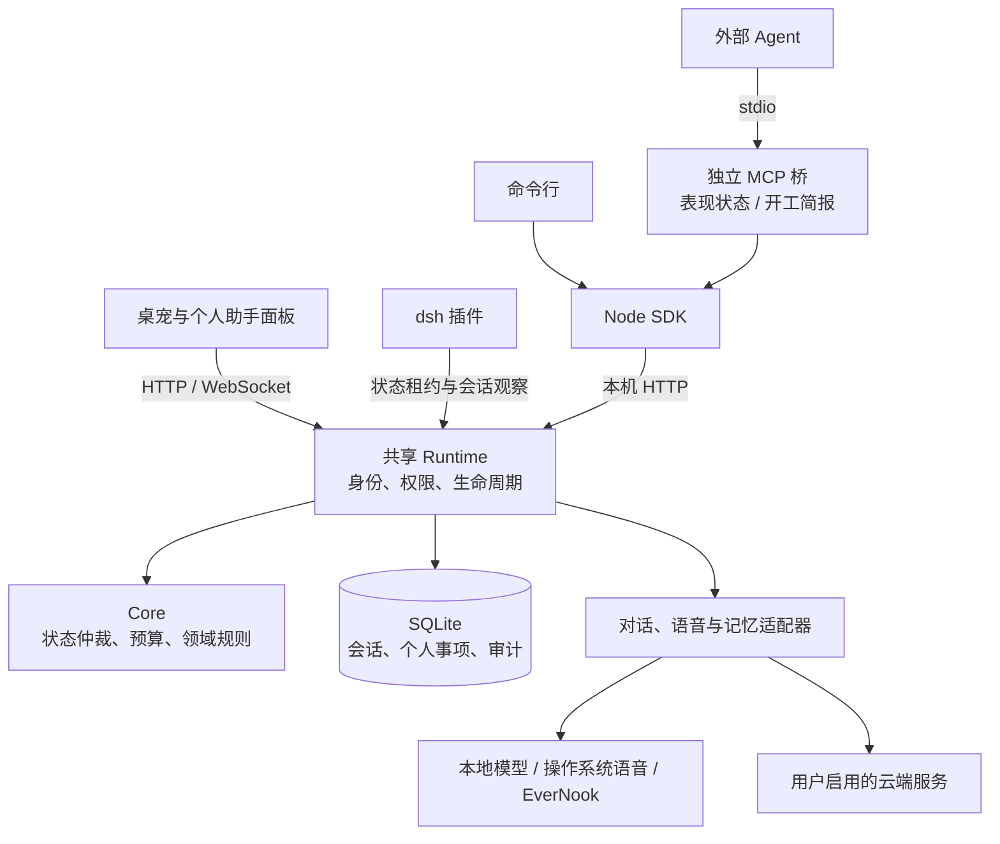

# Maneki · 小招

一只陪你工作、替你留意 dsh 会话的桌宠。两个项目同时运行时，你可以直接问「哪个会话在等我？」。小招会根据宿主事件回答，工程操作和审批仍留在 dsh。关掉桌宠窗口后，后台继续照看提醒。

[Windows 安装指南](./docs/install-windows.md) · [dsh 插件](./apps/dsh-plugin/README.md) · [架构设计](./docs/architecture.md) · [路线图与验收](./docs/roadmap.md) · [MIT](./LICENSE) · [开工简报验收](./docs/audits/2026-11-21-work-briefing.md)

## 现在能用什么

| 场景 | 能力与验收边界 |
| --- | --- |
| 聊天、待办与单次提醒 | Windows x64 个人预览 `0.2.0-alpha.2`。模型关闭也能处理「半小时后提醒我休息」等明确指令。阶段一另以 Windows 独立身份确认跨项目续聊，两个 dsh 均退出后，用户看到了该次 Windows 提醒。[安装与使用](./docs/install-windows.md) · [阶段一实机记录](./docs/audits/2026-11-13-stage1-dsh-companion.md) |
| 找到等待回应的会话 | 当前源码支持按项目目录名、会话 ID 和阶段查看进度。真实 dsh 的等待、完成、续接、取消和失联均有对照记录。[会话验收](./docs/audits/2026-11-14-session-observations.md) |
| 按住说话与朗读 | 麦克风、识别和合成分别启用。可选本地引擎、百炼，或单独授权 dsh 提供只读进度查询所需的转写。真实录音与第二个会话同时完成的组合场景仍待验收。[语音配置](./docs/voice.md) |
| 形象、动作与轻陪伴 | 源码支持动作包、点播、模板气泡、「来一句」及暂停。自动台词遵守勿扰和独立预算。正式素材另行准备；长时间节奏、真实休眠及多屏观感待验。[轻陪伴验证](./docs/audits/2026-11-14-template-companionship.md) |
| 长期记忆 | EverNook 的保存与召回分别授权，记忆有来源，tokenizer 在本地匹配模型。已做隔离身份联验，跨天自然问句的产品体验仍在验收。[配置与证据](./packages/adapters/evernook/README.md) |
| 让 personal agent 整理开工简报 | 单独授权后，agent 可通过 SDK、HTTP、CLI 或 MCP 一次查询到期待办和等待回应的 dsh 会话。[接入示例](#让-personal-agent-帮你开工) |

安装包是封存的本地预览。下文的 SDK、CLI 与独立 MCP 桥使用同一版 `main` 源码构建。Windows x64 是本轮验证平台，macOS/Linux 仍是目标平台。

## 架构



多个 Shell 共享一个 Runtime 和一个数据库拥有者。Core 定义规则与端口，Runtime 负责 IO 与装配。表情租约表达的是某个来源当前想展示的状态；个人会话的任务进度另有来源、序列和时效。personal agent 可将自己的工作进度显示在桌宠上，也可以经独立授权读取小招整理的开工简报。要接入可执行任务，仍须单独实现并验收 Adapter 的审批、取消和恢复。[模块分工与接口](./docs/architecture.md)

## 接入小招

| 入口 | 适用场景 | 当前边界 |
| --- | --- | --- |
| dsh 插件 | 人类在宿主输入 `/maneki pair`、`show`、`assistant` | 首个宿主，观察已收到的会话事件；配对与退出经原生管理入口 |
| 本机 API / WebSocket | 非 Node 客户端、原生桌面或订阅实时事件 | HTTP v1 固定回环、按 scope 鉴权；WS 使用一次性短期票据。[本地接口](./docs/architecture.md#61-runtime-应用接口) |
| Node SDK | 在 Node agent 中显示工作进度或查询简报 | 源码 workspace 包 `@maneki-pet/sdk`，状态与简报各自配对，提供 `getState()`、`setState()`、`getBriefing()`。[SDK 源码](./packages/sdk/src/index.ts) |
| CLI | 脚本查询开工简报、读取或更新表现状态 | `briefing`、`state get`、`state set`；已有平台草稿、导出和离线诊断命令继续可用 |
| MCP stdio | 支持 MCP 的外部宿主连接已运行的小招 | 状态桥提供 `maneki_set_state`，简报桥提供 `maneki_get_briefing`。每个桥使用自己的凭证。[MCP 契约](./docs/architecture.md#55-mcp-与各-harness-的接入策略) |

**从源码试用。** Windows 构建使用 Node 24.12.0 x64、Corepack、Rust 1.88+、MSVC 和 PATH 中的 FFmpeg、ffprobe。干净检出会生成开发占位形象。正式角色包的导入、许可证与构建配方另见[角色素材说明](./apps/desktop/recipes/catgirl-signature-v2.md)。

```powershell
corepack pnpm install --frozen-lockfile
corepack pnpm -r build
corepack pnpm -r test
```

以下示例使用单独的数据目录。先在仓库根目录的一个终端启动后台，保持终端打开。

```powershell
$demoDir = Join-Path $env:LOCALAPPDATA 'ManekiIntegrationDemo'
node packages/runtime/dist/cli.js --config-dir "$demoDir" --port 18101 --background
```

在第二个终端为该调用方配对。配对脚本验证正在运行的实例，只输出该客户端的 JSON 凭证文件路径。每次调用都在发送凭证前核验同一连接上的 Runtime 身份。缺少身份证明的旧 Runtime 需要与客户端一起升级。同一名称可复用已配对的身份。每个接入方使用独立名称，凭证文件留在当前用户的私有目录。

```powershell
$demoDir = Join-Path $env:LOCALAPPDATA 'ManekiIntegrationDemo'
$env:MANEKI_RUNTIME_URL = 'http://127.0.0.1:18101'
$env:MANEKI_TOKEN_FILE = node packages/runtime/scripts/pair-expression-client.mjs "$demoDir" 18101 my-agent
$sourceId = [guid]::NewGuid().ToString()
node packages/cli/dist/main.js state set working --source-id $sourceId
node packages/cli/dist/main.js state get
node packages/cli/dist/main.js state set idle --source-id $sourceId
```

状态租约持续 15 秒。长任务用同一个来源续租，结束时发送 `idle`。返回值为所有来源仲裁后的当前状态。例中的后台独立于已有安装；要让桌宠显示这些状态，桌面与客户端须连接同一个 Runtime。

同一个 agent 改用 SDK 时，可在依赖 `@maneki-pet/sdk` 的 workspace 包中使用它自己的凭证。另一个 agent 应以新名称配对，这样可以单独撤销。可写入 `idle`、`thinking`、`working`、`waiting_input`、`celebrating`、`error`。

```js
import { createExpressionClient } from "@maneki-pet/sdk";

const pet = createExpressionClient({
  baseUrl: process.env.MANEKI_RUNTIME_URL,
  tokenFile: process.env.MANEKI_TOKEN_FILE,
});
await pet.setState("thinking");
console.log(await pet.getState());
await pet.setState("idle");
```

MCP 宿主将 `command` 设为 `node`，`args` 填入 `packages/cli/dist/state-mcp.js` 的**绝对路径**，独立宿主先用另一个名称（例如 `my-mcp-host`）配对，再为宿主配置同一 `MANEKI_RUNTIME_URL` 和它自己的 `MANEKI_TOKEN_FILE`。工具 `maneki_set_state` 接收如 `{"state":"working"}` 的参数。桥关闭后，原有后台与其他来源继续运行。

## 让 personal agent 帮你开工

问「今天有什么该处理？哪个 dsh 会话在等我？」时，agent 可以一次读取两份已有记录：按小招设置的时区，列出到今天为止仍未完成的待办；按最近观测时间，列出在线来源中正在等你输入的会话。每类最多 8 条。返回的 `moreTodos`、`partialSessions` 标明省略情况，`onlineSources`、`offlineSources` 区分“没人等”和“宿主已失联”。在 dsh 中确认并处理实际工作。

| personal agent 想做的事 | 本版的调用边界 |
| --- | --- |
| 查看今天到期和已经逾期的待办 | 简报返回标题与截止日；备注、未来事项、无截止日事项以及已完成项留在助手内 |
| 找到等待回应的 dsh 会话 | 简报返回项目目录名、会话 ID、观测时间及来源标识。项目名和标题均按数据处理 |
| 新建、修改待办或投递提醒 | 现有个人助手面板或本人对话可以办理；外部简报凭证只有读取权限 |
| 调模型、用麦克风、读长期记忆或执行工程任务 | 各有单独的入口与授权；工程派发仍受原生审批和恢复验收限制 |

**授权一次，查询多次。** 以下沿用上面已启动的示例 Runtime。该权限覆盖所有项目。配对前请核对实际调用方及它使用的模型：如果 agent 接入云端，返回的标题和项目名可能随其上下文发往该服务。每个 agent 使用独立名称，同名重复配对复用既有身份。

```powershell
node packages/runtime/scripts/pair-briefing-client.mjs --help
$env:MANEKI_BRIEFING_TOKEN_FILE = node packages/runtime/scripts/pair-briefing-client.mjs "$demoDir" 18101 personal-agent --allow-briefing-read
node packages/cli/dist/main.js briefing
```

在 `@maneki-pet/sdk` 的 workspace 调用方读取同一份结构化结果：

```js
import { createBriefingClient } from "@maneki-pet/sdk";

const agent = createBriefingClient({
  baseUrl: process.env.MANEKI_RUNTIME_URL,
  tokenFile: process.env.MANEKI_BRIEFING_TOKEN_FILE,
});
const { date, todos, waiting, offlineSources } = await agent.getBriefing();
```

本机 HTTP 接口为 `GET /v1/briefing`，使用 `briefing_read`。SDK 先验证 Runtime 身份，再在同一连接发送凭证；旧 Runtime 缺少该证明时需升级。MCP 宿主使用 Node 启动 `packages/cli/dist/briefing-mcp.js` 的绝对路径，并传入 `MANEKI_RUNTIME_URL` 及该宿主自己的 `MANEKI_BRIEFING_TOKEN_FILE`。它只公布无参工具 `maneki_get_briefing`。dsh 的观察插件负责上报会话，简报 MCP 客户端单独配置。[HTTP 身份校验协议](./docs/architecture.md#work-briefing) · [dsh 配置与命令](./apps/dsh-plugin/README.md#让-dsh-读取开工简报)

随时可用下列命令撤销该 agent 的访问。已连接的 MCP 桥下一次读取也会被拒绝。撤销按 Runtime 登记的调用方名称办理，即使凭证文件已经丢失也能生效。之后如需重新授权，请显式选用新名称。

```powershell
node packages/runtime/scripts/pair-briefing-client.mjs "$demoDir" 18101 personal-agent --revoke-briefing-read
```

## 模型与数据

- **对话**使用显式配置的 Chat Completions 兼容端点。本地服务使用回环地址，云端服务需要 HTTPS 和单独授权。更换模型服务的协议、主机或端口后，需为新服务重新配置密钥。
- **语音**独立选择 ASR 和 TTS。录音默认仅在内存处理，关闭麦克风仍可使用文字和提醒。云端语音使用独立密钥。[语音配置与设备验收](./docs/voice.md)
- **主动陪伴**由确定性规则决定是否打扰。模板可离线工作；外部工具和模型输出作为数据处理，个人事项的修改必须经过相应入口的授权与校验。[轻陪伴协议](./docs/architecture.md#light-companionship)
- **性能目标**为空闲全相关进程树私有内存 ≤ 300 MiB，其中 Runtime ≤ 75 MiB；事件到动画首帧 p95 < 300 ms，已运行状态下提醒到通知调用 p95 < 1 s。不同设备、模型及素材分别测量。[性能预算与验收口径](./docs/architecture.md#8-性能可维护性与验证)

## 设计参考与许可

AIRI 将展示端、共享模块、服务通道与外部集成分别画在架构图上。Maneki 借鉴这一点，让宿主和桌宠共用一个状态入口。Open-LLM-VTuber 分别配置语言模型、识别与合成；小招沿用独立 Provider 的思路，并为云端数据传输单独授权。[AIRI](https://github.com/moeru-ai/airi/tree/e2e19ca972a789fa5ebf2edb9622eca855c340c7) · [Open-LLM-VTuber](https://github.com/Open-LLM-VTuber/Open-LLM-VTuber/tree/992309c0aa19845960228f880013d4685fde93b5) · [早期桌宠项目调研与致谢](./docs/research.md)

代码采用 [MIT 许可证](./LICENSE)。角色、第三方组件和模型各自适用随附许可。问题、复现步骤和接入体验可提交到 [GitHub Issues](https://github.com/destinyTaoTao/maneki-pet/issues)。
