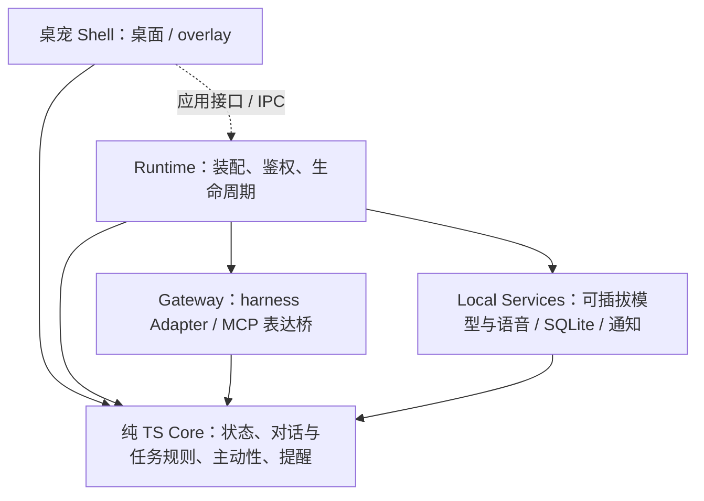

# 🐱 Maneki · 小招

**一只主动招手的桌宠，也是你和 AI Agent 之间的贴心中间人**

*A beckoning-cat desktop pet that brokers tasks between you and your AI coding agents.*

> 招财猫（招き猫 / Maneki-neko）的天性就是：**主动招手迎接你，把好运带回来**。
>
> Maneki 也一样 —— 它会主动找你聊天、帮你记事到点提醒、把你的指令交给 AI 编程 Agent（dsh / Claude Code / pi / Codex …），盯着它们把活干完，再把结果叼回来交给你。

> **当前状态：M1 开发中。** Core、内置动作包与浏览器前端已构建并通过测试；原生 Tauri 已完成 Windows 本机编译并产出 MSI/NSIS 安装包，真机启动验收通过：透明置顶窗、透明视频动画、点击动作与约 29MB 空闲内存（详见 roadmap 证据记录）。托盘菜单、拖拽手感与多屏场景仍待人工逐项验收。首个可用版本优先可换装桌宠 + dsh 文字任务中间人 + 插件入口，pi 为第二目标；语音和提醒独立追加。下文是目标能力，均需实现后验收。

## ✨ 目标能力

| 能力 | 说明 |
|---|---|
| 🎨 自定义形象 | 纯数据动作包驱动，透明视频 / 精灵图按平台选择；先支持本地换装，再建设社区生态 |
| 🎭 预设可爱动作 | 待机呼吸、漫游、玩耍、庆祝、睡觉……按宠物状态与权重无缝衔接，交互带物理反馈（点击、拖拽、甩抛） |
| 💬 主动交流 | 主动性引擎：到点提醒、任务完成、久等输入、节日问候；带防打扰预算（勿扰时段 + 频率上限） |
| 🎙️ 可选语音 | ASR、TTS 独立启用和替换；本地优先、云端显式配置；按键说话、主动播报与邀请回应，可选增强唤醒/连续对话 |
| 📝 记事与提醒 | 「小招帮我记一下……」→ 本地 SQLite 持久化，到点气泡 + 语音 + 系统通知多通道送达 |
| 🧠 外挂记忆 | 可选接入用户自建的 MCP 记忆服务作为背景知识；写回粒度可配置，与内置提醒/记事互不依赖 |
| 🤝 Agent 中间人 | 接收你的语音/文字指令 → 派发给 harness → 盯进度切动画 → 完成后通知你并交付产物 |
| 🔌 多 harness 接入 | Adapter 按能力提供观察、派发、回答、取消与审批；MCP 提供表达工具，候选适配 dsh / Claude Code / pi 等 |
| 🗂️ 会话总览与介入 | 查看最近 harness 会话（默认 10 个、范围可配），等待输入时按来源授权在助理内回答；完全接管与宠物审批桥后续另验 |
| 🧩 扩展 | 形象包、语音/模型 Provider、harness Adapter 分开；第三方可执行技能须通过隔离验收后开放 |

## 🎯 设计原则

- **安全第一**：API 只绑 127.0.0.1 + 随机令牌与分权；派发授权与具体操作审批分开，输出按数据处理；用量与上下文限额三层配置化。
- **可扩展**：纯 TS Core 定义规则与端口，Runtime 装配具体实现；语音、模型、harness 和形象独立替换，关闭可选能力不影响文字入口。
- **性能可测**：Tauri v2 优先；空闲总内存目标 < 150MB，计入 WebView、Runtime 和桥接进程；活跃模型资源另报。
- **按能力接入**：支持 MCP 的宿主可接入表达工具；完整任务代理另需经过会话路由与执行审批验收的 Adapter。

## 🏗️ 架构总览

实线表示依赖，虚线表示跨进程调用；Shell 不导入 Node 服务实现，Core 不依赖具体 IO。安装一次共享本地 Runtime，桌面界面与插件连接它；插件可受控启动已安装 Runtime，不要求先打开桌宠 App。完整设计见 [docs/architecture.md](./docs/architecture.md)。

## 🔌 接入方式（三种运行形态）

| 形态 | 适用场景 |
|---|---|
| ① 独立桌宠界面 | Tauri 透明窗连接共享 Runtime，按已验证的 API / MCP / hooks 能力接入 harness |
| ② harness 内嵌 overlay 插件 | 首个目标 dsh；连接/受控启动同一个已安装 Runtime，无须先打开桌宠窗口 |
| ③ core 库模式 | 第三方嵌入 `@maneki-pet/core` 并注入端口，可只使用所需规则，无需桌面壳或语音服务 |

**双向通道是不同能力**：harness → 宠物为状态/表达/通知；宠物 → harness 的派发、补充输入、查询与取消由 Adapter 提供。具体宿主、版本和平台通过验收后才列为已支持。

首版派发新建受控会话，已有会话仅观察；自己的任务可以继续补充输入、跟踪和取消。“受控”指路由与授权可追踪，不代表替代 harness 的 OS 隔离。关闭窗口或插件后继续后台跟踪；明确“退出助理”停止本机服务并提示外部任务可能继续，不假称已取消。开机自启动默认关闭。

## 🛡️ 安全模型（摘要）

- 本机回环 + 令牌/scope + Host/Origin 校验；CORS 不能代替鉴权。
- 任务派发默认 ask；首版危险操作回到 harness 原生界面确认，后续审批桥另行验证；无法保证时只开放观察。
- Agent 输出不执行；结构化调用也要校验和授权。模型或语音不能代批危险操作。
- 数据本地优先，录音默认不落盘；可一键关闭 Maneki 自身云端 Provider。harness 的数据去向与云端使用另行授权，不将本机 CLI 当作全本地推理。
- 收费 Provider 的交互调用须明确启用；主动收费调用默认关闭、另行授权和限额；购买/支付逐次审批。
- 动作包为纯数据，验证内容哈希与路径；哈希不等于来源签名，权限清单不等于代码沙箱。
- 勿扰抑制主动打扰，用户主动交互仍可用；语音输出关闭和麦克风禁用独立。审批等待不自动放行，过期提醒按规则补发。

## 🗺️ Roadmap（摘要）

| 里程碑 | 内容 |
|---|---|
| M0 ✅ | 仓库 + 设计文档（本仓库当前状态） |
| M1 | 最小桌宠：透明窗 + 动画链 + 托盘 + 拖拽点击 |
| M2 | 共享 Runtime 独立启动 + 本地 API/MCP + dsh 接入与恢复 spike |
| M2b | dsh 文字任务 → 原生审批 → 结果交付 + 最小 overlay 插件首版 |
| M3 | 独立可选的模型 / ASR / TTS + 主动语音邀请回应 |
| M4 | 记忆与可靠提醒 + `maneki_remind` + 防打扰与恢复 |
| M5 | pi 等第二宿主/库模式 + 按能力整合语音与提醒，审批桥可选另验 |
| M6 | 隔离验收后的第三方技能 + 社区动作包工具 + 多宠 |

详见 [docs/roadmap.md](./docs/roadmap.md)。

领域词义见 [GLOSSARY.md](./GLOSSARY.md)；共享运行时取舍见 [ADR](./docs/adr/0001-shared-local-runtime.md)；本轮整体目标与架构复核见 [审计报告](./docs/audits/2026-10-30-design-audit.md)。

## 💡 灵感与致谢

Maneki 站在以下优秀项目的肩膀上，感谢它们的开源精神（设计借鉴分析见 [docs/research.md](./docs/research.md)）：

- [PC2005-cloud/dsh-pet](https://github.com/PC2005-cloud/dsh-pet) — 透明视频桌宠、插件化、开放 API 的完整范本
- [pooriaanv/claudeBuddy](https://github.com/pooriaanv/claudeBuddy) — Agent 完成时"敲门"提醒
- [Xiaooolong/code-pet](https://github.com/Xiaooolong/code-pet) — 实时感知 Claude Code 状态切动画
- [agentscope-ai/QwenPaw](https://github.com/agentscope-ai/QwenPaw) — 桌宠形态的个人助理与技能体系
- [dev-zyl/LingoPet](https://github.com/dev-zyl/LingoPet) — 轻量桌宠 + 提醒待办 + 宠物市场
- [TopSea/Alive](https://github.com/TopSea/Alive) — 可私有化部署的 AI 桌宠
- [Lazily01/desktop-pet](https://github.com/Lazily01/desktop-pet) — 语音指令 + 屏幕理解的桌宠

## 📄 许可证

- 代码：[MIT](./LICENSE)
- 官方形象素材（含「小招」默认形象）：随素材发布单独声明授权，允许非商用二创。

## 🤝 参与建设

目前处于孵化期，欢迎在 Issues 里聊聊你想要的形象、动作和 harness 适配优先级。
