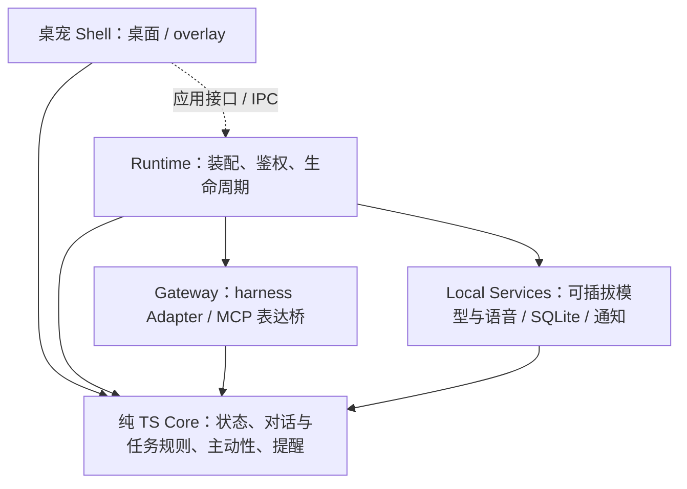

# 🐱 Maneki · 小招

**一只主动招手的桌宠，也是你和 AI Agent 之间的贴心中间人**

*A beckoning-cat desktop pet that brokers tasks between you and your AI coding agents.*

> 招财猫（招き猫 / Maneki-neko）的天性就是：**主动招手迎接你，把好运带回来**。
>
> Maneki 也一样 —— 它会主动找你聊天、帮你记事到点提醒、把你的指令交给 AI 编程 Agent（dsh / Claude Code / pi / Codex …），盯着它们把活干完，再把结果叼回来交给你。

> **当前状态：M0 设计阶段，尚无可运行程序。** 下文是目标能力；平台兼容性、安全机制与性能均需实现后验收。

## ✨ 目标能力

| 能力 | 说明 |
|---|---|
| 🎨 自定义形象 | 纯数据动作包驱动，透明视频 / 精灵图按平台选择；先支持本地换装，再建设社区生态 |
| 🎭 预设可爱动作 | 待机呼吸、漫游、玩耍、庆祝、睡觉……按宠物状态与权重无缝衔接，交互带物理反馈（点击、拖拽、甩抛） |
| 💬 主动交流 | 主动性引擎：到点提醒、任务完成、久等输入、节日问候；带防打扰预算（静音时段 + 频率上限） |
| 🎙️ 可选语音 | ASR、TTS 独立启用和替换；本地优先、云端显式配置；按键说话、主动播报与邀请回应，可选增强唤醒/连续对话 |
| 📝 记事与提醒 | 「小招帮我记一下……」→ 本地 SQLite 持久化，到点气泡 + 语音 + 系统通知多通道送达 |
| 🤝 Agent 中间人 | 接收你的语音/文字指令 → 派发给 harness → 盯进度切动画 → 完成后通知你并交付产物 |
| 🔌 多 harness 接入 | Adapter 按能力提供观察、派发、回答、取消与审批；MCP 提供表达工具，候选适配 dsh / Claude Code / pi 等 |
| 🧩 扩展 | 形象包、语音/模型 Provider、harness Adapter 分开；第三方可执行技能须通过隔离验收后开放 |

## 🎯 设计原则

- **安全第一**：API 只绑 127.0.0.1 + 随机令牌与分权；派发授权与具体操作审批分开，输出按数据处理。
- **可扩展**：纯 TS Core 定义规则与端口，Runtime 装配具体实现；语音、模型、harness 和形象独立替换，关闭可选能力不影响文字入口。
- **性能可测**：Tauri v2 优先；空闲总内存目标 < 150MB，计入 WebView、Runtime 和桥接进程；活跃模型资源另报。
- **按能力接入**：支持 MCP 的宿主可接入表达工具；完整任务代理另需经过会话路由与执行审批验收的 Adapter。

## 🏗️ 架构总览

实线表示依赖，虚线表示跨进程调用；Shell 不导入 Node 服务实现，Core 不依赖具体 IO。桌面部署基线为 Tauri Shell + Node Runtime sidecar，每个用户配置目录一个 Runtime。完整设计见 [docs/architecture.md](./docs/architecture.md)。

## 🔌 接入方式（三种运行形态）

| 形态 | 适用场景 |
|---|---|
| ① 独立桌宠 App（默认目标） | Tauri 透明窗 + Runtime，按已验证的 API / MCP / hooks 能力接入 harness |
| ② harness 内嵌 overlay 插件 | 以 dsh 插件等形式嵌入 web 视口，连接同一个本机 Runtime |
| ③ core 库模式 | 第三方嵌入 `@maneki-pet/core` 并注入端口，可只使用所需规则，无需桌面壳或语音服务 |

**双向通道是不同能力**：harness → 宠物为状态/表达/通知；宠物 → harness 的派发、补充输入、查询与取消由 Adapter 提供。具体宿主、版本和平台通过验收后才列为已支持。

## 🛡️ 安全模型（摘要）

- 本机回环 + 令牌/scope + Host/Origin 校验；CORS 不能代替鉴权。
- 任务派发默认 ask；危险操作通过 harness 原生审批或可验证的审批桥逐次确认，无法保证时只开放观察。
- Agent 输出不执行；结构化调用也要校验和授权。模型或语音不能代批危险操作。
- 数据本地优先，录音默认不落盘；云端能力独立配置、可一键全关，失败不静默切云端。
- 动作包为纯数据，验证内容哈希与路径；哈希不等于来源签名，权限清单不等于代码沙箱。
- 默认静音时段不主动打扰，过期提醒恢复后补发；审批等待超时拒绝，不自动放行。

## 🗺️ Roadmap（摘要）

| 里程碑 | 内容 |
|---|---|
| M0 ✅ | 仓库 + 设计文档（本仓库当前状态） |
| M1 | 最小桌宠：透明窗 + 动画链 + 托盘 + 拖拽点击 |
| M2 | Runtime + 本地 API + MCP 表达桥 + harness 状态联动与接入 spike |
| M2b | 提前验证文字派发 → 执行审批 → 结果交付的最小闭环 |
| M3 | 独立可选的模型 / ASR / TTS + 主动语音邀请回应 |
| M4 | 记忆与可靠提醒 + `maneki_remind` + 防打扰与恢复 |
| M5 | 完整任务体验 + dsh overlay + 经验证的其他适配器 |
| M6 | 隔离验收后的第三方技能 + 社区动作包工具 + 多宠 |

详见 [docs/roadmap.md](./docs/roadmap.md)。

## 💡 灵感与致谢

Maneki 站在以下优秀项目的肩膀上，感谢它们的开源精神（设计借鉴分析见 [docs/research.md](./docs/research.md)）：

- [PC2005-cloud/dsh-pet](https://github.com/PC2005-cloud/dsh-pet) — 透明视频桌宠、插件化、开放 API 的完整范本
- [pooriaanv/claudeBuddy](https://github.com/pooriaanv/claudeBuddy) — Agent 完成时"敲门"提醒
- [Xiaooolong/code-pet](https://github.com/Xiaooolong/code-pet) — 实时感知 Claude Code 状态切动画
- [agentscope-ai/QwenPaw](https://github.com/agentscope-ai/QwenPaw) — 桌宠形态的个人助理与技能体系
- [dev-zyl/LingoPet](https://github.com/dev-zyl/LingoPet) — 轻量桌宠 + 提醒待办 + 宠物市场
- [TopSea/Alive](https://github.com/TopSea/Alive) — 可私有化部署的 AI 桌宠
- [Lazily01/desktop-pet](https://github.com/Lazily01/desktop-pet) — 语音指令 + 屏幕理解的桌宠

## 📄 许可证

- 代码：[MIT](./LICENSE)
- 官方形象素材（含「小招」默认形象）：随素材发布单独声明授权，允许非商用二创。

## 🤝 参与建设

目前处于孵化期，欢迎在 Issues 里聊聊你想要的形象、动作和 harness 适配优先级。
