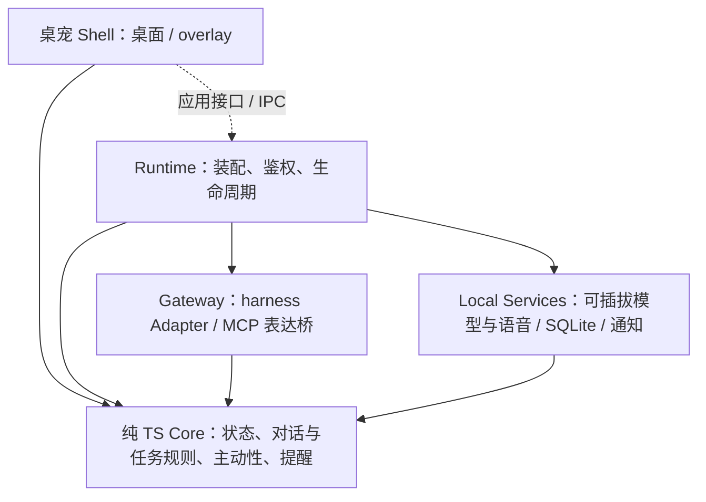

<div align="center">

# 🐱 Maneki · 小招

**一只主动招手的桌宠，也是你和 AI Agent 之间的贴心中间人**

*A beckoning-cat desktop pet that brokers tasks between you and your AI coding agents.*

[](./LICENSE)
[](./docs/roadmap.md)
[](./docs/roadmap.md)

</div>

> 招财猫（招き猫 / Maneki-neko）的天性就是：**主动招手迎接你，把好运带回来**。
>
> Maneki 的目标是陪你聊天、管理个人待办并到点提醒，后续把授权的工程任务交给 dsh，跟踪并带回结果。近期只适配 dsh，其他 harness 后置。

> **当前状态：孵化开发中；更新于 2026-11-07。** 已有 Core、动作包、Windows Tauri 安装包、共享 Runtime 和 dsh 状态观察插件；新增文字主会话、个人待办、单次提醒和按键语音面板，验证范围见下方记录。M1/M2/M2b 整体出口尚未通过，执行缺口见[审计](./docs/audits/2026-11-01-product-architecture-review.md)。近期补齐真实设备人工验收，之后独立验收 dsh 工程派发；其他 harness 暂缓。下文区分设计目标与已验收增量。
>
> **当前执行限制：** dsh 原生审批和完整恢复尚未通过验收，新任务派发及未经核实的取消均已关闭；已有本地任务记录可查询，重启后的真实外部状态请到 harness 核查。
>
> **2026-11-03 可用增量：** [dsh 状态联动 MVP](./apps/dsh-plugin/README.md) 已通过 Windows 真实 dsh 文字任务验证。任务在 dsh 原生界面操作，小招显示工作、思考、等待和完成等状态；本增量不含反向派发、overlay 或完整交付恢复。需要使用本轮构建的桌面与 Runtime，不能沿用旧安装版。

> **2026-11-07 基础插件增量：** 新增 `/maneki status|connect|pair|show|quit`，通过已登记原生入口连接/启动共享 Runtime、显式配对、显示同一桌宠和退出后台；插件仅持有状态表达凭证。真实 dsh 本地包安装与注册、Windows 发行布局通过验证；原生授权按钮、托盘退出及安装器流程仍待人工验收。需一起更新桌面与 Runtime，未自动替换当前安装版，详见[使用说明](./apps/dsh-plugin/README.md)与[验证边界](./docs/audits/2026-11-07-dsh-plugin-management.md)。

> **2026-11-07 文字助理增量：** `/maneki assistant` 或桌宠文字入口打开同一窗口的对话、待办、提醒与设置面板。默认关闭模型和自身云端能力；不启用模型也能输入“待办：周五前提交报销”“半小时后提醒我休息”。待办截止日期不会自动创建提醒，完成/删除待办取消未触发的关联提醒。历史本地保留，清空须预览确认并同时删除摘要；模型回答只作文本显示。系统通知由后台调度，系统受理不等于用户已看到。模型接口通过本机替身验证，未进行真实计费调用；语音、MCP 提醒工具、休眠/DPI/长期性能和安装器仍分别验收，见[本轮记录](./docs/audits/2026-11-07-text-assistant-reminders.md)。

> **2026-11-07 按键语音增量：** 同一助手面板支持按住说话、松开转写后自动提交，以及可选本地朗读。麦克风、ASR、TTS 三项独立且默认关闭；用户自行安装 whisper.cpp 1.9.5 和模型，TTS 使用 Windows 已安装语音。录音仅走内存，不自动下载或转云端；语音复用个人对话/待办/提醒，工程派发仍关闭。Windows 本地引擎与原生组件检测已验证，真实麦克风/扬声器、权限弹窗、识别准确率和长期性能保留人工验收。见[安装与使用](./docs/voice.md)及[验证记录](./docs/audits/2026-11-07-push-to-talk-voice.md)。未替换现有安装版。

迁移：桌面与 Runtime 须一起更新，dsh 插件仍可用 `0.3.0` 入口。SQLite 升级到 v5，升级前按源版本生成 `runtime.db.bak-<版本>`（如 v3 的 `.bak-3`、v4 的 `.bak-4`）；旧 Runtime 拒绝新库，回退须停止后台并显式恢复对应备份。旧设置缺少 voice 时默认关闭，旧客户端保存时保留已有语音设置。个人助理凭证独立保存在 `assistant-client.json`，首次打开助手才创建；既有表达凭证不扩权，撤销后不静默重配。模型密钥只由 Runtime 保存在用户目录，设置页仅显示是否配置，不放进 dsh 或项目配置。

2026-11-04 安全迁移：桌面与 Runtime 须一同更新并重启后台。桌面改由 native 配对，WebView 不再获取 root；修改勿扰需单独 `settings` 权限，旧 `express` 凭证不会自动提权。桌面凭证被撤销后须由受信管理入口重新配对；旧无归属任务不向新客户端开放，先到原 harness 核查。实现与安装验收边界见[记录](./docs/audits/2026-11-04-mvp-reliability-implementation.md)。
>
> 抖音发布资格可通过构建后的 `node packages/cli/dist/main.js platform douyin-check` 查看离线诊断；它不核验真实账号、不接受凭证，也不启用发布。

## ✨ 目标能力

| 能力 | 说明 |
|---|---|
| 🎨 自定义形象 | 纯数据动作包驱动，透明视频 / 精灵图按平台选择；先支持本地换装，再建设社区生态 |
| 🎭 预设可爱动作 | 待机呼吸、漫游、玩耍、庆祝、睡觉……按宠物状态与权重无缝衔接，交互带物理反馈（点击、拖拽、甩抛） |
| 💬 主动交流 | 主动性引擎：到点提醒、任务完成、久等输入、节日问候；带防打扰预算（勿扰时段 + 频率上限） |
| 🗨️ 独立主会话 | 日常/技术问答，管理待办提醒、解释 dsh 状态；模型由 Runtime 独立配置，历史本地保留至主动清除，不直接操作项目文件或命令 |
| 🎙️ 可选语音 | ASR、TTS 独立启用；本地优先、云端显式配置；按住录音、松开成功转写后自动发送，失败不提交，半双工且可打断播报；唤醒/连续对话后置 |
| 📝 个人待办与提醒 | 平铺待办与单次提醒分开，截止时间不自动建立提醒；本地 SQLite 持久化，到点系统通知、桌宠在线同步展示，语音播报单独开启 |
| 🧠 外挂记忆 | 可选接入用户自建的 MCP 记忆服务作为背景知识；写回粒度可配置，与内置提醒/记事互不依赖 |
| 🤝 Agent 中间人 | 接收你的语音/文字指令 → 派发给 harness → 盯进度切动画 → 完成后通知你并交付产物 |
| 🔌 dsh 优先接入 | 近期只适配 dsh；插件提供入口与设置，Runtime 保存助手全局配置，其他 harness 的 Adapter 扩展后置；MCP 表达不等于工程派发 |
| 🗂️ 会话总览与介入 | 查看最近 harness 会话（默认 10 个、范围可配），等待输入时按来源授权在助理内回答；完全接管与宠物审批桥后续另验 |
| 🧩 扩展 | 形象包、语音/模型 Provider、harness Adapter 分开；第三方可执行技能须通过隔离验收后开放 |
| 🎬 平台运营 | 当前仅备料与人工发布回执；未来在官方权限获批后，预览并逐次确认作品/账号再发布和核验回执，不承诺个人账号一定获批 |

## 🎯 设计原则

- **安全第一**：API 只绑 127.0.0.1 + 随机令牌与分权；派发授权与具体操作审批分开，输出按数据处理；用量与上下文限额三层配置化。
- **可扩展**：纯 TS Core 定义规则与端口，Runtime 装配具体实现；语音、模型、harness 和形象独立替换，关闭可选能力不影响文字入口。
- **性能可测**：Tauri v2 优先；2026-11-03 用户确认空闲全相关进程树 Private Bytes 目标 ≤ 300 MiB（Runtime ≤ 75 MiB），计入 WebView、Runtime 和桥。正式猫娘无调试器固定场景采样约 267–279 MiB，Runtime 约 62 MiB，详见[验收记录](./docs/audits/2026-11-03-catgirl-default-acceptance.md)；这些采样不代表长期峰值或全部负载。2026-10-31 的约 243.7MB 为旧 250MB 目标下的历史测量；活跃模型资源另报。
- **按能力接入**：支持 MCP 的宿主可接入表达工具；完整任务代理另需经过会话路由与执行审批验收的 Adapter。

## 🏗️ 架构总览



实线表示依赖，虚线表示跨进程调用；Shell 不导入 Node 服务实现，Core 不依赖具体 IO。共享 Runtime 不要求先打开桌宠 App；完整安装与人工确认边界见上方记录。当前 dsh 通过命令打开桌面助手设置，由 Runtime 保存全局配置；嵌入 dsh 的设置页面后续另验。不同 profile 默认共享个人助手，项目配置不能覆盖麦克风、云端授权和勿扰。完整设计见 [docs/architecture.md](./docs/architecture.md)。

## 🔌 接入方式（三种运行形态）

| 形态 | 适用场景 |
|---|---|
| ① 独立桌宠界面 | Tauri 透明窗连接共享 Runtime，按已验证的 API / MCP / hooks 能力接入 harness |
| ② harness 内嵌 overlay 插件 | 首个目标 dsh；连接/受控启动同一个已安装 Runtime，无须先打开桌宠窗口 |
| ③ core 库模式（后置） | 保留第三方嵌入 `@maneki-pet/core` 的设计边界，近期不作为交付目标 |

**双向通道是不同能力**：harness → 宠物为状态/表达/通知；宠物 → harness 的派发、补充输入、查询与取消由 Adapter 提供。具体宿主、版本和平台通过验收后才列为已支持。

后续工程派发首版新建受控会话，已有会话仅观察；自己的任务输入、跟踪与取消须分别通过验收。“受控”指路由与授权可追踪，不替代 harness 的 OS 隔离。独立助理设计要求关闭 dsh/窗口后仍调度提醒，重新唤起桌宠且模型可用时仍可聊天；明确“退出助理”才停止本机服务。关机/退出期间错过的提醒下次启动补扫，外部任务可能继续且不伪报取消；开机自启动默认关闭。

## 🎨 素材准备与试片

2026-11-03：橘猫娘 `xiaozhao-default@1.1.0` 已完成正式默认交付，17 段静音透明动画覆盖七状态与十项动作，附同角色兼容精灵图及 MIT 授权；旧程序招财猫已移除。素材检查及 Windows release 播放、抢占、兼容回退、换装和固定场景资源采样通过，资源预算采用用户确认的 300 MiB，详见[验收记录](./docs/audits/2026-11-03-catgirl-default-acceptance.md)。配方与制作历史见[角色配方](./apps/desktop/recipes/orange-catgirl-v1.md)。本机交付为 `renders/orange-catgirl/maneki-catgirl-default-1.1.0.zip`，获取后按包内 README 显式安装；大素材不入库，目前没有公开发行下载地址，克隆仓库不会自动获得已批准原片或正式包。

设置面板可选择当前形象声明的动作并点播；切换形象会更新动作列表，无动作时入口禁用。

Windows 桌宠已增加人物轮廓交互与下方控制条：悬停人物或键盘聚焦时显示，透明留白放行鼠标，人物仍可点击与拖动。控制条文字入口将草稿带入助手；麦克风入口打开助手并聚焦按键语音，未启用时引导到设置，不自动录音。人物交互的历史检查与剩余边界见[交互验收记录](./docs/audits/2026-11-04-pet-interaction-acceptance.md)，本轮语音边界见上方记录。

开发构建会在缺包时补齐 `1.0.1` 中性三方块占位包；生成失败不留下目标半包。旧内置默认 `xiaozhao-default` / `小招 · 招财猫` / `1.0.0` 已退役，准备时会报错并保留原文件，须显式导入正式包。其他已有合法包保持不变，损坏包报错并保留现场；仅已知旧程序招财猫 fallback 按冻结指纹迁移为中性图，其他已准备 fallback 保留。图标源复用当前 fallback，`--public-dir` 隔离生成不写应用图标目录。它不启动生成模型，也不提供正式橘猫娘素材。收到版本化动作包目录后，显式安装并检查（先安装依赖并构建 Core）；将下列源目录占位符替换为实际绝对路径，避免 pnpm 在 `apps/desktop` 下执行脚本时解析到错误位置：

```sh
pnpm --filter @maneki-pet/core build
pnpm --filter @maneki-pet/desktop import:pack "<absolute-source-pack-dir>"
pnpm --filter @maneki-pet/desktop generate:packs
pnpm --filter @maneki-pet/desktop prepare:packs
```

开发环境的安装、`prepare:packs` 和动作包测试需要本机 PATH 中的 `ffmpeg` / `ffprobe`。它们只读校验当前内置列表的 v1 结构、映射、文件哈希、真实媒体格式/尺寸与完整解码；JSON 各限 1 MiB、素材单文件 64 MiB、包合计 256 MiB，缺工具或校验失败明确拒绝并保留旧包。不生成或下载素材，不代替 Windows 播放与创作验收。独立候选包导入后，还需在 `apps/desktop/config/builtin-packs.json` 中显式登记 ID 才能出现在换装列表；不要把未验收试片改为默认。制作入口与正式晋升步骤见[角色配方](./apps/desktop/recipes/orange-catgirl-v1.md#可重复处理入口)。

## 🛡️ 安全模型（摘要）

- 本机回环 + 令牌/scope + Host/Origin 校验；CORS 不能代替鉴权。
- 任务派发默认 ask；首版危险操作回到 harness 原生界面确认，后续审批桥另行验证；无法保证时只开放观察。
- Agent 输出不执行；结构化调用也要校验和授权。模型或语音不能代批危险操作。
- 数据本地优先，录音默认不落盘；可一键关闭 Maneki 自身云端 Provider。harness 的数据去向与云端使用另行授权，不将本机 CLI 当作全本地推理。
- 收费 Provider 的交互调用须明确启用；主动收费调用默认关闭、另行授权和限额；购买/支付逐次审批。
- 动作包为纯数据，验证内容哈希与路径；哈希不等于来源签名，权限清单不等于代码沙箱。
- 桌面播放器单个素材最多 64 MiB，图片或视频画面最多 8,388,608 像素；超限时提示并回退。大素材活跃资源与剩余验收见[资源验证记录](./docs/audits/2026-11-01-media-budget.md)。
- 勿扰抑制主动打扰，用户主动交互仍可用；语音输出关闭和麦克风禁用独立。审批等待不自动放行，过期提醒按规则补发。

## 🗺️ Roadmap（摘要）

| 里程碑 | 内容 |
|---|---|
| M0 ✅ | 仓库 + 设计文档 |
| M1 | 最小桌宠：透明窗 + 动画链 + 托盘 + 拖拽点击 |
| M2 | 共享 Runtime + dsh 基础插件连接/配对/唤起/设置与助理退出 |
| M3 + M4 近期 | 先文字主会话、个人待办与单次可靠提醒，再接按键语音 |
| M2b 后续 | dsh 工程文字任务 → 原生审批 → 完整恢复与结果交付，独立验收 |
| M5 暂缓 | 其他宿主/库模式、会话介入与外挂记忆，按后续需求另验 |
| M6 | 隔离验收后的第三方技能 + 社区动作包工具 + 多宠 |

详见 [docs/roadmap.md](./docs/roadmap.md)。

领域词义见 [GLOSSARY.md](./GLOSSARY.md)；共享运行时取舍见 [ADR](./docs/adr/0001-shared-local-runtime.md)，独立主会话见 [ADR-0003](./docs/adr/0003-independent-assistant-session.md)，本次 dsh 优先个人助理范围见 [ADR-0005](./docs/adr/0005-dsh-first-personal-assistant.md)。历史架构审计见[报告](./docs/audits/2026-11-01-product-architecture-review.md)。

## 💡 灵感与致谢

Maneki 站在以下优秀项目的肩膀上，感谢它们的开源精神（设计借鉴分析见 [docs/research.md](./docs/research.md)）：

- [PC2005-cloud/dsh-pet](https://github.com/PC2005-cloud/dsh-pet) — 透明视频桌宠、插件化、开放 API 的完整范本
- [pooriaanv/claudeBuddy](https://github.com/pooriaanv/claudeBuddy) — Agent 完成时"敲门"提醒
- [Xiaooolong/code-pet](https://github.com/Xiaooolong/code-pet) — 实时感知 Claude Code 状态切动画
- [agentscope-ai/QwenPaw](https://github.com/agentscope-ai/QwenPaw) — 桌宠形态的个人助理与技能体系
- [dev-zyl/LingoPet](https://github.com/dev-zyl/LingoPet) — 轻量桌宠 + 提醒待办 + 宠物市场
- [TopSea/Alive](https://github.com/TopSea/Alive) — 可私有化部署的 AI 桌宠
- [Lazily01/desktop-pet](https://github.com/Lazily01/desktop-pet) — 语音指令 + 屏幕理解的桌宠

## 📄 许可证

- 代码：[MIT](./LICENSE)
- 小招 · 原创橘猫娘 1.1.0 素材：MIT，随素材附带许可和独立生成来源记录；不包含参考项目蓝鲸素材或生成模型权重。其他素材以各包许可为准。

## 🤝 参与建设

目前处于孵化期，欢迎在 Issues 里聊聊你想要的形象、动作和 harness 适配优先级。
