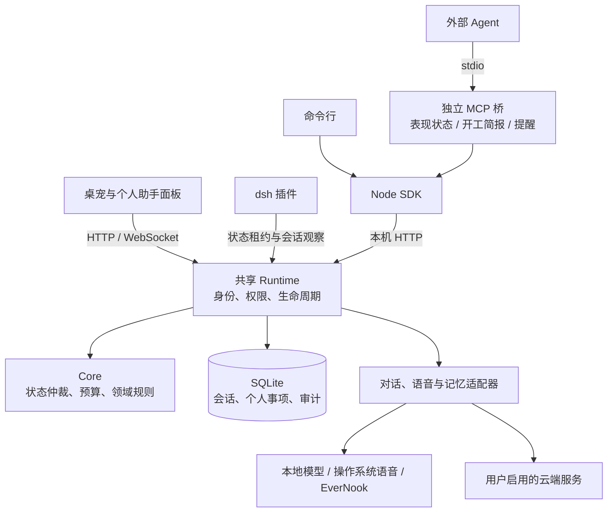

# Maneki · 小招

一只陪你工作、替你留意 dsh 会话的桌宠。两个项目同时运行时，你可以直接问「哪个会话在等我？」。小招会根据宿主事件回答，工程操作和审批仍留在 dsh。关掉桌宠窗口后，后台继续照看提醒。

[Windows 安装指南](./docs/install-windows.md) · [dsh 插件](./apps/dsh-plugin/README.md) · [架构设计](./docs/architecture.md) · [路线图与验收](./docs/roadmap.md) · [MIT](./LICENSE) · [工作日改期验收](./docs/audits/2026-11-22-weekday-reminder-reschedule.md)

## 现在能用什么

| 场景 | 能力与验收边界 |
| --- | --- |
| 聊天、待办与单次提醒 | Windows x64 个人预览 `0.2.0-alpha.2`。模型关闭也能处理「半小时后提醒我休息」等明确指令。阶段一另以 Windows 独立身份确认跨项目续聊，两个 dsh 均退出后，用户看到了该次 Windows 提醒。[安装与使用](./docs/install-windows.md) · [阶段一实机记录](./docs/audits/2026-11-13-stage1-dsh-companion.md) |
| 找到等待回应的会话 | 当前源码支持按项目目录名、会话 ID 和阶段查看进度。真实 dsh 的等待、完成、续接、取消和失联均有对照记录。[会话验收](./docs/audits/2026-11-14-session-observations.md) |
| 按住说话与朗读 | 麦克风、识别和合成分别启用。可选本地引擎、百炼，或单独授权 dsh 提供只读进度查询所需的转写。真实录音与第二个会话同时完成的组合场景仍待验收。[语音配置](./docs/voice.md) |
| 形象、动作与轻陪伴 | 源码支持动作包、点播、模板气泡、「来一句」及暂停。自动台词遵守勿扰和独立预算。正式素材另行准备；长时间节奏、真实休眠及多屏观感待验。[轻陪伴验证](./docs/audits/2026-11-14-template-companionship.md) |
| 长期记忆 | 小招与 dsh 可通过同一个 EverNook 0.1.98 及以上本机服务读写普通记忆，各用自己的身份。小招分别控制保存与召回，并用所选模型的本地 tokenizer 复算注入预算。Windows 跨日对照中，预选三问均取回原文，一问答出茶名，三问均未完整复述偏好；追加问法有一问同时答出茶名和配料。[逐题回答](./docs/audits/2026-11-28-natural-memory-answers.md) · [配置与证据](./packages/adapters/evernook/README.md) |
| 让 personal agent 安排休息 | 对已授权的 agent 说「半小时后提醒我休息」。小招保存一次提醒，宿主退出后，仍由后台到点投递。[配对与重试示例](#agent-reminders) |
| 让 personal agent 定期提醒你 | 对已授权的 agent 说「每周一、三、五上午九点提醒我休息」。小招按个人时区调度。[指定星期](#weekly-reminders) · [改时间](#weekly-reminder-reschedule) · [换星期](#weekly-reminder-change-days) · [每日提醒](#daily-reminders) · [工作日提醒](#weekday-reminders) |
| 让 personal agent 管理自己安排的提醒 | 权限分别授予。agent 可查询尚未开始投递的提醒，并精确取消或改期其中一条。[查询与取消](#agent-reminder-management) · [改期](#agent-reminder-reschedule) |
| 让 personal agent 整理开工简报 | 单独授权后，agent 可通过 SDK、HTTP、CLI 或 MCP 一次查询到期待办和等待回应的 dsh 会话。[接入示例](#让-personal-agent-帮你开工) |

安装包是封存的本地预览。下文的 SDK、CLI 与独立 MCP 桥使用同一版 `main` 源码构建。Windows x64 是本轮验证平台，macOS/Linux 仍是目标平台。

## 架构



多个 Shell 共享一个 Runtime 和一个数据库拥有者。Core 定义规则与端口，Runtime 负责 IO 与装配。表情租约表达的是某个来源当前想展示的状态；个人会话的任务进度另有来源、序列和时效。personal agent 可将自己的工作进度显示在桌宠上。简报查询与单次提醒操作分别授权，重复提醒和重复提醒改期分别配对。要接入可执行任务，仍须单独实现并验收 Adapter 的审批、取消和恢复。[模块分工与接口](./docs/architecture.md)

## 接入小招

| 入口 | 适用场景 | 当前边界 |
| --- | --- | --- |
| dsh 插件 | 人类在宿主输入 `/maneki pair`、`show`、`assistant` | 首个宿主，观察已收到的会话事件；配对与退出经原生管理入口 |
| 本机 API / WebSocket | 非 Node 客户端、原生桌面或订阅实时事件 | HTTP v1 固定回环、按 scope 鉴权；WS 使用一次性短期票据。[本地接口](./docs/architecture.md#61-runtime-应用接口) |
| Node SDK | 在 Node agent 中显示进度、查询简报或管理自己的提醒 | 源码 workspace 包 `@maneki-pet/sdk`，提供 `getState()`、`setState()`、`getBriefing()`、`createReminder()`、`listReminders()`、`cancelReminder()`、`rescheduleReminder()`，另有重复提醒客户端。[SDK 源码](./packages/sdk/src/index.ts) |
| CLI | 脚本管理提醒、查询简报、读取或更新表现状态 | 提供 [单次提醒](#agent-reminders)、[每日提醒](#daily-reminders)、[工作日提醒](#weekday-reminders)、[指定星期提醒](#weekly-reminders)、[每日改期](#daily-reminder-reschedule)、[工作日改期](#weekday-reminder-reschedule) 和 [指定星期改期](#weekly-reminder-reschedule) 命令，以及 `briefing`、`state get`、`state set`、平台草稿、导出和离线诊断。 |
| MCP stdio | 支持 MCP 的外部宿主连接已运行的小招 | 状态和简报工具分别是 `maneki_set_state` 与 `maneki_get_briefing`。各类提醒使用对应的工具桥。每日、工作日和指定星期桥复用重复提醒凭证，三个改期桥复用独立的改期凭证。[MCP 契约](./docs/architecture.md#55-mcp-与各-harness-的接入策略) |

**从源码试用。** Windows 构建使用 Node 24.12.0 x64、Corepack、Rust 1.88+、MSVC 和 PATH 中的 FFmpeg、ffprobe。干净检出会生成开发占位形象。正式角色包的导入、许可证与构建配方另见[角色素材说明](./apps/desktop/recipes/catgirl-signature-v2.md)。

```powershell
corepack pnpm install --frozen-lockfile
corepack pnpm -r build
corepack pnpm -r test
```

以下示例使用单独的数据目录。先在仓库根目录的一个终端启动后台，保持终端打开。

```powershell
$demoDir = Join-Path $env:LOCALAPPDATA 'ManekiIntegrationDemo'
node packages/runtime/dist/cli.js --config-dir "$demoDir" --port 18101 --background
```

在第二个终端为该调用方配对。配对脚本验证正在运行的实例，只输出该客户端的 JSON 凭证文件路径。每次调用都在发送凭证前核验同一连接上的 Runtime 身份。缺少身份证明的旧 Runtime 需要与客户端一起升级。同一名称可复用已配对的身份。每个接入方使用独立名称，凭证文件留在当前用户的私有目录。

```powershell
$demoDir = Join-Path $env:LOCALAPPDATA 'ManekiIntegrationDemo'
$env:MANEKI_RUNTIME_URL = 'http://127.0.0.1:18101'
$env:MANEKI_TOKEN_FILE = node packages/runtime/scripts/pair-expression-client.mjs "$demoDir" 18101 my-agent
$sourceId = [guid]::NewGuid().ToString()
node packages/cli/dist/main.js state set working --source-id $sourceId
node packages/cli/dist/main.js state get
node packages/cli/dist/main.js state set idle --source-id $sourceId
```

状态租约持续 15 秒。长任务用同一个来源续租，结束时发送 `idle`。返回值为所有来源仲裁后的当前状态。例中的后台独立于已有安装；要让桌宠显示这些状态，桌面与客户端须连接同一个 Runtime。

同一个 agent 改用 SDK 时，可在依赖 `@maneki-pet/sdk` 的 workspace 包中使用它自己的凭证。另一个 agent 应以新名称配对，这样可以单独撤销。可写入 `idle`、`thinking`、`working`、`waiting_input`、`celebrating`、`error`。

```js
import { createExpressionClient } from "@maneki-pet/sdk";

const pet = createExpressionClient({
  baseUrl: process.env.MANEKI_RUNTIME_URL,
  tokenFile: process.env.MANEKI_TOKEN_FILE,
});
await pet.setState("thinking");
console.log(await pet.getState());
await pet.setState("idle");
```

MCP 宿主将 `command` 设为 `node`，`args` 填入 `packages/cli/dist/state-mcp.js` 的**绝对路径**，独立宿主先用另一个名称（例如 `my-mcp-host`）配对，再为宿主配置同一 `MANEKI_RUNTIME_URL` 和它自己的 `MANEKI_TOKEN_FILE`。工具 `maneki_set_state` 接收如 `{"state":"working"}` 的参数。桥关闭后，原有后台与其他来源继续运行。

## 让 personal agent 帮你开工

问「今天有什么该处理？哪个 dsh 会话在等我？」时，agent 可以一次读取两份已有记录：按小招设置的时区，列出到今天为止仍未完成的待办；按最近观测时间，列出在线来源中正在等你输入的会话。每类最多 8 条。返回的 `moreTodos`、`partialSessions` 标明省略情况，`onlineSources`、`offlineSources` 区分“没人等”和“宿主已失联”。在 dsh 中确认并处理实际工作。

| personal agent 想做的事 | 本版的调用边界 |
| --- | --- |
| 查看今天到期和已经逾期的待办 | 简报返回标题与截止日；备注、未来事项、无截止日事项以及已完成项留在助手内 |
| 找到等待回应的 dsh 会话 | 简报返回项目目录名、会话 ID、观测时间及来源标识。项目名和标题均按数据处理 |
| 安排一次提醒 | 另外授权创建提醒后可调用 `maneki_remind`。查询、取消和改期自己的提醒分别授权。管理待办使用个人助手面板 |
| 调模型、用麦克风、读长期记忆或执行工程任务 | 各有单独的入口与授权；工程派发仍受原生审批和恢复验收限制 |

**授权一次，查询多次。** 以下沿用上面已启动的示例 Runtime。该权限覆盖所有项目。配对前请核对实际调用方及它使用的模型：如果 agent 接入云端，返回的标题和项目名可能随其上下文发往该服务。每个 agent 使用独立名称，同名重复配对复用既有身份。

```powershell
node packages/runtime/scripts/pair-briefing-client.mjs --help
$env:MANEKI_BRIEFING_TOKEN_FILE = node packages/runtime/scripts/pair-briefing-client.mjs "$demoDir" 18101 personal-agent --allow-briefing-read
node packages/cli/dist/main.js briefing
```

在 `@maneki-pet/sdk` 的 workspace 调用方读取同一份结构化结果：

```js
import { createBriefingClient } from "@maneki-pet/sdk";

const agent = createBriefingClient({
  baseUrl: process.env.MANEKI_RUNTIME_URL,
  tokenFile: process.env.MANEKI_BRIEFING_TOKEN_FILE,
});
const { date, todos, waiting, offlineSources } = await agent.getBriefing();
```

本机 HTTP 接口为 `GET /v1/briefing`，使用 `briefing_read`。SDK 先验证 Runtime 身份，再在同一连接发送凭证；旧 Runtime 缺少该证明时需升级。MCP 宿主使用 Node 启动 `packages/cli/dist/briefing-mcp.js` 的绝对路径，并传入 `MANEKI_RUNTIME_URL` 及该宿主自己的 `MANEKI_BRIEFING_TOKEN_FILE`。它只公布无参工具 `maneki_get_briefing`。dsh 的观察插件负责上报会话，简报 MCP 客户端单独配置。[HTTP 身份校验协议](./docs/architecture.md#work-briefing) · [dsh 配置与命令](./apps/dsh-plugin/README.md#让-dsh-读取开工简报)

随时可用下列命令撤销该 agent 的访问。已连接的 MCP 桥下一次读取也会被拒绝。撤销按 Runtime 登记的调用方名称办理，即使凭证文件已经丢失也能生效。之后如需重新授权，请显式选用新名称。

```powershell
node packages/runtime/scripts/pair-briefing-client.mjs "$demoDir" 18101 personal-agent --revoke-briefing-read
```

<a id="agent-reminders"></a>

## 让 personal agent 到点提醒你

对已配置提醒工具的 dsh 说「半小时后提醒我休息」。agent 将这条意图转换成 1800 秒和正文「休息」，小招以首次成功受理的时间为起点，保存后返回提醒 ID 和到期时间。关闭 dsh 后请让 Runtime 继续运行。勿扰期间到期的提醒按现有调度规则延后投递。[dsh 配置示例](./apps/dsh-plugin/reminder.patch.example.yml) · [创建与 Windows 投递验收](./docs/audits/2026-11-21-agent-reminders.md)

在上文启动示例 Runtime 的第二个 PowerShell 终端中，**为实际调用方单独授权**。该权限允许这个 agent 安排多条一次性提醒，正文会出现在本机通知上。

```powershell
$env:MANEKI_REMINDER_TOKEN_FILE = node packages/runtime/scripts/pair-reminder-client.mjs "$demoDir" 18101 personal-agent --allow-reminder-create
if ($LASTEXITCODE -ne 0) { throw '提醒配对失败' }
$requestId = [guid]::NewGuid().ToString()
node packages/cli/dist/main.js remind --request-id $requestId --after-seconds 1800 --message '休息'
```

**同一条用户意图保留同一个请求 ID。** 如果没收到响应，使用原凭证、原 ID、原延时和正文重试，即使 Runtime 已重启也会返回首次创建回执。改用新 ID 会创建另一条提醒；用同一个 ID 更换参数会收到 HTTP 409。即使用户后来取消了提醒，重试也不会恢复它。不同 agent 的请求 ID 互相独立。

| 接入方式 | 调用 |
| --- | --- |
| Node SDK | `createReminderClient({ baseUrl, tokenFile }).createReminder({ requestId, afterSeconds: 1800, message: "休息" })`，客户端从 `@maneki-pet/sdk` 导入 |
| 本机 HTTP | 完成提醒身份校验后，向 `POST /v1/reminders` 发送相同三个字段。[握手与回执协议](./docs/architecture.md#agent-reminders) |
| MCP stdio | 用 Node 启动 `packages/cli/dist/reminder-mcp.js` 的绝对路径，传入 `MANEKI_RUNTIME_URL` 及专用的 `MANEKI_REMINDER_TOKEN_FILE`。唯一工具为 `maneki_remind` |

每个已授权身份在每个 UTC 整点小时最多新建 30 条。重复读取原创建回执不占配额。创建回执里的 `remindAt` 是到期时间（Unix 毫秒）；系统受理通知和用户确认已看见分别记录。要停止 agent 继续创建，运行以下命令。已经安排的提醒会保留，可从个人助手面板管理。

```powershell
node packages/runtime/scripts/pair-reminder-client.mjs "$demoDir" 18101 personal-agent --revoke-reminder-create
```

<a id="agent-reminder-management"></a>

## 让 personal agent 查询和取消提醒

对已授权的 dsh 说「帮我看看还有哪些提醒，把刚才那个休息提醒取消掉」。agent 先查询自己安排且尚未开始投递的提醒，再用上次创建回执中的 ID 确认「刚才那个」，并带上列表中的版本取消。若只知道标题且有多条同名记录，请先让用户确认具体时间和条目。小招按 ID 和版本处理每次取消。[dsh 查询与取消配置](./apps/dsh-plugin/README.md#让-dsh-查询和取消自己安排的提醒)

先为实际调用方配对创建权限，再用**同一登记名**分别授权查询和取消。查询权限可读取该身份所建提醒的正文和时间。由 agent 使用的模型也可能收到这些字段。其他 agent 和桌面创建的提醒可在小招个人助手面板管理。以下沿用上文的演示 Runtime、端口和名称。

```powershell
$env:MANEKI_REMINDER_READ_TOKEN_FILE = node packages/runtime/scripts/pair-reminder-read-client.mjs "$demoDir" 18101 personal-agent --allow-reminder-read
if ($LASTEXITCODE -ne 0) { throw '查询提醒配对失败' }
$env:MANEKI_REMINDER_CANCEL_TOKEN_FILE = node packages/runtime/scripts/pair-reminder-cancel-client.mjs "$demoDir" 18101 personal-agent --allow-reminder-cancel
if ($LASTEXITCODE -ne 0) { throw '取消提醒配对失败' }
node packages/cli/dist/main.js reminders
```

从列表确认 `reminderId` 和 `version` 后，为这次取消生成一个新的 `requestId`。如响应丢失，原样保留这三个值重试。相同请求会返回首次回执。成功后，拿同一个请求 ID 改取消另一条会被拒绝。若版本变化或投递已开始，读取最新状态并向用户说明。

| 入口 | 查询 | 取消 |
| --- | --- | --- |
| SDK | `createReminderReadClient(...).listReminders()` | `createReminderCancelClient(...).cancelReminder({ requestId, reminderId, version })` |
| HTTP | `GET /v1/reminders/pending` | `POST /v1/reminders/cancel`，提交三个取消字段 |
| CLI | `maneki reminders` | `maneki cancel-reminder --request-id <id> --reminder-id <uuid> --version <n>` |
| MCP stdio | `reminder-read-mcp.js` 提供 `maneki_list_reminders` | `reminder-cancel-mcp.js` 提供 `maneki_cancel_reminder` |

分别用相应配对脚本的 `--revoke-reminder-read` 和 `--revoke-reminder-cancel` 撤销权限。撤销对已连接的桥的下一次调用也生效。[身份校验及响应格式](./docs/architecture.md#agent-reminder-management) · [查询与取消验收](./docs/audits/2026-11-21-agent-reminder-management.md)

<a id="agent-reminder-reschedule"></a>

## 让 personal agent 改期一条提醒

对已配置查询和改期工具的 dsh 说「把刚才那个休息提醒改到一小时后」。agent 用原创建回执的 ID 和当前列表的版本锁定目标。出现无法区分的同名记录时，先确认具体时间和条目。小招把同一条提醒的到期时间更新为首次受理时刻加 3600 秒，保留原 ID 和正文。只有新的到期安排进入调度。[dsh 使用指南](./apps/dsh-plugin/README.md#让-dsh-改期自己安排的提醒) · [改期验收](./docs/audits/2026-11-21-agent-reminder-reschedule.md)

用与创建提醒相同的登记名，单独授权 `reminder_reschedule`。它只能修改该身份自己安排且从未开始投递的提醒时间。以下示例沿用上文的 Runtime、端口和名称。从查询结果填入实际 UUID 和版本。

```powershell
$env:MANEKI_REMINDER_RESCHEDULE_TOKEN_FILE = node packages/runtime/scripts/pair-reminder-reschedule-client.mjs "$demoDir" 18101 personal-agent --allow-reminder-reschedule
if ($LASTEXITCODE -ne 0) { throw '提醒改期配对失败' }
node packages/cli/dist/main.js reminders
```

| 入口 | 调用 |
| --- | --- |
| SDK | `createReminderRescheduleClient(...).rescheduleReminder({ requestId, reminderId, version, afterSeconds: 3600 })` |
| 本机 HTTP | `POST /v1/reminders/reschedule`，提交同样四个字段 |
| CLI | `maneki reschedule-reminder --request-id <id> --reminder-id <uuid> --version <n> --after-seconds 3600` |
| MCP stdio | 用 Node 启动 `reminder-reschedule-mcp.js`，传入 `MANEKI_RUNTIME_URL` 和专用 `MANEKI_REMINDER_RESCHEDULE_TOKEN_FILE`。工具为 `maneki_reschedule_reminder`。 |

回执包含到期 Unix 毫秒 `remindAt` 和新 `version`。响应丢失时，原样重试四个字段，包括原版本。重试取回同一份回执，不会从重试时间重新算一小时。版本变更或投递开始会拒绝新的改期请求。每个改期身份每 UTC 整点小时可成功改期 30 次，重试取回回执不占次。撤销时使用相同配对脚本和 `--revoke-reminder-reschedule`；已安排的新时间保留。[请求、回执与握手](./docs/architecture.md#agent-reminder-reschedule)

<a id="daily-reminders"></a>

## 让 personal agent 每天提醒你

对已配置每日提醒工具的 dsh 说「每天上午九点提醒我休息」。小招用当前个人助手设置里的时区保存 `09:00`，每天按当地日历调度。若今天九点已到或已过，首次安排从次日起。之后改变默认时区只影响新规则。夏令时使指定分钟不存在或不唯一时跳过当天。[dsh 接入](./apps/dsh-plugin/README.md#让-dsh-安排每日提醒) · [验收记录](./docs/audits/2026-11-21-daily-reminders.md)

以下沿用已运行的演示 Runtime。为实际调用方单独授予 `reminder_recurring`。该授权允许 agent 创建、查看和取消自己安排的每日、工作日和指定星期规则。查询结果的正文可能随 agent 的上下文交给它选用的模型。

```powershell
$env:MANEKI_REMINDER_RECURRING_TOKEN_FILE = node packages/runtime/scripts/pair-reminder-recurring-client.mjs "$demoDir" 18101 personal-agent --allow-reminder-recurring
if ($LASTEXITCODE -ne 0) { throw '每日提醒配对失败' }
$dailyRequestId = [guid]::NewGuid().ToString()
node packages/cli/dist/main.js remind-daily --request-id $dailyRequestId --at '09:00' --message '休息'
node packages/cli/dist/main.js daily-reminders
```

| 入口 | 创建、查询与取消 |
| --- | --- |
| SDK | `createRecurringReminderClient(...)` 提供 `createDailyReminder()`、`listDailyReminders()`、`cancelDailyReminder()` |
| 本机 HTTP | `POST /v1/recurring-reminders` 创建，`GET /v1/recurring-reminders` 查询，`POST /v1/recurring-reminders/cancel` 取消 |
| CLI | `maneki remind-daily`、`maneki daily-reminders`、`maneki cancel-daily-reminder --request-id <id> --series-id <uuid>` |
| MCP stdio | 用 Node 启动 `reminder-recurring-mcp.js`，传入 `MANEKI_RUNTIME_URL` 和 `MANEKI_REMINDER_RECURRING_TOKEN_FILE`。工具为 `maneki_remind_daily`、`maneki_list_daily_reminders`、`maneki_cancel_daily_reminder`。 |

取消使用列表或创建回执中的完整 `seriesId`，并为取消生成新的 `requestId`。重试时保留原参数。取消后，旧的创建请求重放只返回原回执，规则仍处于取消状态。撤销 agent 凭证后，规则仍由小招后台调度，本机用户可按登记名称查看和取消。

```powershell
node packages/runtime/scripts/manage-daily-reminders.mjs "$demoDir" 18101 personal-agent list
# 用列表中的实际 ID 替换 $seriesId
$cancelRequestId = [guid]::NewGuid().ToString()
node packages/runtime/scripts/manage-daily-reminders.mjs "$demoDir" 18101 personal-agent cancel "$seriesId" $cancelRequestId
```

同一规则的每个本地日最多调用通知器一次。Runtime 在调用通知器前保存该日的认领，重启也不会再次认领。若在认领与通知受理之间崩溃，当次可能错过。勿扰、休眠或停机后的补发限于当前本地日。[调度与回执契约](./docs/architecture.md#daily-reminders)

<a id="weekday-reminders"></a>

## 让 personal agent 在工作日提醒你

对已配置工作日工具的 dsh 说「每个工作日上午九点提醒我休息」。小招按创建时的用户时区，在当地**周一至周五**的 `09:00` 提醒。周末零投递。若周五九点已经过去才设置，首次安排是周一九点。法定节假日和调休也按同一星期规则处理。[调度契约](./docs/architecture.md#weekday-reminders) · [dsh 接入](./apps/dsh-plugin/README.md#让-dsh-安排工作日提醒)

工作日工具沿用上文的 `reminder_recurring` 和 `MANEKI_REMINDER_RECURRING_TOKEN_FILE`。已为这个 agent 配对的凭证可以直接使用。以下沿用已运行的 Runtime 和配对环境。

```powershell
$weekdayRequestId = [guid]::NewGuid().ToString()
node packages/cli/dist/main.js remind-weekdays --request-id $weekdayRequestId --at '09:00' --message '休息'
node packages/cli/dist/main.js weekday-reminders
```

| 入口 | 创建、查询与取消 |
| --- | --- |
| SDK | `createRecurringReminderClient(...)` 的 `createWeekdayReminder()`、`listWeekdayReminders()` 和 `cancelWeekdayReminder()` |
| 本机 API | `GET` / `POST /v1/recurring-reminders/weekdays`，以及 `POST /v1/recurring-reminders/weekdays/cancel` |
| CLI | `remind-weekdays`、`weekday-reminders`、`cancel-weekday-reminder --request-id <id> --series-id <uuid>` |
| MCP stdio | `reminder-weekdays-mcp.js` 提供 `maneki_remind_weekdays`、`maneki_list_weekday_reminders` 和 `maneki_cancel_weekday_reminder` |

创建与取消超时时，用原请求 ID 和原参数重试。取消提交工作日列表中的完整 `seriesId`，此后小招停止认领该规则。按本地日期保存认领，同日重启不会重投，跨到周末也不会补发周五。凭证丢失或撤销后，本机用户仍可用 `manage-daily-reminders.mjs` 的 `list-weekdays` 和 `cancel-weekday` 管理。[验收记录](./docs/audits/2026-11-22-weekday-reminders.md)

<a id="weekly-reminders"></a>

## 让 personal agent 在指定星期提醒你

对已加载指定星期工具的 dsh 说「每周一、三、五上午九点提醒我休息」。小招按创建时的个人时区，只在当地周一、周三、周五的 `09:00` 调度。参数 `daysOfWeek` 使用 ISO 星期编号，周一为 1，周日为 7。可选任意非空星期集合，节假日及调休沿用相同的星期规则。[dsh 接入](./apps/dsh-plugin/README.md#让-dsh-在指定星期提醒)

复用 [重复提醒配对](#daily-reminders) 的 `reminder_recurring` 和 `MANEKI_REMINDER_RECURRING_TOKEN_FILE`。以下命令沿用已运行的 Runtime。

```powershell
$weeklyRequestId = [guid]::NewGuid().ToString()
node packages/cli/dist/main.js remind-weekly --request-id $weeklyRequestId --days '1,3,5' --at '09:00' --message '休息'
node packages/cli/dist/main.js weekly-reminders
```

| 入口 | 创建、查询与取消 |
| --- | --- |
| SDK | `createRecurringReminderClient(...)` 提供 `createWeeklyReminder({ requestId, localTime, message, daysOfWeek: [1, 3, 5] })`、`listWeeklyReminders()` 和 `cancelWeeklyReminder({ requestId, seriesId })`。 |
| 本机 API | `POST /v1/recurring-reminders/weekly` 接收与 SDK 创建方法相同的字段，`GET` 同一路径查询，`POST /v1/recurring-reminders/weekly/cancel` 接收 `{ requestId, seriesId }`。 |
| CLI | `remind-weekly`、`weekly-reminders`、`cancel-weekly-reminder --request-id <id> --series-id <uuid>`。 |
| MCP stdio | `reminder-weekly-mcp.js` 提供 `maneki_remind_weekly`、`maneki_list_weekly_reminders` 和 `maneki_cancel_weekly_reminder`。 |

创建超时可用原请求 ID 重试，星期顺序可以不同，变更星期集合会冲突。按列表里的完整 `seriesId` 取消后，小招停止认领该规则。在同一个本地日期内重启也只认领一次。凭证撤销后，本机用户仍可用 `manage-daily-reminders.mjs` 的 `list-weekly` 和 `cancel-weekly` 查询和取消。[调度契约](./docs/architecture.md#weekly-reminders) · [验收记录](./docs/audits/2026-11-22-weekly-reminders.md)

<a id="daily-reminder-reschedule"></a>

## 把每日提醒改到另一个时刻

对已配置每日改期工具的 dsh 说「把每天上午九点的休息提醒改到每天上午十点」。先查改期目标，用完整 `seriesId` 和当前 `version` 选中原规则。仍有同名、同时刻的多个候选时，请用户确认具体条目。改期保留规则的时区、正文和 ID，下一次调度使用新时刻。

- 原规则当天还有一次待投递提醒，且十点还没到，今天可以在十点提醒。
- 今天九点这一轮已被 Runtime 认领，今天十点不再发。通常会从明天十点开始，夏令时缺失或不唯一的时刻会顺延。
- 改期受理后，旧九点安排被替换。已经交给通知器的那次无法撤回。

以下沿用上文已登记的每日提醒身份与演示 Runtime。单独授权 `reminder_recurring_reschedule`，它允许查看该身份的改期目标和修改时刻。

```powershell
$env:MANEKI_REMINDER_RECURRING_RESCHEDULE_TOKEN_FILE = node packages/runtime/scripts/pair-reminder-recurring-reschedule-client.mjs "$demoDir" 18101 personal-agent --allow-reminder-recurring-reschedule
if ($LASTEXITCODE -ne 0) { throw '每日改期配对失败' }
node packages/cli/dist/main.js daily-reschedule-targets
```

| 入口 | 查询版本和改期 |
| --- | --- |
| SDK | `createRecurringReminderRescheduleClient(...).listTargets()` 和 `.rescheduleDailyReminder({requestId,seriesId,version,localTime:"10:00"})` |
| 本机 HTTP | `GET /v1/recurring-reminders/reschedule/targets` 与 `POST /v1/recurring-reminders/reschedule` |
| CLI | `maneki daily-reschedule-targets`，再运行 `maneki reschedule-daily-reminder --request-id <id> --series-id <uuid> --version <n> --at 10:00` |
| MCP stdio | `reminder-recurring-reschedule-mcp.js` 提供 `maneki_list_daily_reschedule_targets` 和 `maneki_reschedule_daily_reminder`。用独立改期凭证连接同一个 Runtime。 |

响应丢失时原样保留请求 ID、系列 ID、旧版本和新时刻重试，返回首次回执里的下一次时间和新版本。重新发起改期时先查询当前版本。用配对脚本的 `--revoke-reminder-recurring-reschedule` 撤销该能力，已改好的规则继续调度。[请求与回执契约](./docs/architecture.md#daily-reminder-reschedule) · [dsh 接入](./apps/dsh-plugin/README.md#让-dsh-改期自己安排的每日提醒) · [验收记录](./docs/audits/2026-11-21-daily-reminder-reschedule.md)

<a id="weekday-reminder-reschedule"></a>

## 把工作日提醒改到另一个时刻

对已配置工作日改期工具的 dsh 说「把每个工作日上午九点的休息提醒改到上午十点」。先查工作日改期目标，用完整 `seriesId` 和当前 `version` 选中原规则。若仍有多个候选，先确认准确目标。改期保留原规则的系列 ID、正文、时区和周一至周五周期。

- 原规则当天仍待投递时，周五九点前改期，下一次排程为当天十点，旧九点失效。
- 周五九点已经认领后改期，目标当天十点不再发，周末也不发。下一次是下周一十点（如果该时刻有效）。

工作日改期沿用已经配对的 `reminder_recurring_reschedule` 和 `MANEKI_REMINDER_RECURRING_RESCHEDULE_TOKEN_FILE`。它与创建、查询、取消使用的 `reminder_recurring` 分开授权。通过原改期配对脚本撤销时，该身份失去所有重复提醒的改期权限，已排程的规则继续运行。[dsh 接入](./apps/dsh-plugin/README.md#让-dsh-改期工作日提醒)

| 入口 | 查询版本和改期 |
| --- | --- |
| SDK | `createRecurringReminderRescheduleClient(...).listWeekdayTargets()` 和 `.rescheduleWeekdayReminder({requestId,seriesId,version,localTime:"10:00"})` |
| 本机 HTTP | `GET /v1/recurring-reminders/weekdays/reschedule/targets` 与 `POST /v1/recurring-reminders/weekdays/reschedule` |
| CLI | `maneki weekday-reschedule-targets`、`maneki reschedule-weekday-reminder --request-id <id> --series-id <uuid> --version <n> --at 10:00` |
| MCP stdio | `reminder-weekdays-reschedule-mcp.js` 提供 `maneki_list_weekday_reschedule_targets`、`maneki_reschedule_weekday_reminder` |

超时或回执丢失时，原样重试请求 ID、系列 ID、旧版本和新时刻，取回第一次的下一次时间与新版本。另一次改期先重新查询。同一凭证的所有重复提醒改期共用请求 ID 和配额。[请求与回执契约](./docs/architecture.md#weekday-reminder-reschedule) · [验收记录](./docs/audits/2026-11-22-weekday-reminder-reschedule.md)

<a id="weekly-reminder-reschedule"></a>

## 把指定星期的提醒改到另一个时刻

对已配置指定星期改期工具的 dsh 说「把每周一、三、五上午九点的休息提醒改到上午十点」。先按星期、原时刻和正文查询，再用目标的完整 `seriesId` 和当前 `version` 改期。仍有多个匹配时，请用户选定。原星期、时区和正文随同一个系列保留。[dsh 接入](./apps/dsh-plugin/README.md#让-dsh-改期指定星期提醒)

当天的提醒仍待认领且十点未到时，可以在当天十点提醒。若周一九点已认领，周一十点跳过，下一次从周三十点开始。已进入投递流程的当次通知无法撤回。

复用 [重复提醒改期配对](#daily-reminder-reschedule) 的独立 `reminder_recurring_reschedule` 凭证。首次改期前先查版本。

| 入口 | 查询版本和改期 |
| --- | --- |
| SDK | `createRecurringReminderRescheduleClient(...).listWeeklyTargets()` 和 `.rescheduleWeeklyReminder({ requestId, seriesId, version, localTime: "10:00" })` |
| 本机 HTTP | `GET /v1/recurring-reminders/weekly/reschedule/targets` 与 `POST /v1/recurring-reminders/weekly/reschedule` |
| CLI | `maneki weekly-reschedule-targets`，再运行 `maneki reschedule-weekly-reminder --request-id <id> --series-id <uuid> --version <n> --at 10:00` |
| MCP stdio | `reminder-weekly-reschedule-mcp.js` 提供 `maneki_list_weekly_reschedule_targets` 和 `maneki_reschedule_weekly_reminder` |

查询目标和改期回执都包含 `daysOfWeek`。响应丢失时，用原请求 ID、系列 ID、旧版本和新时刻重试，取回原回执。新的改期先重新查询版本。[请求与回执契约](./docs/architecture.md#weekly-reminder-reschedule) · [验收记录](./docs/audits/2026-11-22-weekly-reminder-reschedule.md)

<a id="weekly-reminder-change-days"></a>

### 把周一、三、五改成周二、四

对 dsh 说「把每周一、三、五上午十点的休息提醒改成每周二、四上午十点」。复用上面的独立改期授权和工具。先按原星期 `[1, 3, 5]`、十点和正文找到目标，再提交该目标的 `seriesId`、当前 `version`、新请求 ID、`localTime: "10:00"` 和 `daysOfWeek: [2, 4]`。新星期集合会整体替换旧集合，沿用原时区。当天已经认领的系列不会在当天再发。

| 入口 | 更换星期 |
| --- | --- |
| SDK | `.rescheduleWeeklyReminder({ requestId, seriesId, version, localTime: "10:00", daysOfWeek: [2, 4] })` |
| 本机 HTTP | 同样的字段发送至 `POST /v1/recurring-reminders/weekly/reschedule` |
| CLI | `maneki reschedule-weekly-reminder --request-id <id> --series-id <uuid> --version <n> --at 10:00 --days 2,4` |
| MCP stdio | 用现有 `maneki_reschedule_weekly_reminder` 提交相同字段 |

超时后沿用原请求 ID 和参数。星期顺序可以不同，修改集合会返回冲突。若只改时刻，可省略 `daysOfWeek`。[调度契约](./docs/architecture.md#weekly-reminder-change-days) · [dsh 接入](./apps/dsh-plugin/README.md#在-dsh-更换指定星期) · [验收记录](./docs/audits/2026-11-22-weekly-reminder-change-days.md)

## 模型与数据

- **对话**使用显式配置的 Chat Completions 兼容端点。本地服务使用回环地址，云端服务需要 HTTPS 和单独授权。更换模型服务的协议、主机或端口后，需为新服务重新配置密钥。
- **语音**独立选择 ASR 和 TTS。录音默认仅在内存处理，关闭麦克风仍可使用文字和提醒。云端语音使用独立密钥。[语音配置与设备验收](./docs/voice.md)
- **主动陪伴**由确定性规则决定是否打扰。模板可离线工作；外部工具和模型输出作为数据处理，个人事项的修改必须经过相应入口的授权与校验。[轻陪伴协议](./docs/architecture.md#light-companionship)
- **性能目标**为空闲全相关进程树私有内存 ≤ 300 MiB，其中 Runtime ≤ 75 MiB；事件到动画首帧 p95 < 300 ms，已运行状态下提醒到通知调用 p95 < 1 s。不同设备、模型及素材分别测量。[性能预算与验收口径](./docs/architecture.md#8-性能可维护性与验证)

## 设计参考与许可

AIRI 将展示端、共享模块、服务通道与外部集成分别画在架构图上。Maneki 借鉴这一点，让宿主和桌宠共用一个状态入口。Open-LLM-VTuber 分别配置语言模型、识别与合成；小招沿用独立 Provider 的思路，并为云端数据传输单独授权。[AIRI](https://github.com/moeru-ai/airi/tree/e2e19ca972a789fa5ebf2edb9622eca855c340c7) · [Open-LLM-VTuber](https://github.com/Open-LLM-VTuber/Open-LLM-VTuber/tree/992309c0aa19845960228f880013d4685fde93b5) · [早期桌宠项目调研与致谢](./docs/research.md)

代码采用 [MIT 许可证](./LICENSE)。角色、第三方组件和模型各自适用随附许可。问题、复现步骤和接入体验可提交到 [GitHub Issues](https://github.com/destinyTaoTao/maneki-pet/issues)。
