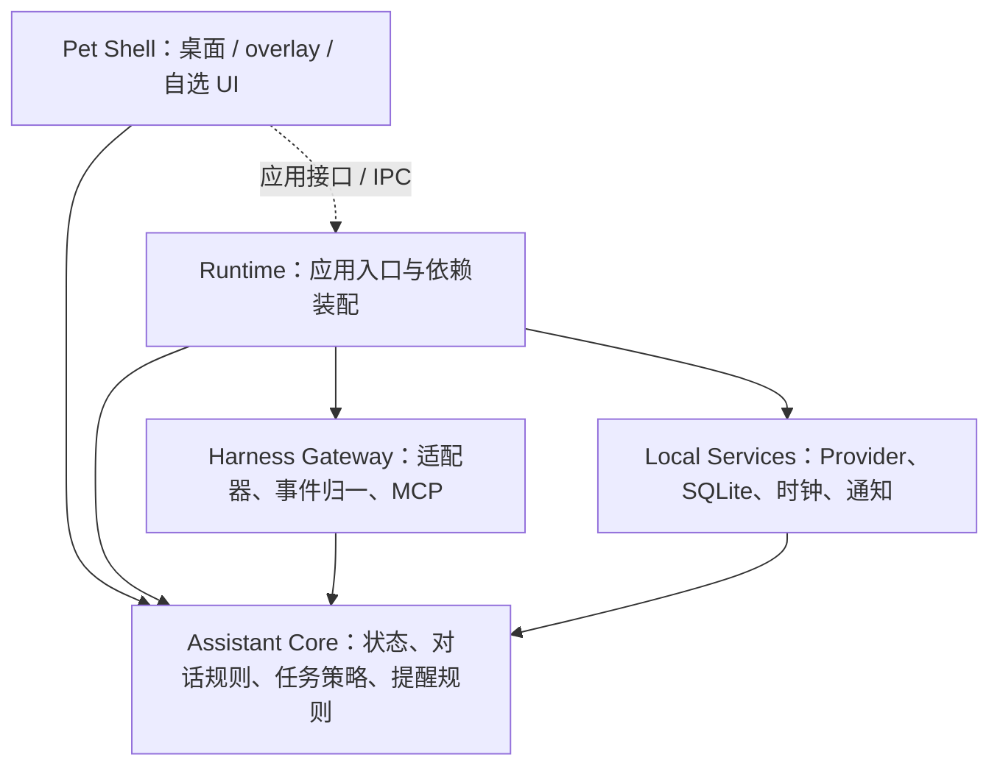

# Maneki 架构设计

> 状态：v0.3 设计基线（M1 实现中），修订于 2026-10-31；Core 与前端已验证，原生桌面尚未验收。
> 本文是架构、契约和安全规则的唯一事实来源。示例是待实现契约，不代表已经支持某个产品或平台；路线图中的验收通过后才可声明支持。
> 领域用语见 [GLOSSARY.md](../GLOSSARY.md)，历史取舍见 [ADR](./adr/0001-shared-local-runtime.md)，本轮审计与处置见 [审计报告](./audits/2026-10-30-design-audit.md)。术语与 ADR 不另立一份实现规范。

## 1. 目标、范围与不变量

Maneki（小招）是以桌宠为交互入口的本地个人助理，也是用户与 AI 编程 harness 之间的任务中间人。

| 场景 | 输入与结果 | 必须保持的规则 |
|---|---|---|
| 陪伴与形象 | 自定义动作包、点击/拖拽、主动搭话 | 形象不绑定模型、语音或 harness；素材不执行代码 |
| 对话 | 文字或语音输入，文字和可选语音回答 | 文字始终可用；关闭语音后不加载语音模型、不占用麦克风 |
| 记事提醒 | 用户确认的内容与时间，持久化并到点送达 | 时间不明确先确认；重启可恢复；勿扰与通道策略统一 |
| 任务代理 | 选择项目/会话，派发、跟踪、补充输入、返回产物 | 路由明确；派发授权与执行审批分开；不重复执行未知结果的提交 |
| harness 接入 | 适配器或 MCP 驱动宠物 | 能力如实声明；不把单向表达接入宣传为完整双向代理 |

非目标：云端多用户 SaaS、通用 IM/完整项目管理、移动端、重造 harness 的模型推理与工具执行系统。社区市场和多宠不是首个可用版本的前置条件。

首个可用版本优先交付 **可换装桌宠 + 一个真实 harness 的文字任务中间人 + 插件入口**；语音、主动陪伴与记事提醒继续作为独立增量，不阻塞该版本。首个目标先验证 dsh，pi 为第二目标；这是验证优先级，不是已支持声明。首版为派发任务新建受控会话，已有会话只观察；任务内补充输入仍回到原任务，不接管其他正在工作的会话。危险操作先使用可实际到达的 harness 原生审批界面，宠物内审批桥留作后续扩展。

架构不变量：

- Core 为纯 TypeScript，不导入 UI、Node/Rust API、数据库驱动、具体 Provider 或 harness SDK；副作用经注入的 Interface 完成。
- 只有 Runtime 装配具体依赖、管理生命周期和执行本机策略；Shell 负责交互，不能直接持有数据库或 Provider 密钥。
- 主动行为的触发、防打扰、权限与路由由确定性规则裁决；LLM 只能生成候选意图、内容和摘要，不能修改这些规则。
- 模型输出、harness 输出、记忆、插件内容都视为不可信数据；结构化工具调用也必须校验来源、参数和授权。
- 本地优先；启用外部服务必须显式选择并展示将发送的数据。“关闭 Maneki 云端能力”只控制自身 Provider；harness 的云端使用与数据去向单独授权，不能把本机 CLI 描述为本地推理。任何一侧均不通过静默回退更换数据目的地。

## 2. 模块分工、依赖与运行形态

### 2.1 四类职责与装配入口

保留 Shell / Core / Gateway / Local Services 四类职责，但不再把逻辑分层画成 Core 依赖具体 IO 的编译依赖链。



实线表示编译依赖，虚线表示跨进程调用；Gateway / Local Services 实现 Core 定义的端口。执行时 Core 可调用注入的端口，不导入具体实现。Shell 仅导入 Core 中可复用的状态/类型/纯函数与客户端契约，不导入 Node Runtime 服务实现；业务规则只在 Core 保留一份。HTTP、WS、MCP 是入口与传输，不是领域逻辑的拥有者。

| Module | 拥有的行为 | 不负责 |
|---|---|---|
| Pet Shell | 动画播放器、输入、气泡、设置与审批展示、音频设备交互 | 调用任意命令、保存密钥、决定授权 |
| Assistant Core | PetState、意图分流、对话编排、Task Broker 状态/策略、主动性与提醒规则；所需端口与领域数据 | 协议解析、磁盘、网络、具体模型推理 |
| Harness Gateway | HarnessAdapter 注册、宿主协议转换、事件归一、MCP 表达工具 | 替用户授权、将任意输出解释为命令 |
| Local Services | 具体模型/语音 Provider、存储、系统时钟与通知、审计写入 | 绕过 Core 策略直接触发任务 |
| Runtime | 组合以上 Module、应用接口、鉴权、单实例、数据库事务、生命周期、恢复与资源限额 | 通用插件框架、分布式服务治理 |

不建设全局 service locator、通用工作流 DSL 或跨机器消息总线。先用显式构造注入和进程内事件；一个 Provider 更换只影响对应 Adapter 与装配，不要求修改 Core。

### 2.2 目标目录与依赖约束

随里程碑创建实际需要的目录，不提前建空包：

```text
apps/
  desktop/              # M1：Tauri v2 Shell 与受限原生桥
  dsh-plugin/           # M2b：首个插件入口，不等待语音与提醒
packages/
  core/                 # M1：PetState 先行，逐步加入纯 TS 规则与端口
  runtime/              # M2：应用装配、本地服务、存储及 Provider 实现
  gateway/              # M2：归一契约、Adapter 注册与 MCP 桥
  adapters/<harness>/    # M2 起：有真实接入证据后添加独立适配包
```

`@maneki-pet/*` 为 npm scope。初期 Provider 实现放 `runtime` 内，出现独立发布/复用需求后才拆包；不为每个 Interface 提前建一个 workspace。渲染器先放 Shell；跨 Shell 的动画选择/物理计算只抽纯函数，不将 DOM 或 WebView 依赖带入 Core。

### 2.3 进程与生命周期

Maneki 安装一次 **共享本地 Node Runtime**，桌面与插件均可连接或受控启动它，不要求先打开桌宠 App。桌面版仍采用 Tauri v2 Shell，Runtime 可随安装包以 sidecar 分发，但其生命周期不绑定某个窗口或插件宿主进程。M1 验证透明窗；M2 必须验证无桌宠窗口的 Runtime 启动/连接、发行打包、IPC、关闭与总内存，达不到预算再依据证据修订。Tauri WebView 不假定存在 Node 环境。[官方 sidecar 说明](https://v2.tauri.app/learn/sidecar-nodejs/)

- 每个本地用户配置目录只运行一个 Runtime；通过本机实例锁与受控发现元数据避免重复进程，SQLite 连接仅由 Runtime 拥有。崩溃后核验锁持有者，不盲删锁。
- 关闭窗口、关闭插件或宿主退出只断开该客户端，不停止已授权任务的后台跟踪；安装与首次启用时明示此行为，并提供受信本机管理入口查看状态和“退出助理”。该入口不能依赖先打开桌宠窗口；具体托盘/管理命令随 M2 验证，开机自启动默认关闭。
- 共享启动器只启动已安装、来源可信且版本相容的 Runtime 固定入口；使用实例锁合并并发启动，不运行插件/模型给出的命令。首次配对通过本机受信入口确认；缺安装、版本不匹配或配对失败要明确提示，不静默下载/提权/安装。启动描述与凭证见 §6.1。
- overlay 连接共享 Runtime，不私建另一份记忆/任务数据库；本机服务未运行时可走已安装启动器按需启动。卸载/撤销某个插件仅撤销该客户端连接与凭证，不删除共享数据、不关闭其他客户端的任务。具体安装与启动命令在 M2b 验证后写入用户文档。
- npm 库模式可以仅嵌入 Core 并注入自己的端口；不必启动 Node 服务、监听端口或安装语音模型。需要完整本地能力时再嵌入/连接 Runtime。
- “退出助理”负责结构化关闭：停止接收新任务、保存状态、撤销本机待决审批、取消 Provider 请求、停止音频、释放数据库与实例锁。只终止助理自己的服务/推理进程；harness 执行进程不能作为普通 sidecar 一并杀掉，退出前提示外部任务可能继续、跟踪会停止。需要取消任务须另走 Adapter 并确认结果。退出期间不通知，下次启动按 §4.4 与 §5.3 恢复；原生审批仍由 harness 决定超时/拒绝，Maneki 不自动放行。
- 每个已启用 Module 具备启动/就绪/降级/停止状态；不支持或初始化失败应显式呈现。配置更换只影响对应能力；不在任务中途自动更换 harness 或把本地请求转给云端。

Runtime 采用发行包自带的运行时或自包含二进制；用户无需手动安装 Node。若平台的 sidecar 进程随 Shell 关闭而必然终止，M2 必须采用能独立维持生命周期的受信启动方式并验证，不能声称仅修改关闭按钮便已支持后台 Runtime。具体打包工具、SQLite 驱动、OS 通知桥在 M2 以最小 spike 验证后落定；不得把未验证的打包能力当已完成。

## 3. Pet Shell 与动作包

### 3.1 动画与交互

- 透明视频 `video-alpha` 为主，`spritesheet` 为兼容性/资源兜底；播放器根据能力选择素材。VP9-alpha WebM 与 HEVC-alpha MOV 是待测组合，不能把浏览器可播放等同于 Tauri 三平台已验证。
- Core 给出 `PetState` 和动作意图，Shell 处理解码、渲染和输入。状态集合固定为 `idle / thinking / working / waiting_input / celebrating / error / sleeping`。
- Core 的动画链接收状态变更、动作请求与 clip 结束事件，并返回当前应播放的 clip；随机数由调用方注入，Core 不读取时钟、DOM 或播放器。状态 clip 结束后按对应状态的权重选择下一个 clip；权重为零的 clip 不得被选中。
- 每次播放返回递增的 playback ID。只有当前 playback 的结束事件才能推进动画链，打断前的迟到结束事件必须忽略。缺失的非 `idle` 状态回退到 `idle`。
- 动作包含有序 clips、非负整数 `priority` 与 `interruptible`。动作请求只在无活动动作，或活动动作可打断且新优先级不低于它时接受；动作结束后回到调用方最新设置的 PetState。PetState 变更始终抢占动作，以免装饰动作掩盖真实任务状态；`interruptible` 只限制其他动作请求。
- 点击、拖拽、甩抛计算接收显式时间与几何参数；窗口移动、多屏/DPI、鼠标穿透由 Shell/原生桥负责。
- M1 提供默认形象和第二个最小测试包验证换装；用户可导入自制包，不以社区市场为前提。

### 3.2 动作包 v1 最小契约

M1 固定 v1 的加载语义与 JSON Schema。包根目录的描述文件名为 `pet-pack.json`，独立完整性清单为 `assets.manifest.json`；其他扩展主版本一律拒绝。最小有效结构如下，生产包不得省略清单：

```json
{
  "schemaVersion": 1,
  "id": "xiaozhao-default",
  "name": "小招 · 招财猫",
  "version": "1.0.0",
  "permissions": [],
  "clips": {
    "breathe": {
      "sources": [
        { "renderer": "video-alpha", "path": "assets/breathe.webm", "mimeType": "video/webm" },
        {
          "renderer": "spritesheet",
          "path": "assets/breathe.png",
          "mimeType": "image/png",
          "frameWidth": 128,
          "frameHeight": 128,
          "frameCount": 2,
          "framesPerSecond": 2
        }
      ]
    }
  },
  "states": {
    "idle": { "clips": ["breathe"], "weights": [1] }
  },
  "actions": [
    { "id": "wave", "clips": ["breathe"], "priority": 1, "interruptible": true }
  ]
}
```

`assets.manifest.json` 的结构为 `{ "schemaVersion": 1, "algorithm": "sha256", "files": [{ "path", "sha256", "bytes }] }`。`sha256` 是素材原始字节的 64 位小写十六进制摘要，`bytes` 是非负安全整数。每个 clip source 必须有同路径清单项，每个清单项必须至少被一个 source 引用，同一路径只能登记一次；安装器必须对实际文件重新计算哈希和大小，不能只相信清单值。

- `idle` 与至少一个 source 必需；其他状态缺省回退 `idle`。所有 clip/state/action ID 与引用必须唯一、存在，状态名不得超出固定集合。权重数量匹配、为有限非负数且和大于零；动作 clips 至少一项。
- v1 对 JSON 对象拒绝未声明字段。`permissions` 只接受空数组；不加载 JS、HTML、SVG 或远程资源。source MIME 仅允许 `video/webm`、`video/quicktime`、`image/png`、`image/webp`，renderer 与 MIME 必须匹配。精灵图必须提供正整数帧宽高/帧数及有限正帧率。
- 所有素材路径使用 `/` 分隔并相对包目录，拒绝反斜杠、绝对路径、盘符、UNC、空段、`.`、`..`、控制字符与描述/清单文件路径。安装器还须在真实路径层拒绝符号链接或 junction 逃逸。
- v1 每包最多 128 个素材，单文件最多 64 MiB，清单合计最多 256 MiB。安装器验证 JSON/图片/视频实际字节、媒体规格与上述限额，并防止超额输入和解压炸弹；v1 不内置压缩包解压语义。
- 校验失败不得修改当前包。安装按 `id/version` 写入新目录，完整校验后原子切换活动版本；失败保留旧版本。哈希仅验证完整性，发布者信任另见 §7.5。
- 素材配方、转码/抠像脚本和授权说明入库；大渲染产物 ignore，发行渠道另行分发。AI 生成可重复运行不代表逐像素确定性，记录模型/版本/提示词/参数与输出哈希。

### 3.3 桌面壳选型与验证

Tauri v2 优先，Electron 保留备选。M1 测透明窗、透明视频/精灵图切换、点击穿透、多屏 DPI 与托盘；M2 追加 Runtime 后重新测总占用。先在 Windows 完成可用基线，macOS/Linux 分别记录真实设备/CI 证据与限制；本机未验证的项保持未勾选。

若某平台视频透明失败，先尝试精灵图兜底；只有证据表明 Tauri 的窗口/媒体/集成限制使目标不可达时才讨论切换 Electron，并同步性能预算与迁移影响。不引用未经本项目测量的内存基线作为结论。

## 4. Assistant Core 与可插拔能力

### 4.1 Interface 与 Provider

只为当前确实变化的能力设置端口，不定义一个包含所有功能的万能 Provider。Core 使用与厂商无关的数据；Provider Adapter 转换协议与错误，Runtime 注入实现。OpenAI 兼容协议是首个模型 Adapter 的选项，不能成为所有端口的共同约束。

| 能力 | 端口/职责 | 初始实现与关闭行为 |
|---|---|---|
| 对话模型 | `ChatProvider`：候选回答/意图生成 | 先实现一个 OpenAI 兼容 Adapter；本地/云端端点显式选择，关闭后保留确定性命令、提醒与状态联动 |
| 语音识别 | `SpeechRecognizer`：音频转文字 | whisper.cpp 本地优先；缺模型不自动下载或切云端，退回文字输入 |
| 语音合成 | `SpeechSynthesizer`：文字转音频 | 首个本地 TTS 实现 M3 验证；可单独替换/关闭，关闭后气泡/系统通知继续工作 |
| 音频设备 | Shell 音频端口：采集、播放、释放 | 宿主适配设备与系统授权；不交给模型操作麦克风 |
| VAD / 唤醒 | 可选音频检测 Adapter | 按需开启；未安装/关闭不影响按键说话，M3 基线不要求常驻监听 |
| harness | `HarnessAdapter`：会话/任务/审批协议转换 | 见 §5；不支持某能力时显式拒绝，不能猜测通用命令 |
| 背景记忆 | `ExternalMemoryProvider`：外部记忆检索与写回，首个实现走 MCP 客户端 | 可选接入用户自建记忆服务；关闭或故障时提醒、记事、文字派发照常（见 §4.4） |
| 通知/存储/时钟 | 系统端口、事务仓储、可注入时钟 | 本地实现；Core 测试可替换，SQLite 保持默认存储，不提前支持多数据库 |

最小 Provider 契约示意（v1 先采用有界音频段，流式能力以后按真实实现扩展）：

```ts
interface CallContext {
  requestId: string;
  signal: AbortSignal;
  deadlineAtMs: number;
}

interface ProviderInfo {
  id: string;
  apiVersion: 1;
  locality: "local" | "cloud";
}

interface AudioData {
  bytes: Uint8Array;
  mimeType: string;
  sampleRateHz?: number;
}

interface ChatProvider {
  info: ProviderInfo;
  reply(input: { messages: { role: "system" | "user" | "assistant"; text: string }[] },
        ctx: CallContext): Promise<{ text: string }>;
}

interface SpeechRecognizer {
  info: ProviderInfo;
  transcribe(audio: AudioData, ctx: CallContext): Promise<{ text: string }>;
}

interface SpeechSynthesizer {
  info: ProviderInfo;
  synthesize(input: { text: string; voiceId?: string }, ctx: CallContext): Promise<AudioData>;
}
```

`ChatProvider.reply` 的回答按数据处理；结构化意图须经独立 Schema 校验和 Core 授权，不从文字中提取“隐含命令”。v1 不提供模型直连 shell 的工具。采样率、编码、单段大小/时长在 Provider 能力与媒体校验中协商，不要求所有实现支持相同音色/语言/流式协议。

所有调用遵守统一语义：超时与取消可区分、错误可展示但脱敏；同一 request 的迟到结果不覆盖新结果。Adapter 必须转发取消并释放资源；无法中止的本地推理丢弃迟到结果并受并发上限约束。模型/语音队列有界，不阻塞动画、审批或提醒调度。

Provider 的本地/云端声明由受信实现与实际端点配置共同核验；禁止本地实现隐式转发外网。云端关闭会中止在途云请求、丢弃迟到响应并阻止新请求，已经发出的数据无法撤回。默认不把项目源码、长期记忆或原始音频整包发送给对话模型。

设置使用准确名称“关闭 Maneki 云端能力”，不承诺阻止外部 harness 联网。任务派发另展示已选 harness 的数据目的地与授权范围；去向未知时明确标注，不可冒充全本地。用户未授予该目标的数据授权时不派发，授权后也不能静默改目标或扩大数据范围。严格离线执行不在首版承诺内；以后支持时需验证执行环境与 Adapter，不能仅看回环地址。

**收费调用与支付行为分开**：配置密钥不等于授权调用；用户明确启用某 Provider、调用类型与范围后，交互调用可持续使用，不逐轮弹支付审批。主动收费调用默认关闭，需单独开启并设置非零的次数/token/音频时长等可执行限额；不清楚单次成本或无法给出保守上界时禁止主动收费调用。达到限额或计量失效即停止后续调用并提示，不能切换账号/Provider 绕过。金额估算与真实账单分开，无法实时结算时不承诺绝对金额封顶。harness 发起的购买、支付、开通服务仍属于 §5.4 的逐次操作审批，Maneki 的 Provider 预算不代表约束 harness 自身账单。

**用量与上下文限额三层配置化**：① 单次调用限额——交互调用与主动调用都有默认保守的输入/输出 token 上限，可按 Provider 覆盖；② 会话上下文预算——主/子会话历史维护滚动窗口，超限按配置摘要压缩、截断或拒绝，默认摘要压缩；③ 周期总额——每日 token/费用上限默认约束主动收费调用，交互调用总额可显式开启。到达限额即停止后续调用并提示，不能切换账号/Provider 绕过；剩余额度、降额与停用状态在界面如实呈现，不隐藏降级。

### 4.2 对话与主动语音交互

```text
文字输入 ────────────────────┐
按键采集 → ASR → 转写文字 ────┼→ 同一意图分流 → 对话 / 记事 / 任务
可选唤醒 → 有限采集 → ASR ────┘                    ↓
                                              气泡 + 可选 TTS
```

- 默认文字 + 按键说话，麦克风仅在明确采集阶段开启；用户可以分别开启 ASR/TTS，允许“文字输入、语音回答”或“语音输入、文字回答”。
- 主动对话由事件触发邀请：宠物先以气泡/可选 TTS 开口，用户点击回应或在已明确授权的短时对话模式中回答；每轮完成、超时、麦克风禁用或取消立即释放采集。勿扰生效时终止尚未由用户主动回应的邀请采集，但不终止用户主动按键发起的一轮。主动播报本身不能自动授权常驻麦克风。
- 半双工为首个可用版本：播报时不把自身声音再次提交为用户命令；用户点击/按键可打断播放并开始一轮采集。回声抑制、VAD 插话和全双工需要独立设备验证，作为可选增强，不宣称已支持。
- 开启唤醒/连续对话必须显示持续状态、提供一键停止和采集超时，原始音频默认仅在内存中使用；设备拒绝、被占用、ASR 失败均回到文字入口。语音不能自动批准危险操作，审批需受信 UI 明确动作。
- 主会话是用户与助理唯一常驻对话入口，所有意图从主会话分流；子会话绑定到具体 harness 会话或助理任务，用于查看进度、回答等待输入并保留交互记录。子会话绑定的项目指令与上下文只在子会话内注入，不携带进主会话，置顶/常驻项目可配置；子会话上下文组装同受 §4.1 的会话上下文预算约束。

多个 Shell 表示同一助理的多个视图。Runtime 为一次语音交互分配唯一 owner 与有时限的租约：用户在某界面发起时由该界面持有，其他界面只显示文字；主动 TTS 仅发往用户选定的可用输出端，无可用端则退为文字。客户端凭租约才能采集/播放，失联、过期或被明确切换时停止设备并释放；Runtime 不确认旧 owner 已停用或租约已过期前不发放第二份。M3 验证断网时客户端也能按租约到期自行停止，不用隐式抢麦/抢播解决冲突。

### 4.3 PetState 与主动性

任务状态、对话状态与宠物表现分开保存；PetState 是可重新计算的展示状态，不能据宠物动画推断任务执行结果。

```text
idle → thinking / working → waiting_input → working → celebrating / error → idle
idle ↔ sleeping
```

多任务默认展示当前用户关注的项目/任务，后台任务记入列表；待输入/审批只在防打扰规则允许时提示。其他会话的 idle 不覆盖当前任务的 working；庆祝为限时动作，结束后重算状态。

主动性 = `已验证触发器 × 防打扰预算 × 可用通道`。触发器包括提醒、任务完成/需输入、用户明确允许的存在感知和问候；存在感知不默认截屏或监听内容。碎碎念（murmur）与每日简报（daily briefing）是低频轻量类别：触发由确定性规则决定——空闲时长、任务事件、时段，或每日简报由用户配置的时间点；内容可确定性汇总任务状态、到期提醒与会话动态，LLM 只生成话术。两者纳入防打扰预算，默认低频，碎碎念可单独关闭，每日简报默认关闭，勿扰内完全静默；主动内容当日失效、无料不发，没有新内容不硬凑打扰。LLM 失败时用固定文案，不阻止真实提醒。

三个偏好独立且不共用“静音”一词：

| 偏好 | 生效范围 | 用户主动交互 |
|---|---|---|
| 勿扰 | 抑制 Maneki 主动气泡弹出、声音、系统通知和抢注意动作，保留待查看事项 | 主动打开面板、按键说话可以使用已启用通道 |
| 语音输出关闭 | 禁止所有 TTS/交互音效，并停止在播声音 | 保留文字与已获授权的语音输入 |
| 麦克风禁用 | 所有模式禁止采集，立即关闭设备/唤醒与在途录音处理 | 仅文字输入，不能由按键或模型绕过 |

默认勿扰时段高优先级不穿透；用户可单独授权特定类别/通道例外，但例外不能覆盖语音输出关闭或麦克风禁用。外部 MCP 客户端不能通过 `urgency` 绕过规则。勿扰导致审批无人响应时保持阻塞，bridge 超时拒绝，原生审批按 harness 的拒绝/等待规则处理，不能自动放行。Maneki 不承诺控制 harness 自己发出的系统提示。

### 4.4 记忆与提醒可靠性

- 存储由 Runtime 的 SQLite 仓储实现；Core 定义记事、检索、到期判断、确认和重提规则。记忆内容不能提升权限或被当系统指令；支持查看、删除与保留期限，日志不包含原文。
- 结构化事实（提醒、记事、会话历史）由内置 SQLite 仓储承载；背景知识与长期个人记忆可接入外挂记忆（用户自建的外部记忆服务，首个途径为 MCP 客户端）。两层互不混写、互不依赖：外挂记忆关闭或故障时，提醒、记事、文字派发与状态联动照常；外挂记忆内容按数据渲染，不作为提醒调度的事实源。
- 写回外挂记忆的粒度配置为关闭/仅摘要/全量原始，默认全量原始；全量原始覆盖助理侧产生的记录（主会话对话、子会话交互、任务状态与结果、记事），不复制 harness 自己的会话存储。启用外挂记忆时单独授权一次，展示数据去向与内容范围；写入开关独立于读取开关。
- 显式记忆（用户主动要求记住）与隐式引用（对话历史背景检索）分别配置开关；界面明示"删除助理会话不删除已写回外挂记忆的副本"，删除入口分列并指向记忆系统侧。
- 单次提醒为 v1 基线：存 UTC 到期时间、原始时区和用户确认的文案；相对时间锚定创建时刻。歧义日期/时区先确认；重复日程与夏令时规则在扩展时另定，不默默猜测。
- 提醒记录及待投递记录在同一数据库事务写入；调度按最近到期唤醒，并在启动、恢复休眠和时钟变动后重新扫描逾期项。并发调度以数据库约束认领，不能两个 Shell 各自触发。
- 使用稳定 `reminderId + occurrenceId + channel` 去重。承诺本地至少一次投递尝试，不承诺用户一定看见或外部通知严格一次；发送后、记账前崩溃可能重投，Shell 应按 ID 合并。
- 勿扰期间到期的提醒保留待处理，恢复后合并补发并显示原到期时间；用户可选择忽略过期提醒。语音输出关闭时仅跳过声音，不阻塞其他已授权通道。未确认重提默认关闭，启用时次数/间隔受预算限制。
- 发送成功、系统通知受理、用户确认是不同状态；OS 拒绝通知时显示投递失败/待查看，不伪报“已提醒”。

### 4.5 技能扩展

技能与形象、语音、harness Adapter 分开：技能提出对话工具/主动触发器/面板动作；执行请求仍进入同一 Core 策略与任务授权链。内置能力（动作包、Provider、Adapter、技能、主动触发器、面板组件）走同一插件接口，内置实现随应用发行；纯数据包（形象、话术模板、提醒文案）可先于第三方代码开放社区安装。M1–M5 不提供任意 npm 包动态执行入口，M6 的第三方可执行技能必须先达到 §7.5 隔离验收，再开放安装。

## 5. Harness Gateway 与任务闭环

### 5.1 能力声明与最小 Adapter Interface

适配器转换宿主协议，不成为第二个 Agent。事件观察、新建任务、继续会话、回答输入、状态查询、取消、审批桥接是不同能力；每个适配器记录已验证的宿主版本、平台、数据边界与限制。首版只开放新建受控会话、自己的任务输入/取消与已有会话观察；`continueSession` 和 bridge 字段为后续扩展，不是首版必需实现项。

会话总览与介入按能力分级，均为正式需求，实现窗口在 M5（依赖 M2 记录的宿主能力 spike）：

- `sessionOverview`：按最近活动返回会话概览列表（状态、最近活动时间、标题/摘要），展示范围可配置，默认最近 10 个。数据只来自 Adapter 声明的能力；扫描宿主本地会话存储只能是特定 Adapter 的内部实现细节并单独声明数据边界，Core/Gateway 不做跨 harness 通用扫描器。`listSessions` 与 `SessionOverviewItem` 契约在 M5 落地时细化。
- `externalReply`：回答非派发会话的等待输入，仅限非审批的 `task.needs_input`，须用户按来源显式授权；不发送新工作、不接管会话语境，开放前验证目标会话的繁忙/续接语义。审批类提示不走此通道，仍按原生审批路由跳转。
- 完全接管已有会话与宠物内审批桥维持 M5 以后按需另验，不因总览/回答能力提前开放。

```ts
interface HarnessSession {
  sessionId: string;
  workdir: string;
}

interface SessionOverviewItem {
  sessionId: string;
  workdir: string;
  lastActiveAt: string;
  state: "busy" | "idle" | "waiting_input" | "waiting_permission" | "unknown";
  title?: string;
}

interface TaskRequest {
  brokerRequestId: string;
  prompt: string;
  target: { kind: "new"; workdir: string }
        | { kind: "existing"; sessionId: string; workdir: string };
}

interface TaskRef {
  brokerRequestId: string;
  taskId: string;
  sessionId: string;
}

type TaskStatus = "queued" | "running" | "waiting_input" | "waiting_permission"
                | "completed" | "failed" | "cancelled" | "unknown";

interface TaskSnapshot {
  ref: TaskRef;
  status: TaskStatus;
  completeness: "full" | "status_only";
  sourcePosition?: { streamId: string; sequence: number };
  result?: { summary?: string; artifacts: string[] };
  pendingInput?: { inputId: string; question: string };
  pendingApproval?: { mode: "native"; routeId: string }
                  | { mode: "bridge"; request: PermissionRequest };
}

type TaskQueryResult = { outcome: "found"; snapshot: TaskSnapshot }
                     | { outcome: "not_found" | "unknown" };

interface PermissionDecision {
  operationId: string;
  permissionId: string;
  operationDigest: string;
  decision: "allow_once" | "deny";
}

interface OperationSnapshot {
  operationId: string;
  operationDigest: string;
  approval: "pending" | "allowed" | "denied" | "expired";
  execution: "not_started" | "in_progress" | "completed" | "unknown";
  result?: { outcome: "succeeded" | "failed"; summary?: string };
}

type OperationQueryResult = { outcome: "found"; snapshot: OperationSnapshot }
                          | { outcome: "not_found" | "unknown" };

interface HarnessAdapter {
  id: string;
  apiVersion: 1;
  dataBoundary: {
    processing: "local" | "cloud" | "unknown";
    destinations: string[];
  };
  capabilities: {
    events: boolean;
    newTask: boolean;
    continueSession: boolean;
    reply: boolean;
    query: "full" | "status_only" | "none";
    cancel: boolean;
    deduplicateSubmit: boolean;
    approval: "native" | "bridge" | "none";
    sessionOverview: boolean;
  };
  discover(ctx: CallContext): Promise<HarnessSession[]>;
  subscribe(cb: (event: HarnessEvent) => void, ctx: CallContext): Promise<() => void>;
  submit?(req: TaskRequest, ctx: CallContext): Promise<TaskRef>;
  query?(key: { brokerRequestId: string }, ctx: CallContext): Promise<TaskQueryResult>;
  reply?(ref: TaskRef, input: { inputId: string; text: string }, ctx: CallContext): Promise<void>;
  listSessions?(query: { limit?: number }, ctx: CallContext): Promise<SessionOverviewItem[]>;
  cancel?(ref: TaskRef, ctx: CallContext): Promise<void>;
  decidePermission?(decision: PermissionDecision, ctx: CallContext): Promise<OperationSnapshot>;
  queryOperation?(key: { operationId: string }, ctx: CallContext): Promise<OperationQueryResult>;
}
```

能力与方法在注册时一致性校验；未声明/未实现的操作返回 `UNSUPPORTED`，不运行兜底命令。`discover` 不支持自动发现时返回显式配置的会话列表，空列表不代表接入已就绪。`CallContext` 见 §4.1，仅作调用关联/取消，不替代业务幂等键；`HarnessEvent` 见 §5.2。`TaskRequest` 不接受外部传入的 `confirmPolicy`；策略由 Runtime 根据用户设置与当次授权计算。dataBoundary 来自受信 Adapter 与用户实际端点配置，未知目的地明确告知并单独确认，不根据 CLI 在本机或模型自述推断本地处理。

`query: full` 要求恢复与当前状态相符的完整快照：completed 必须有 result（允许明确的空产物集合）；waiting_input 必须有待答问题与 inputId；waiting_permission 必须有可用的原生路由或 bridge 请求。不能恢复的字段不填虚构值，应返回 status_only/unknown 并标明交付或等待详情缺失；not_found 也不能自动推出“从未执行”。首个可用版本的执行 Adapter 必须通过完整快照恢复验收，否则仅作为有限观察接入，不宣称可靠任务闭环。事件重放可用于实现该快照，但不新增一套通用历史总线。

上游 harness → Runtime 的恢复也必须无缝衔接，不能只保证 Shell → Runtime：`subscribe` 成功表示上游订阅已就绪，此时 Runtime 已缓冲事件，再调用 query 取快照。Adapter 应提供同会话流的 sourcePosition，让快照与后续事件按位置合并；若宿主没有可用版本/游标，Adapter 必须验证另一种等效的一致快照与订阅衔接方式，不能仅凭本地到达计数假造源位置。无法证明无遗漏或无法排除旧待输入事件重开时，不声明 full。订阅初始化超时不进入已连接状态；成功后由返回的注销函数、signal 或源断线结束订阅，deadline 仅限制建立阶段。

任务派发至少需要经验证的 `native` 或 `bridge` 执行审批模式；`approval: none` 只允许观察/表达。`native` 表示危险操作由 harness 原生机制阻塞并在其受信 UI 确认，Maneki 不代替批准；`bridge` 表示操作在执行前暂停，并能按 §5.4 往返确认。两者均需真实危险操作的拒绝测试，不能仅凭字段声明启用派发。普通 hooks/MCP 能收到事件不代表具备这些能力。

首版以 native 为出口：验证任务会话中真实的审批提示可被用户到达、拒绝确实阻止操作、无人响应不自动放行；不能以无人可交互的 CLI 参数模式冒充原生审批。Maneki 对原生操作不发 `decidePermission`。bridge 是 M5 以后按真实宿主能力评估的可选项，只有 `decidePermission + queryOperation + 执行侧持久化单次消费` 全部验证后才能声明支持。

### 5.2 归一事件与路由

```ts
interface HarnessEvent {
  eventId: string;
  adapterId: string;
  sessionId: string;
  taskId?: string;
  brokerRequestId?: string;
  occurredAt: string;
  sequence?: number;
  streamId?: string;
  payload:
    | { type: "task.started" | "task.progress"; summary?: string }
    | { type: "task.needs_input"; inputId: string; question: string }
    | { type: "permission.requested"; mode: "native"; routeId: string }
    | { type: "permission.requested"; mode: "bridge"; request: PermissionRequest }
    | { type: "task.completed"; summary?: string; artifacts?: string[] }
    | { type: "task.error"; message: string }
    | { type: "task.cancelled" }
    | { type: "session.idle" }
    | { type: "session.busy"; state: "thinking" | "working" | "waiting" };
}
```

- task/permission 事件必须携带 `taskId`；已由 Maneki 提交的任务还需映射到持久化 `brokerRequestId`。Runtime 根据适配器连接身份绑定 `adapterId`，不接受客户端冒充其他来源。
- 原生审批事件只提供受限路由让用户返回 harness，bridge 才提供待批操作快照；二者不可混用。Adapter 不得把权限提示伪装为可通过普通 reply/语音回答的问题，task.needs_input 只承载非审批的任务补充输入。
- 使用 `adapterId + sessionId + taskId` 定位任务，workdir 规范化后绑定目标；UI 派发前显示项目与会话，歧义时要求选择，不自动发往“最近会话”。路径校验见 §7.4。
- `eventId` 在重放时保持稳定；来源无法提供稳定 ID 时由 Adapter 结合宿主记录定位生成，重复任务终态另以状态与副作用 ID 防重。有 `sequence` 时在同 sessionId + streamId 流内单调校验，快照位置与事件位置使用同一语义；宿主重启导致序列复位须更换 streamId 并重新校准。没有源位置时靠已验证的 Adapter 一致性机制与查询校准，不以时间戳猜测严格顺序。终态不能被迟到 progress 覆盖。
- 高频 progress 可合并；开始、需输入、审批、终态与确认结果持久化。WS 断线后取同一一致性边界的任务快照与 Runtime 游标，再订阅该游标之后的增量，避免快照与订阅间漏事件；游标有界缓冲已丢失时要求重取快照，不承诺无限历史回放。
- 输出摘要、产物路径和跳转链接都按数据处理；宿主特有状态转换集中在各 Adapter，不泄露到 Core/Shell。

### 5.3 Task Broker 与失败恢复

```text
文字/转写 → 意图候选 → 校验目标、能力与用户策略 → 用户确认派发
  → 入口幂等键映射 brokerRequestId，持久化目标/授权 → Adapter.submit
  → 已接收 / 提交结果未知 → 事件或查询校准
  → 需输入 / 需审批 → 指定任务响应
  → 已完成 / 已失败 / 已取消 → 验证产物引用 → 通知交付
```

- 派发 `confirmPolicy` 默认 `ask`，`deny` 禁止派发，`auto` 仅在用户明确配置的任务范围内免除整任务确认；它们均不能豁免危险操作逐步审批。模型、MCP 客户端、普通插件不能修改策略。
- Shell 为一次派发生成 clientRequestId，网络重发沿用该 ID；Runtime 按受信客户端身份 + clientRequestId 唯一约束认领，在同一事务中分配全局唯一 brokerRequestId，保存不可变请求快照与授权后才提交。相同入口键但内容/目标不同拒绝；Adapter 的 submit/query/去重一律使用 brokerRequestId，不使用客户端裸 ID，映射重启后仍保留。
- 自动重试提交必须同时满足 Adapter 可按 brokerRequestId 去重、请求内容一致且结果可核查。提交超时/崩溃后先查询，not_found/unknown 或不可核查时均不盲重发。不同入口 ID 的相似文字不靠模型猜测合并。
- 首版新建受控会话，保留项目绑定与任务内补充输入，不向其他已有会话发送新工作。Maneki 管理的同一项目默认串行派发，队列有界，避免新建多个会话后并行修改同一工作区；不同项目可在限额内并发。此约束不能替用户锁住其他独立启动的 harness/编辑器，发现占用或冲突时提示用户处理。
- 一次输入以客户端幂等键认领并绑定原 task/inputId；收到问题的原任务才能消费，不能将未确认结果的输入自动重发或送到另一个任务。后续支持接管已有会话前需另验其繁忙/队列/续接语义。
- 超时/取消表示请求中止，不代表外部已停止。取消成功确认后才标 `cancelled`；无确认则保留未知/待核查，并提示去 harness 查看。不得把进程断线标成任务成功。
- Runtime 重启先恢复本地记录，await Adapter.subscribe 并缓冲，再查询 TaskSnapshot；按 §5.1 的源位置/等效一致性机制合并缓冲与后续事件后恢复展示，不能在查询后才订阅。仅查到 completed 但无交付信息时显示“任务完成，结果暂不可恢复”，不能伪造交付。无查询能力时显示中断/未知，不声称仍被跟踪。bridge pending 审批过期拒绝，原生审批恢复只查询/跳转，不重放批准。
- 交付包括任务结果、摘要与经校验的本地产物引用；打开文件/会话走受限路由，不从产物字符串执行 shell。未找到产物应标明，不将摘要等同于验收成功。

### 5.4 执行审批契约

首版使用原生审批；以下是未来 bridge 开放前必须满足的协议约束，不要求 M2b 实现宠物审批桥。

```ts
interface PermissionRequest {
  permissionId: string;
  operationId: string;
  sessionId: string;
  taskId: string;
  operation: {
    kind: "process" | "file_write" | "file_delete" | "network" | "payment" | "other";
    workdir: string;
    executable?: string;
    args?: string[];
    rawCommand?: string;
    targets: string[];
    contentDigest?: string;
    payment?: { amountDecimal: string; currency: string };
    description: string;
  };
  operationDigest: string;
  expiresAt: string;
}
```

- bridge 模式由可验证的宿主执行钩子在操作前发出并等待；展示完整命令/参数、工作目录、目标文件/网络/付费范围，长内容可展开但不能截断后批准。无法描述实际操作则回到原生审批或拒绝。
- 按 kind 校验必需字段：process 提供 executable/args 或完整 rawCommand；file_write 提供待写内容/差异的 contentDigest，UI 可查看实际变更；payment 提供精确金额/币种及收款目标。摘要必须覆盖这些执行数据，不能只批准一句 description 或一个文件名。
- Runtime 对完整操作快照绑定摘要、适配器/会话/任务/permission ID 与过期时间；采用标准 SHA-256 与稳定序列化，不能仅相信展示文案。执行前需由宿主校验实际操作与批准快照一致，变化必须重新审批。
- 仅受信交互界面可返回 `allow_once / deny`；用户批准一次只覆盖该操作。语音转写、Agent 文本或 MCP 工具调用不能发审批决策。重复决策幂等，过期、断线、退出、重启默认拒绝。
- 决策先持久化再传递；执行侧按 operationId + operationDigest 持久化认领一次执行权，多次 permissionId 不能获得多次执行权。批准已接收、执行进行中、执行完成和结果未知是不同状态；执行失败也不能未经新任务授权自动重做副作用。
- 批准回执丢失时先 queryOperation，不重放操作。执行中/已完成不能再次批准执行；not_found/unknown 或执行侧在调用外部副作用后崩溃均保留未知并人工核查，不能改 permissionId/operationId 后重试。同一操作只有经查询证明尚未执行且仍被阻塞时，才可因旧批准过期发新审批；新请求仍保留原 operationId 与完整快照。
- 执行侧的持久化单次认领防重复启动，不承诺外部支付/系统副作用严格一次。无法判断真实外部结果时宁可保持未知，不重新消费批准。拒绝/超时由执行侧保持阻塞；无法验证操作级查询与单次消费的 Adapter 不得声明 bridge 就绪。
- operationId 在 Adapter 范围内持久唯一，并绑定会话/任务与 operationDigest；重启或更换 permissionId 不改变原操作身份，不能在另一会话复用该 ID。Runtime 按已保存来源路由操作查询，不接受客户端任意指定其他任务的操作 ID。
- 删除、强推、付费及未知风险操作必须确认；危险命令模式清单只作附加检查，不能覆盖任意脚本、间接调用或任意 harness 的行为。原生审批也不得启用跳过权限/全局自动批准选项。
- 审计记录关联 ID、来源、操作摘要、决策、时间和结果；命令中的凭证按敏感字段脱敏。用户界面可展示完整待执行命令，默认日志不保留含密钥原文。

### 5.5 MCP 与各 harness 的接入策略

Maneki MCP Server 初始提供表达工具，不提供执行/审批工具：

| 工具 | 行为 | 里程碑 |
|---|---|---|
| `maneki_say(text, mood?)` | 气泡与已启用的 TTS | M2（TTS 随 M3） |
| `maneki_set_state(state)` | 当前来源的展示状态意图，受仲裁限制 | M2 |
| `maneki_play(action)` | 播放已安装包中的动作 ID | M2 |
| `maneki_notify(title, body, urgency)` | 受限额与防打扰控制的通知 | M2 |
| `maneki_remind(when, message)` | 创建该客户端权限范围内的本地提醒 | M4 |

外部记忆反向使用 MCP：Runtime 作为 MCP 客户端连接用户自建的记忆服务（检索与写回），与上述表达桥方向相反、权限独立，按 §4.4 的分层与授权执行。

MCP 调用按客户端身份授权、校验参数与限流；提醒是有持久化副作用的能力，需独立 scope 与用户授权，不把模型工具调用本身当用户同意。v1 不提供删除其他来源提醒、派发任务、修改策略或代批操作的 MCP 工具。

初始使用 harness 启动的 stdio MCP 桥，将表达请求转发给现有 Runtime；桥不启动另一份数据库/助理。stdout 只写 MCP 消息，日志走 stderr；启动凭证不放命令行。需要远程 HTTP 传输时另行评估，本项目仍只允许本机回环。普通 HTTP/WS 不是 MCP 传输的替代命名。[MCP 传输规范](https://modelcontextprotocol.io/specification/2025-11-25/basic/transports)

**MCP 表达接入不等于任务派发适配。** 当前工具集覆盖 harness → 宠物；反向派发/回答/取消必须由具备对应能力的 Adapter 实现；本设计不预设其他 MCP 功能自动提供这些能力。

| harness | 候选接入路线 | 验证与发布约束 |
|---|---|---|
| dsh | 宿主插件事件与 API；overlay 为独立 Shell | 首个验证目标；M2 记录版本/新会话/原生审批/完整快照证据，M2b 发布最小插件。不假定 dsh-pet 表达接口就是任务 API |
| pi | 宿主扩展/结构化接口优先，CLI 作为候选 | 第二接入目标；M2 可做轻量可行性对照，M5 按证据开放，不笼统假定“支持 MCP 即双向可用” |
| Claude Code | hooks 观察；官方 CLI/结构化接口作为候选 | 按需要作事件/接入对照，不默认取代 dsh 的首个目标；需通过同样的审批与恢复 gate |
| 其他宿主 | MCP 表达桥或专用 Adapter | 能力按验收开放；先观察后执行 |

generic-cli 仅供受信配置使用：固定 executable + argv，以 stdin 传文本，不把用户 prompt 插入 shell 模板；输出按受限结构解析。没有可验证原生/桥接审批的 CLI 不能获得通用执行能力。有 CLI 不等于安全可派发。

若 dsh 无法满足首版的新会话、原生审批或完整恢复要求，保留未完成项并记录具体版本/调用证据，明确提出收缩能力或调整适配目标；不擅自换成另一个宿主后宣称原目标已完成。契约因真实宿主证据需要修订时先改本文，不靠空实现“通过”能力检查。

## 6. Local Services、配置与可观测性

### 6.1 Runtime 应用接口

- HTTP/WS 只绑 `127.0.0.1`，使用随机令牌、按客户端授权的 scope 和 `/v1` 版本前缀；接口以 OpenAPI/消息 Schema 描述，尚未实现时不提供虚构安装命令。
- 表达、任务操作、审批和设置分权。MCP 桥只获得表达/被授权提醒权限；任务与审批仅受信 Shell 可调用。WS 握手鉴权、Host/Origin 检查与 HTTP 一致，CORS 不是鉴权替代。
- 浏览器 WS 不在 URL/query 放 token；用已鉴权 HTTP 换取一次性短期连接票据，绑定客户端、Origin 与 scope；用后失效，票据与 header 不进入日志。无 Origin 的本地工具仍须 token 与 Host 校验。
- 控制请求 Schema 限制未知字段、长度、枚举、消息/音频大小与并发；所有入口共享 Core 校验，不能只在 UI 禁用按钮。
- 连接发现元数据只含端口、协议版本、实例 ID，不含令牌；启动描述由安装器写入受控位置，固定到已安装 Runtime 的真实路径、版本与来源校验信息，插件不能任意替换。长效根令牌保存在 OS 凭证存储或用户私有权限文件中；配对由独立于桌宠窗口的本机受信管理入口发放可撤销、最小 scope 凭证，overlay 不持有根令牌。

### 6.2 持久化、配置与故障

- Runtime 单独管理 SQLite 事务与版本迁移；M2 建状态跟踪/审计所需最小表，M2b 加派发授权与审批记录，M4 增加 reminders/memories/conversations，M6 按需加安装记录。不为尚未用到的功能预建表。
- 迁移先备份并检测 schema 版本；失败停止写入、保留备份并报错。新版本数据库不交给旧程序盲写；导出/恢复另走显式用户操作。
- 配置使用有版本的 Schema，Provider/Adapter 以明确 ID 配置，密钥用安全存储引用。用量与上下文限额、外挂记忆写回粒度与会话总览范围按 §4.1/§4.4 的结构配置并带默认值。启动时检查依赖、版本、模型可用性与权限，禁用能力无需配置其凭证。
- 本地音频与推理按需启动，空闲释放模型/设备；无硬件加速不能卡住 UI。子进程固定入口与 argv，禁止从模型输出构造执行命令。
- 超时、限流、不可用、鉴权失败、配置错误、协议不匹配与结果未知分别呈现。只对明确可重试且幂等的操作作有界退避；不自动重试审批、付费或未知状态的任务提交。
- 日志带 request/task/session/provider 等关联 ID，默认不写 prompt、记忆、录音、token、完整命令参数。诊断导出须脱敏、由用户主动触发；默认不发送遥测。

## 7. 安全与信任边界

### 7.1 本地服务与宿主

回环绑定阻止远程直连，token/scope 阻止未授权本机客户端；HTTP/WS 验证 Host 与配置的 Origin 白名单，防止恶意网页借本地服务发起操作。所有敏感操作需服务端鉴权；不使用“隐蔽路径”或 CORS 代替授权。

桌面 WebView 使用受限 Tauri capability、CSP 与受控资源协议，不提供任意 shell/file/network 原生调用。overlay 所在页面/宿主属于同一信任域，不能防范已控制该页面的恶意宿主；只分配该插件必要权限，向用户说明此限制。

浏览器 Shell 的连接凭证仅给当前客户端最小权限，不暴露根令牌；审批 scope 只授予用户明确配对的受信界面，不能由普通 overlay/MCP 自行提升。具备同一 OS 用户权限且已控制 Runtime/凭证文件的恶意进程不在应用层鉴权可完全防御的范围内；不把本地 token 描述为 OS 级隔离。

### 7.2 内容与提示注入

纯文本优先；若支持 Markdown，禁用 HTML/脚本与危险 URL scheme。记忆、harness 摘要、素材 metadata 不注入系统权限指令。模型生成的结构化意图也必须经白名单 Schema、来源身份和用户授权校验；不得自动执行文本里的“命令”。

这只能约束 Maneki 的入口与调度；harness 内部收到外部内容后的执行安全须依赖其原生审批/可验证桥接和自身隔离。不能把“UI 安全渲染”当作“下游任意命令已拦截”。

### 7.3 最小授权与默认拒绝

整任务授权见 §5.3，危险操作审批见 §5.4。Adapter、Provider 的信任不来自模型声明，而来自用户安装的受信实现与验收记录。无法检查、来源不明、版本不兼容、审批桥失联均拒绝执行并展示原因；不通过自动降级绕过权限。

### 7.4 项目、文件与产物

工作目录必须由用户选择/确认并规范化，校验真实路径、Windows junction/符号链接以及实际执行目标；路径绑定只防错派，不是 OS 文件沙箱。harness 的文件/网络隔离由其执行环境负责。

产物只接受目标项目内经校验的文件引用；跨目录文件由用户再次选择授权，不自动打开可执行文件。会话跳转仅允许已登记的路由和 scheme，外部 URL 需用户动作；不将任意 Agent 链接传给系统 shell。

### 7.5 动作包、代码插件与供应链

- **数据包**：按 §3.2 校验 Schema/哈希/路径/资源限额。哈希清单能发现损坏，不能证明来源；安装时展示来源、版本与授权。
- **受信代码**：内置 Provider/Adapter/技能随应用发布，拥有进程权限；代码审查、依赖锁定和发行来源验证是必要前提，不能宣称仅靠权限清单沙箱化。
- **第三方可执行技能**：M6 前禁止安装执行。开放前须选择并验证带 OS 权限限制的隔离进程或等效方案；只经 broker 访问授权 API，限制网络/目录/资源并支持撤销。普通子进程、Worker、受限对象或 `node:vm` 本身不视为不可信代码安全沙箱。[Node 官方说明](https://nodejs.org/api/vm.html)
- **来源签名**：若引入发布者签名，使用成熟验签实现，并在开放自动更新前明确公钥信任来源、轮换、撤销和降级防护；不自造密码协议。不要求早期手动导入的纯数据包凭空具备可信发布者签名。
- 更新必须重新校验内容与新增权限；权限扩大需用户重新授权。失败保留旧版，撤销后停止调用并清理凭证。社区市场在这些验收通过后再建设。

### 7.6 隐私与数据删除

记忆、提醒、对话和任务记录默认本地；录音默认不落盘。用户可关闭 Maneki 云端能力、单独禁用 ASR/TTS/唤醒、查看并删除历史。已写回外挂记忆的副本不属于本地删除范围，删除入口分列并指向记忆系统侧（§4.4）。外部 harness 的云端使用按 §4.1 独立授权，不能被设置页的 Provider 开关误导。云端调用仅发送所需最小数据并展示目的地，语音/源码/记忆不能借“可插拔”绕过授权。删除需覆盖数据库关联记录与应用缓存；SQLite 备份与 OS 缓存的保留边界须告知，不承诺已发往外部服务的数据可被本地删除撤回。

## 8. 性能、可维护性与验证

指标是待验证目标；测量记录硬件、OS/WebView、Provider/模型、素材规模、冷/热启动与运行模式。

| 指标 | 目标与测量范围 |
|---|---|
| 空闲常驻内存 | < 150MB；统计 Shell、WebView、Runtime、桥与存储相关进程，不含外部 harness；空闲已释放语音模型 |
| 活跃模型资源 | ASR/TTS/本地对话模型单独报告峰值、加载时间与释放时间，不藏在空闲数字之外 |
| harness 事件到动画 | 正常负载 p95 < 300ms；覆盖网关接收、仲裁与首帧，另记录输入洪泛时降级 |
| 真实提醒到通知调用 | 已运行、非勿扰且 OS 允许时 p95 < 1s；休眠补发与系统展示延迟分别报告 |
| 本地 ASR | 基准设备/模型上，从结束采集到转写返回 p95 < 1.5s，冷启动另计 |
| 一轮语音回答 | 基准设备/模型/输入长度下，结束采集到开始播报目标 < 5s；不作为任意 Provider 的保证 |

策略：事件驱动、单连接复用、进度合并、有界队列；播放器仅预载必要片段并限制缓存字节，音频/模型按需启动。不能用无限预解码或无限事件历史换取“无卡顿”。

验证分层：

1. Core 使用可注入时钟/存储/Provider 的行为测试：勿扰/音频开关、调用授权/预算、任务状态、审批过期、迟到结果、提醒恢复。
2. 每个 Adapter/Provider 跑契约测试：能力与实际方法一致、取消/超时/错误语义、数据转换与资源释放；至少用两个不同实现或一个真实实现与故障替身验证替换 seam。
3. 集成测试覆盖本地鉴权、来源隔离、跨客户端请求 ID、数据库事务/迁移、完整任务快照恢复、提交结果未知、原生审批拒绝后确实不执行；bridge 开放前另验操作级对账与执行一次认领，M3 另验多 Shell 音频租约。
4. 真实桌面验收覆盖透明窗/素材、音频权限、休眠恢复、OS 通知与多平台；CI/静态测试不冒充人工设备验收。

有代码后执行 `pnpm -r build && pnpm -r test`，补充涉及包的类型检查与最小集成验收。公共 Interface 与 Schema 有版本；主版本不兼容时显式拒绝并提供迁移说明，不能靠猜字段兼容。日志与审计分层，架构文档随决策先行更新。

## 9. 技术决策与开放问题

| 已选基线 | 原因与约束 |
|---|---|
| TypeScript strict + pnpm workspace，Node ≥ 22 LTS | 复用 Web/CLI 生态；Node 是 Runtime 的运行环境，不渗入 Core |
| Tauri v2，Electron 备选 | 保持现有选型；以 §3.3 实测决定平台支持与是否切换 |
| 共享 Node Runtime，桌面安装包可附带分发 | TS 网关与 Provider 复用，插件无需桌宠窗口；M2 验证独立生命周期、打包和进程开销，失败再修订 |
| SQLite 单文件 | 本地事务与恢复；只允许 Runtime 管理，不提前支持其他数据库 |
| `@modelcontextprotocol/sdk` | 标准 MCP 表达接入；SDK/协议版本在实现时锁定并验证 |
| ASR 本地优先、ASR/TTS/LLM 分离注入 | 默认可关闭、独立替换；不绑定具体厂商，不静默云端回退 |

M1 工程依赖选择（2026-10-31）：Vitest 用于与 TypeScript/Vite 一致的公共接口行为测试，相比 Node 内置 runner 省去额外 TS 转换配置；Vite 只承担 vanilla TS Shell 的开发与打包，相比引入 UI 框架和自定义构建链保持最小依赖。素材管线使用 FFmpeg/libvpx 生成 VP9 alpha WebM，相比自写编码器采用成熟实现；它是重建素材的外部工具，不进入 Core 或浏览器运行时。

动作包校验选型修订（2026-10-31，Tauri 真机验收发现）：初版选 Ajv 执行动作包 JSON Schema；但 Ajv 在运行时以 `new Function` 即时编译校验器，被桌面壳 CSP（`script-src 'self'`，无 `unsafe-eval`）拦截，打包后整个校验模块崩溃，桌宠白屏。CSP 不放宽（避免开放 eval 注入面），也不引入 Ajv standalone 构建期 codegen 管线（增加构建顺序复杂度）。改为 Core 内手写的结构校验器：零运行时依赖、无 eval，v1 契约字段固定且行为测试完整覆盖结构拒绝与语义拒绝；JSON Schema 语义以手写校验器与测试为准，Schema 升级到 v2 时再重新评估是否引入构建期 codegen。业务交叉检查仍由 Core 自己验证。

M2 Runtime 选型记录（2026-10-31）：SQLite 驱动采用 Node 内置 `node:sqlite`（DatabaseSync，本机 Node 24 实测可用），零外部原生依赖，进程内单一拥有者不变；实验标记随 Node 升级复核。stdio MCP 表达桥在当前环境无法锁定 `@modelcontextprotocol/sdk` 版本（npm registry 不可达），先以手写 JSON-RPC 2.0 子集实现（`initialize / tools/list / tools/call`，stdio 按行分帧，stdout 仅协议消息）；协议一致性以契约测试为准，SDK 在可安装时另验替换，工具面与鉴权约束不变。dsh 接入 spike 依赖本机安装 dsh，当前设备未检出 dsh（见审计记录），真实事件 Adapter 的版本化 spike 在安装后补做。

以下问题保持待验证，不把候选方案写成现成能力：

| 问题 | 最迟落定与证据 |
|---|---|
| 三平台透明窗、视频格式、通知桥 | M1/M2：真实平台矩阵；本机仅 Windows，macOS/Linux 另验 |
| Runtime 启动器/管理入口、打包工具、SQLite 驱动、空闲总占用 | M2：无桌宠窗口启动、双入口并发启动、后台退出/恢复 spike 与进程树测量 |
| dsh 新会话/原生审批/完整恢复，pi 第二目标可行性 | M2 记录版本化 spike；M2b 只开放通过验收的 dsh 派发，失败明确记录且不偷偷更换目标 |
| 首个本地 TTS 模型/引擎与许可/硬件要求 | M3：音质、资源、取消、打断与离线验收 |
| 持续语音、VAD/唤醒/全双工 | M3 基线后：用户启用方式与设备回声/误唤醒验收 |
| 第三方代码隔离与签名/撤销机制 | M6 安装入口开放前：拒绝越权与资源耗尽测试 |
| 宠物内审批桥与已有任意会话接管 | M5 以后按需：桥接完整对账/单次认领；已有会话的繁忙/续接语义，均不阻塞原生审批首版 |
| dsh 会话总览列表与回答等待输入的真实能力；外部 MCP 记忆服务协议与故障语义 | M5 前：版本化 spike 记录；能力不足则对应分级保持未开放，不冒充已接入 |

v0.1 → v0.2 为设计期变更：Core 不再依赖具体网关/本地 IO；新增 Runtime 装配；任务请求/事件/审批与动作包加版本约束，`maneki_remind` 移到 M4。当前无已发布客户端，无运行数据迁移；未来实现必须以本文基线生成契约与测试。

v0.2 → v0.3：Runtime 改为可由插件独立启动的共享本地进程；首版 dsh/新会话/原生审批及插件入口前移；入口 clientRequestId 映射为下游 brokerRequestId；任务查询返回完整 TaskSnapshot，未来 bridge 增加操作级对账。勿扰、语音输出关闭、麦克风禁用与 Provider/harness 云端授权分开。仍无已发布客户端和运行数据，无需数据迁移；后续代码以 v0.3 生成契约，旧示例不得直接沿用。

2026-10-31 M1 契约细化：固定 PetState、动画 playback ID/打断/回退语义，以及动作包描述文件、独立 SHA-256 清单、路径和资源上限。此次只补齐 v1 实现契约，没有已发布包或数据需要迁移。

2026-10-31 第二轮目标对齐（grilling）：新增主/子会话模型、会话总览与介入分级（§5.1）、外挂记忆分层与写回三档（§4.4）、用量与上下文三层限额（§4.1）、murmur/每日简报触发器与“当日失效、无料不发”原则（§4.3）、统一插件接口承诺（§4.5）。均为设计定案，实现按 roadmap 落位；无已发布客户端，无数据迁移。
