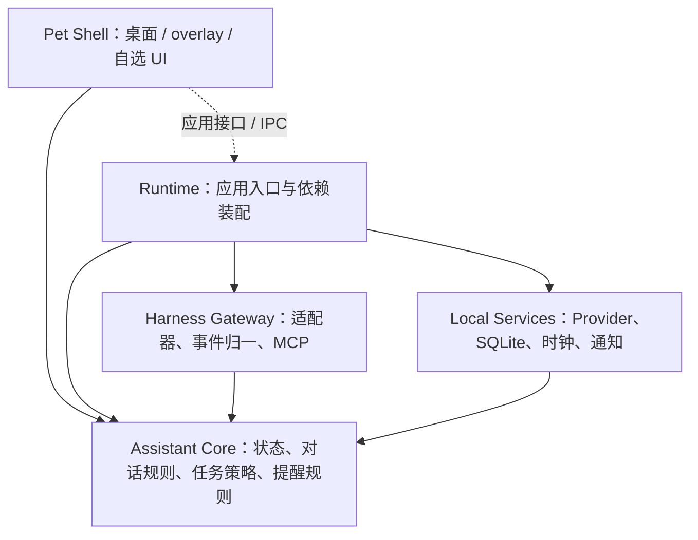

# Maneki 架构设计

> v0.7 设计基线，2026-11-14 确认模板驱动的轻陪伴增量（§4.3.1）；源码已接入，实机验收未完成。保留 v0.6 的 Windows 首版「陪伴型桌面管家」与[四阶段路线图](./roadmap.md)；封存交付仍为 0.2.0-alpha.2 预览，后续源码及各阶段实机验收分别记录。
> 本文是架构、契约和安全规则的唯一事实来源。示例是待实现契约，不代表已经支持某个产品或平台；路线图中的验收通过后才可声明支持。
> 领域用语见 [GLOSSARY.md](../GLOSSARY.md)，历史取舍见 [ADR](./adr/0001-shared-local-runtime.md)，本轮审计与处置见 [审计报告](./audits/2026-11-01-product-architecture-review.md)。术语与 ADR 不另立一份实现规范。

## 1. 目标、范围与不变量

Maneki（小招）是陪伴型桌面管家。dsh 插件是首个入口，独立桌面角色与个人主会话归小招；长期记忆归 EverNook，工程会话、执行、审批和结果归 dsh。换项目后用户仍可接着和同一个小招交流。

| 场景 | 输入与结果 | 必须保持的规则 |
|---|---|---|
| 陪伴与形象 | 自定义动作包、点击/拖拽、主动搭话 | 形象不绑定模型、语音或 harness；素材不执行代码 |
| 对话 | 文字或语音输入，文字和可选语音回答 | 文字始终可用；关闭语音后不加载语音模型、不占用麦克风 |
| 个人待办与提醒 | 个人事项、可选截止时间，以及独立或关联待办的单次提醒 | 截止时间不自动触发提醒；时间不明确先确认；落库后才反馈成功，重启可恢复 |
| 会话进度 | 观察真实 dsh 会话，告知哪个需要回应，引导用户回到宿主 | 工程输入、执行及审批在 dsh 完成；进度来自宿主观察 |
| harness 接入 | 适配器或 MCP 驱动宠物 | 能力如实声明；不把单向表达接入宣传为完整双向代理 |

非目标：云端多用户 SaaS、通用 IM/完整项目管理、移动端、重造 harness 的模型推理与工具执行系统。社区市场和多宠不是首个可用版本的前置条件。

首版依次验收插件入口与主会话续接、逐会话进度、按键语音与动作、EverNook 显式记忆。沿用 [ADR-0005](./adr/0005-dsh-first-personal-assistant.md) 的 dsh 优先、独立主会话和共享 Runtime 决策。2026-11-13 调整其近期排期，把显式长期记忆纳入首版，工程派发移出首版。第二宿主、内嵌浮层、唤醒/连续语音、自动画像与动作市场后置。§5 的工程执行与审批契约供另行立项时使用。

2026-11-14 确认轻陪伴作为可独立验收的增量：先交付无模型、无主动声音的模板碎碎念与“来一句”，再分别设计会话动态提示和个性化表达。第一批不以语音、EverNook 或工程派发验收为前置，也不替代 #66/#67 的剩余出口；见 [§4.3.1](#light-companionship) 与 [ADR-0006](./adr/0006-template-first-companionship.md)。

**跨入口行为约定（待实现与实机验收）**

- dsh Adapter 将授权来源的会话标识、可辨认标签、阶段和最后观测时间交给 Runtime。观察记录按来源和会话隔离且有界。工作、等待、完成、失败、取消和来源失联分别呈现。重连时以新的宿主证据更新；重复或迟到事件不能撤销较新的状态。只传定位所需信息，工程正文与审批内容留在宿主。
- 面板、文字和语音进度查询共用 Runtime 的只读观察记录。关闭对话模型仍可问哪个会话在等待；只验证到来源标识时提供人工定位，原生跳转单独核实。现有聚合表情租约继续服务原客户端（§5.1），不能据此反推出会话身份。
- Shell 根据当前交互选择动作：实际开始采音后倾听，松开后转写，成功提交个人主会话，再按设置朗读。倾听期间继续更新会话记录，保留等待标记；首次进入等待可按勿扰规则招手，重复事件不再打扰。完成另一个会话不会清掉等待标记，结束倾听时展示最新事实。

架构不变量：

- Core 为纯 TypeScript，不导入 UI、Node/Rust API、数据库驱动、具体 Provider 或 harness SDK；副作用经注入的 Interface 完成。
- 只有 Runtime 装配具体依赖、管理生命周期和执行本机策略；Shell 负责交互，不能直接持有数据库或 Provider 密钥。
- 主动行为的触发、防打扰、权限与路由由确定性规则裁决；LLM 只能生成候选意图、内容和摘要，不能修改这些规则。
- 模型输出、harness 输出、记忆、插件内容都视为不可信数据；结构化工具调用也必须校验来源、参数和授权。
- 本地优先；启用外部服务必须显式选择并展示将发送的数据。“关闭 Maneki 云端能力”只控制自身 Provider；harness 的云端使用与数据去向单独授权，不能把本机 CLI 描述为本地推理。任何一侧均不通过静默回退更换数据目的地。

## 2. 模块分工、依赖与运行形态

### 2.1 四类职责与装配入口

保留 Shell / Core / Gateway / Local Services 四类职责，但不再把逻辑分层画成 Core 依赖具体 IO 的编译依赖链。



实线表示编译依赖，虚线表示跨进程调用；Gateway / Local Services 实现 Core 定义的端口。执行时 Core 可调用注入的端口，不导入具体实现。Shell 仅导入 Core 中可复用的状态/类型/纯函数与客户端契约，不导入 Node Runtime 服务实现；业务规则只在 Core 保留一份。HTTP、WS、MCP 是入口与传输，不是领域逻辑的拥有者。

| Module | 拥有的行为 | 不负责 |
|---|---|---|
| Pet Shell | 动画播放器、输入、气泡、设置与审批展示、音频设备交互 | 调用任意命令、保存密钥、决定授权 |
| Assistant Core | PetState、意图分流、对话编排、Task Broker 状态/策略、主动性与提醒规则；所需端口与领域数据 | 协议解析、磁盘、网络、具体模型推理 |
| Harness Gateway | HarnessAdapter 注册、宿主协议转换、事件归一、MCP 表达工具 | 替用户授权、将任意输出解释为命令 |
| Local Services | 具体模型/语音 Provider、存储、系统时钟与通知、审计写入 | 绕过 Core 策略直接触发任务 |
| Runtime | 组合以上 Module、应用接口、鉴权、单实例、数据库事务、生命周期、恢复与资源限额 | 通用插件框架、分布式服务治理 |

不建设全局 service locator、通用工作流 DSL 或跨机器消息总线。先用显式构造注入和进程内事件；一个 Provider 更换只影响对应 Adapter 与装配，不要求修改 Core。

### 2.2 目标目录与依赖约束

随里程碑创建实际需要的目录，不提前建空包：

```text
apps/
  desktop/              # M1：Tauri v2 Shell 与受限原生桥
  dsh-plugin/           # M2：宿主入口、配对/设置/唤起；M2b 追加经验证的工程派发
packages/
  core/                 # M1：PetState 先行，逐步加入纯 TS 规则与端口
  runtime/              # M2：应用装配、本地服务、存储及 Provider 实现
  gateway/              # M2：归一契约、Adapter 注册与 MCP 桥
  adapters/<harness>/    # M2 起：有真实接入证据后添加独立适配包
```

`@maneki-pet/*` 为 npm scope。初期 Provider 实现放 `runtime` 内，出现独立发布/复用需求后才拆包；不为每个 Interface 提前建一个 workspace。渲染器先放 Shell；跨 Shell 的动画选择/物理计算只抽纯函数，不将 DOM 或 WebView 依赖带入 Core。

### 2.3 进程与生命周期

Maneki 安装一次 **共享本地 Node Runtime**，桌面与插件均可连接或受控启动它，不要求先打开桌宠 App。桌面版仍采用 Tauri v2 Shell，Runtime 可随安装包以 sidecar 分发，但其生命周期不绑定某个窗口或插件宿主进程。M1 验证透明窗；M2 必须验证无桌宠窗口的 Runtime 启动/连接、发行打包、IPC、关闭与总内存，达不到预算再依据证据修订。Tauri WebView 不假定存在 Node 环境。[官方 sidecar 说明](https://v2.tauri.app/learn/sidecar-nodejs/)

- 每个本地用户配置目录只运行一个 Runtime；通过本机实例锁与受控发现元数据避免重复进程，SQLite 连接仅由 Runtime 拥有。崩溃后核验锁持有者，不盲删锁。
- 2026-11-15 用户确认修复单实例崩溃回收：Windows 使用 Node Runtime 内加载的受信 Rust Node-API 模块，直接持有锁文件的内核句柄；无持锁 helper，不依赖桌面窗口。句柄允许诊断读取但拒绝其他写入/删除/重命名；所有 Runtime、管理与配对入口共用同一 `InstanceLock`。取得 OS 排他权限后才检查旧版 PID 元数据并写自身元数据；旧版存活者保守拒绝，已知新版遗留记录不以 PID 复用阻止恢复。正常释放在仍持句柄时标记删除再关闭，未持锁的对象释放不影响他人；崩溃由 OS 关闭句柄，下次启动回收遗留记录后仍走数据库恢复。空文件在已取得排他句柄时可视作创建中崩溃恢复；其他无法解析的旧元数据保守报错，不盲删。
- 原生绑定采用 napi-rs（`napi`/`napi-derive` 与构建期 `napi-build`），用途仅为 Node-API 资源生命周期及 Win32 文件锁，复用现有 Cargo 工具链；不引入 npm 自动下载二进制或常驻进程。相比手写 Node-API ABI，成熟绑定减少 unsafe 生命周期代码；相比目录/PID 锁，内核句柄提供原子排他与崩溃释放。生成 `.node` 随 Runtime 固定相邻资源分发、缺失明确拒绝启动，不回退不安全的 PID 删除；业务库 v6 不迁移。旧版本混用在旧 PID 活跃或 OS 句柄被占用时拒绝；macOS/Linux 原生实现与打包另验，本轮不宣称支持。
- 关闭窗口、关闭插件或宿主退出只断开该客户端，不停止提醒调度或已授权任务的后台跟踪；用户可重新打开桌宠继续对话，选定模型服务可用时不依赖 dsh 宿主存活。安装与首次启用时明示此行为，并提供受信本机管理入口查看状态和“退出助理”。该入口不能依赖先打开桌宠窗口；具体托盘/管理命令随 M2 验证，开机自启动默认关闭。关机或明确退出助理期间不承诺即时提醒，下次启动按 §4.4 补扫。
- 共享启动器只启动已安装、来源可信且版本相容的 Runtime 固定入口；使用实例锁合并并发启动，不运行插件/模型给出的命令。首次配对通过本机受信入口确认；缺安装、版本不匹配或配对失败要明确提示，不静默下载/提权/安装。启动描述与凭证见 §6.1。
- overlay 连接共享 Runtime，不私建另一份记忆/任务数据库；本机服务未运行时可走已安装启动器按需启动。关闭/卸载插件只断开当前客户端，不删除共享数据、不关闭其他客户端的任务；撤销配对由受信管理入口单独进行，只影响对应客户端连接与凭证，已撤销凭证不自动重配。基础安装与启动命令在 M2 插件入口验证后写入用户文档；M2b 另补工程派发能力说明。
- npm 库模式可以仅嵌入 Core 并注入自己的端口；不必启动 Node 服务、监听端口或安装语音模型。需要完整本地能力时再嵌入/连接 Runtime。
- “退出助理”负责结构化关闭：停止接收新任务、保存状态、撤销本机待决审批、取消 Provider 请求、停止音频、释放数据库与实例锁。只终止助理自己的服务/推理进程；harness 执行进程不能作为普通 sidecar 一并杀掉，退出前提示外部任务可能继续、跟踪会停止。需要取消任务须另走 Adapter 并确认结果。退出期间不通知，下次启动按 §4.4 与 §5.3 恢复；原生审批仍由 harness 决定超时/拒绝，Maneki 不自动放行。
- 明确退出时先停止 HTTP 接收并标记关闭中；尚未读完的请求体即使随后完整到达，也不得再写业务状态或伪报成功。已有 HTTP 连接最多排空 1 秒后断开，不能由慢客户端阻止释放数据库和实例锁；Provider/WS 的取消清理仍分别完成。断线不代表未知写入已撤销，客户端按原幂等 ID 查询，不自动换 ID 重做。本约束不改变正常 HTTP 请求格式或持久状态。
- 每个已启用 Module 具备启动/就绪/降级/停止状态；不支持或初始化失败应显式呈现。配置更换只影响对应能力；不在任务中途自动更换 harness 或把本地请求转给云端。

Runtime 采用发行包自带的运行时或自包含二进制；用户无需手动安装 Node。若平台的 sidecar 进程随 Shell 关闭而必然终止，M2 必须采用能独立维持生命周期的受信启动方式并验证，不能声称仅修改关闭按钮便已支持后台 Runtime。具体打包工具、SQLite 驱动、OS 通知桥在 M2 以最小 spike 验证后落定；不得把未验证的打包能力当已完成。

## 3. Pet Shell 与动作包

### 3.1 动画与交互

- 透明视频 `video-alpha` 为主，`spritesheet` 为兼容性/资源兜底；播放器根据能力选择素材。VP9-alpha WebM 与 HEVC-alpha MOV 是待测组合，不能把浏览器可播放等同于 Tauri 三平台已验证。
- Core 给出 `PetState` 和动作意图，Shell 处理解码、渲染和输入。状态集合固定为 `idle / thinking / working / waiting_input / celebrating / error / sleeping`。
- Core 的动画链接收状态变更、动作请求与 clip 结束事件，并返回当前应播放的 clip；随机数由调用方注入，Core 不读取时钟、DOM 或播放器。状态 clip 结束后按对应状态的权重选择下一个 clip；权重为零的 clip 不得被选中。
- 每次播放返回递增的 playback ID。只有当前 playback 的结束事件才能推进动画链，打断前的迟到结束事件必须忽略。缺失的非 `idle` 状态回退到 `idle`。
- 动作包含有序 clips、非负整数 `priority` 与 `interruptible`。动作请求只在无活动动作，或活动动作可打断且新优先级不低于它时接受；动作结束后回到调用方最新设置的 PetState。向播放器提交的 PetState 变更始终抢占动作，以免装饰动作掩盖真实任务状态；`interruptible` 只限制其他动作请求。 首版在播放器上游仲裁倾听与宿主表现，后台会话变化先更新记录，待当前倾听结束再提交对应表现。
- 点击、拖拽、甩抛计算接收显式时间与几何参数；窗口移动、多屏/DPI、鼠标穿透由 Shell/原生桥负责。
- 2026-11-04 用户确认无框交互：关闭原生窗口阴影，不显示包围人物的矩形框。人物轮廓与当前显示的控件接收鼠标，素材透明留白及窗口其他透明处放行到下层窗口；拖动只从人物发起。Windows 首先验证，其他平台保持未验证，不以网页 `pointer-events` 冒充系统窗口穿透。
- 人物正下方的宠物控制条依次为可编辑短文本框、麦克风、下拉设置；采用奶白胶囊、暖橙强调和统一细线图标。悬停人物/键盘聚焦时出现，输入聚焦或设置展开时保留，离开后延迟淡出。沿用现有形象、状态与动作等设置内容，设置面板属于当前可交互控件；状态气泡只作展示。
- 2026-11-14 设置交互选用“贴身旁白”：右键人物打开贴附快捷菜单，勿扰复用现有 settings 权限直接切换；语音、形象和全部设置只负责进入对应视图，不因右键菜单静默创建个人助理凭证。助手打开时，同一 WebView 的原生窗口扩展为约 760×640 的逻辑尺寸，左侧保留当前宠物，右侧以锚定侧栏承载对话、会话、待办、提醒、形象与设置；原形象/状态/动作和运行状态控件迁入“形象”，不再维护两个并行设置面板。关闭后恢复 300×360。窗口向屏幕内侧收拢以避免右侧越界，宠物和实际侧栏接收鼠标，其余透明处继续放行；多屏/DPI 与真实右键手感仍须 Windows 实机验收，macOS/Linux 未验证。
- 同日扩充外观但不改 Pet Pack v1：在既有七状态十动作上新增 `bow / clap / dance / spin / jump / salute / finger-heart / cover-laugh / look-around / excited-rub` 十个独立动作，点播总数为 20；新增动作沿用现有优先级、可打断与回退规则。白猫 `xiaozhao-white` 与黑猫 `xiaozhao-black` 从验收后的橘猫成片做保留明暗的离线换色，共享全部状态和动作，不重新生成角色。侧栏以当前形象的小尺寸标记和配套轨道色反馈换装；橘色操作强调、文字对比与全部设置逻辑保持一致。白/黑包登记在 `config/optional-packs.json`：存在时完整校验，未导入时跳过，不阻断开发构建或显示为加载错误；损坏的已导入包仍拒绝。生成原片、变体包和小标记均不进入 Git，只有配方、处理脚本与验收记录入库。
- 观察 MVP 中草稿仅留在当前 Shell 内存，文字发送与语音明确未启用，不发送网络消息、不采集麦克风、不伪报成功，不改变 Runtime/MCP 或派发授权契约。后续聊天/ASR 仍分别接入独立端口。
- 轮廓命中复用正在播放的画面，采用有界的小尺寸 alpha 采样及原生鼠标位置仲裁，不创建第二套媒体解码/预载缓存；采样与 IPC 至多一个在途更新，拖拽/指针捕获期间维持交互，失效时不长期占住透明区域。控件显隐、换包、DPI 与窗口移动须重新校准；关闭/重载时释放采样、订阅与定时器。托盘“显示”可恢复手动整窗穿透并展开控制条，避免无法重新操作。
- M1 提供默认形象和第二个最小测试包验证换装；用户可导入自制包，不以社区市场为前提。设置面板按当前已校验包的 `actions` 列出动作并点播，复用 Shell 播放器动作入口；切包时更新列表，无动作时禁用。已知动作使用集中中文文案，未知动作 ID 仅按文本数据展示，不扩展 Runtime/MCP 契约。

#### 默认形象制作基线（2026-11-03 Windows 正式默认交付完成）

- 正式默认形象为原创拟人橘猫娘；2026-11-03 用户要求移除原来的程序招财猫形象，开发占位、启动兜底和图标均不得再生成该旧图。2026-11-02 用户确认约三头身、柔和 3D 卡通质感的成年女性角色 Q 版表达，橘色短发、虎斑猫耳、蓬松橘尾与奶油白面部配色；服装为奶油白连衣裙、焦糖色小围裙、红领结和金铃铛，减少细碎装饰。第一版三视图与四表情设定图已经用户视觉确认；2026-11-03 全量 17 段动画覆盖七状态十动作，素材与 Windows release 功能检查通过，用户明确确认 §8 总预算调整为 300 MiB、Runtime 仍为 75 MiB，固定场景资源采样符合新预算，正式默认 `xiaozhao-default@1.1.0` 完成交付，见[验收记录](./audits/2026-11-03-catgirl-default-acceptance.md)。安装器、长期稳定性及其他平台另行验收。
- 借鉴 dsh-pet 的动作组织与表现手感，角色、动画与提示词独立制作；参考项目代码与素材授权不同，不将其动画或形象作为 MIT 素材直接复用。
- 首版沿用一个完整 Pet Pack 承载形象、状态与动作，整包替换；不新增可独立安装、混搭的动作扩展契约。
- 用户澄清后确认沿用透明视频动画为主、精灵图兜底的路线；本轮不引入 Live2D 或实时骨骼引擎。默认动画静音，离线制作的生成模型不成为桌宠运行依赖。
- 正式原创猫娘素材经用户明确确认沿用 MIT 授权，发行附带许可与独立生成来源说明；不包含上游蓝鲸资产或生成模型权重。正式默认沿用 `xiaozhao-default` 标识，由程序占位版本 `1.0.0` 更新为素材版本 `1.1.0`；不改包 v1 契约，也不重置用户已选择的其他包。
- 覆盖既有七种 PetState，另规划招手、伸懒腰、整理猫爪手套、揉脸、挠耳、打哈欠、歪头、扑玩具、吃零食与点击回应；工作时敲小键盘，等待输入时举爪示意。走动、转向、拖拽悬空与落地反馈作为后续连贯交互单独设计、验收，不以新增素材冒充交互能力已实现。
- 制作顺序为角色设定图、待机/招手/工作三段试片、完整动作包、Windows 桌面实测并替换默认形象；dsh 插件后续复用同包，接入验收单列。
- 验收检查跨动作角色一致、循环衔接、透明边缘、脚底锚点稳定，以及状态变化抢占装饰动作。继续遵守 §3.2 的格式、完整性与资源预算；素材生成和接入通过前不替换现有可用默认包。

### 3.2 动作包 v1 最小契约

M1 固定 v1 的加载语义与 JSON Schema。包根目录的描述文件名为 `pet-pack.json`，独立完整性清单为 `assets.manifest.json`；其他扩展主版本一律拒绝。最小有效结构如下，生产包不得省略清单：

```json
{
  "schemaVersion": 1,
  "id": "xiaozhao-default",
  "name": "开发 · 中性占位",
  "version": "1.0.1",
  "permissions": [],
  "clips": {
    "breathe": {
      "sources": [
        { "renderer": "video-alpha", "path": "assets/breathe.webm", "mimeType": "video/webm" },
        {
          "renderer": "spritesheet",
          "path": "assets/breathe.png",
          "mimeType": "image/png",
          "frameWidth": 128,
          "frameHeight": 128,
          "frameCount": 2,
          "framesPerSecond": 2
        }
      ]
    }
  },
  "states": {
    "idle": { "clips": ["breathe"], "weights": [1] }
  },
  "actions": [
    { "id": "wave", "clips": ["breathe"], "priority": 1, "interruptible": true }
  ]
}
```

`assets.manifest.json` 的结构为 `{ "schemaVersion": 1, "algorithm": "sha256", "files": [{ "path", "sha256", "bytes }] }`。`sha256` 是素材原始字节的 64 位小写十六进制摘要，`bytes` 是非负安全整数。每个 clip source 必须有同路径清单项，每个清单项必须至少被一个 source 引用，同一路径只能登记一次；安装器必须对实际文件重新计算哈希和大小，不能只相信清单值。

- `idle` 与至少一个 source 必需；其他状态缺省回退 `idle`。所有 clip/state/action ID 与引用必须唯一、存在，状态名不得超出固定集合。权重数量匹配、为有限非负数且和大于零；动作 clips 至少一项。
- v1 对 JSON 对象拒绝未声明字段。`permissions` 只接受空数组；不加载 JS、HTML、SVG 或远程资源。source MIME 仅允许 `video/webm`、`video/quicktime`、`image/png`、`image/webp`，renderer 与 MIME 必须匹配。精灵图必须提供正整数帧宽高/帧数及有限正帧率。
- 所有素材路径使用 `/` 分隔并相对包目录，拒绝反斜杠、绝对路径、盘符、UNC、空段、`.`、`..`、控制字符与描述/清单文件路径。安装器还须在真实路径层拒绝符号链接或 junction 逃逸。
- v1 每包最多 128 个素材，单文件最多 64 MiB，清单合计最多 256 MiB。安装器验证 JSON/图片/视频实际字节、媒体规格与上述限额，并防止超额输入和解压炸弹；v1 不内置压缩包解压语义。
- 2026-11-04（#4）开发用 CLI 安装/构建校验：两份 JSON 各限制 1 MiB，实际素材尺寸和清单字节在读取前核验；文件用固定小缓冲计算摘要，不按未可信文件长度分配内存。真实媒体复用素材管线已有的本机 FFmpeg/ffprobe（开发工具依赖，不加入 Core 或常驻 Runtime）；缺工具明确拒绝安装。先探测单视频流、编码/容器/MIME、正整数尺寸和 8,388,608 像素上限，再有界完整解码；精灵图沿用现有水平条带，实际宽度必须等于 frameWidth × frameCount、高度等于 frameHeight。子进程仅使用固定参数、文件/pipe 协议及允许的媒体 demuxer，不通过 shell 执行；每次探测/解码超时 30 秒，失败保留旧包。此 CLI 检查不替代各 WebView 的实际播放验收，也不承诺 FFmpeg 是不可信媒体的 OS 沙箱。
- MIME 不以扩展名或 FFprobe 的复用 demuxer 别名判定：WebM 须在 4 KiB 内完整读到 EBML 头并确认 [DocType 为 webm](https://www.webmproject.org/docs/container/)，QuickTime 须在前 4 KiB 的完整 `ftyp` atom 中包含 [qt 品牌](https://developer.apple.com/documentation/quicktime-file-format/file_type_compatibility_atom)（major 或 compatible brand，四字节 `qt  `）；无该证明的旧 MOV 明确受限，不冒充已验证兼容。PNG/WebP 校对实际文件签名，之后仍做完整解码；MP4 及 DocType 为 matroska 的 MKV 不能冒充对应允许格式。
- 桌面播放仅保留一个当前素材的对象 URL（编码字节不超过 64 MiB），播放器与校验器共用串行素材读取通道；切换时取消旧读取并等待释放后再加载。验证顺序执行；图片在解码前读取文件头并限制整图不超过 8,388,608 像素，视频元数据尺寸同限，超限回退并提示。为保持当前形象可交互，允许一个活动播放器与一个校验探针同时存在；当前素材与校验暂存的编码字节各不超过 64 MiB（合计最多 128 MiB，读取拼接和 Blob 复制的瞬时分配另计）。校验位图/视频探针使用后立即释放，不缓存其他素材的解码结果。浏览器实际内存随平台变化，须另作实测，像素上限不声称是精确内存上限。
- 启动时先显示内置安全占位，动作包依次验证，首个可用包验证成功即允许交互；单次素材或清单读取超时 30 秒后失败并提示。无法在预算内解码核验的动作包按未通过校验处理，保留已显示的可用形象；不得为了尝试其他素材绕过其完整性和媒体校验。
- 校验失败不得修改当前包。安装按 `id/version` 写入新目录，完整校验后原子切换活动版本；失败保留旧版本。哈希仅验证完整性，发布者信任另见 §7.5。
- 素材配方、转码/抠像脚本和授权说明入库；大渲染产物 ignore，发行渠道另行分发。AI 生成可重复运行不代表逐像素确定性，记录模型/版本/提示词/参数与输出哈希。

#### 橘猫娘素材准备（#59，2026-11-02）

- `generate-packs.mjs` 只在包目录不存在时补齐程序占位包；缺包先在临时目录生成，校验后经既有安装器发布，外部工具失败不得留下目标半包；已有包须通过 v1 与真实文件完整性校验并匹配目录 ID，合法包不写入，损坏包报错且不覆盖。合法默认包已存在时，同时保留已准备的 `fallback.png`；fallback 缺失时仅明确生成开发占位，正式晋升仍须单独准备同角色 fallback。日志明确区分占位与已准备素材。`validate-packs.mjs` 是只读准备检查，缺包提示通过 `install-pack.mjs` 显式导入；导入继续使用既有原子安装路径。构建不启动模型或获取外部素材。
- 旧程序招财猫生成逻辑停用，开发默认和第二测试包改为中性几何占位，版本 `1.0.1`；它不冒充正式橘猫娘。精确匹配旧内置默认 `xiaozhao-default` / `小招 · 招财猫` / `1.0.0` 时，准备步骤明确拒绝该退役默认并提示显式导入正式包，保留磁盘文件，其他合法自定义包沿用保留规则。仅用已知旧兜底 PNG 的字节摘要识别并替换旧图，不覆盖其他已准备兜底；应用图标复用当前安全兜底，不再绘制旧猫。`--public-dir` 隔离准备不写应用图标目录。包 v1 与状态/动作契约不变。
- 本角色离线入口为 `build-catgirl-pack.mjs <recipe.json> --packs-dir <输出目录>`；只执行本机 FFmpeg/ffprobe，不运行模型、不下载、不联网。工具配方不是 Pet Pack 公共 Schema：`recipeVersion: 1`，`id/name/version`，`clips` 映射到 `{ input, startSeconds?, crop?: { x, y, width, height }, loop?: "forward" | "ping-pong" }`；`input` 相对配方目录解析，`states/actions` 沿用 v1 映射。只接受声明字段，不接受任意滤镜或命令。默认 `startSeconds: 0`、`loop: "forward"`；`chromaKey` 可指定 `{ color, similarity, blend }`，默认 `0x00ff00/0.15/0.05`，并去绿溢色。
- 每段主视频输出固定 384×384、24 fps、120 帧、5 秒静音 VP9-alpha WebM；裁切后等比缩放并透明补边，底部居中。`forward` 取连续 5 秒，`ping-pong` 取前 60 帧加倒序 60 帧；这是显式往返修整，不声称原片天然无缝。素材不足时失败，不重复静帧补齐。兼容 PNG 独立固定为每帧 256×256、8 fps、40 帧的单横排（10,240×256，共 2,621,440 像素），v1 描述与实际输出均使用兼容帧尺寸，不增加配方配置。2026-11-03 完整素材 release 实测超出当时 250 MiB 空闲内存目标后采用此减量策略；原 384×384 兼容图的试片记录保留为历史证据。减小像素数未使旧目标通过；最终按用户明确确认的 §8 新预算和无调试器采样完成验收，媒体格式与加载限制保持不变。
- 处理先在临时目录完成，完整解码并检查实际帧数、时长、音轨与 alpha，再生成 v1 描述/清单并经既有安装器写入输出目录。输出目录旁的 `<id>.build.json` 记录配方、输入摘要、FFmpeg 版本、处理命令与媒体检查结果；它是制作证据，不进入正式包 Schema。候选包与制作记录均完整准备并校验后一起发布；可检测的写入或替换失败须回滚两者、保留原有包与记录，不声称跨文件掉电原子性。配方不提供默认形象提升开关。
- 三段试片固定使用独立 ID `xiaozhao-catgirl-trial`，只声明 `idle/working` 和 `wave`。本角色构建入口拒绝保留 ID `xiaozhao-default`，后续全量映射沿用同一入口制作独立候选包；不以状态或动作数量推断视觉完整。七状态十动作完成且用户观感确认、授权与 Windows 桌面验收通过后，才在独立的发行准备中明确改为默认 ID 并显式导入；这个人工晋升步骤须留记录，构建入口不自动晋升。

### 3.3 桌面壳选型与验证

Tauri v2 优先，Electron 保留备选。M1 测透明窗、透明视频/精灵图切换、点击穿透、多屏 DPI 与托盘；M2 追加 Runtime 后重新测总占用。先在 Windows 完成可用基线，macOS/Linux 分别记录真实设备/CI 证据与限制；本机未验证的项保持未勾选。

若某平台视频透明失败，先尝试精灵图兜底；只有证据表明 Tauri 的窗口/媒体/集成限制使目标不可达时才讨论切换 Electron，并同步性能预算与迁移影响。不引用未经本项目测量的内存基线作为结论。

## 4. Assistant Core 与可插拔能力

### 4.1 Interface 与 Provider

只为当前确实变化的能力设置端口，不定义一个包含所有功能的万能 Provider。Core 使用与厂商无关的数据；Provider Adapter 转换协议与错误，Runtime 注入实现。OpenAI 兼容协议是首个模型 Adapter 的选项，不能成为所有端口的共同约束。

| 能力 | 端口/职责 | 初始实现与关闭行为 |
|---|---|---|
| 对话模型 | `ChatProvider`：候选回答/意图生成 | 先实现一个 OpenAI 兼容 Adapter；本地/云端端点显式选择，关闭后保留确定性命令、提醒与状态联动 |
| 语音识别 | `SpeechRecognizer`：音频转文字 | whisper.cpp 本地优先；缺模型不自动下载或切云端，退回文字输入 |
| 语音合成 | `SpeechSynthesizer`：文字转音频 | 首个本地 TTS 实现 M3 验证；可单独替换/关闭，关闭后气泡/系统通知继续工作 |
| 音频设备 | Shell 音频端口：采集、播放、释放 | 宿主适配设备与系统授权；不交给模型操作麦克风 |
| VAD / 唤醒 | 可选音频检测 Adapter | 按需开启；未安装/关闭不影响按键说话，M3 基线不要求常驻监听 |
| harness | `HarnessAdapter`：会话/任务/审批协议转换 | 见 §5；不支持某能力时显式拒绝，不能猜测通用命令 |
| 背景记忆 | Runtime 经已配对的 EverNook 适配器显式保存、检索并核对来源（§4.4、§10.3） | 服务可选；故障时本地对话、提醒与宿主观察继续可用 |
| 通知/存储/时钟 | 系统端口、事务仓储、可注入时钟 | 本地实现；Core 测试可替换，SQLite 保持默认存储，不提前支持多数据库 |

助手对话 Provider 由 Runtime 独立调用、配置和授权；可以显式选择与 dsh 工程模型相同的端点、模型与账号，但不默认读取或复制 dsh 密钥，也不要求保持某个 dsh 会话运行。配置入口可放在 dsh 设置面板，配置归属见 §6.2；模型不可用时明确降级，不影响确定性的待办/提醒管理和调度。

最小 Provider 契约示意（v1 先采用有界音频段，流式能力以后按真实实现扩展）：

```ts
interface CallContext {
  requestId: string;
  signal: AbortSignal;
  deadlineAtMs: number;
}

interface ProviderInfo {
  id: string;
  apiVersion: 1;
  locality: "local" | "cloud";
}

interface AudioData {
  bytes: Uint8Array;
  mimeType: string;
  sampleRateHz?: number;
}

interface ChatProvider {
  info: ProviderInfo;
  reply(input: { messages: { role: "system" | "user" | "assistant"; text: string }[] },
        ctx: CallContext): Promise<{ text: string }>;
}

interface SpeechRecognizer {
  info: ProviderInfo;
  transcribe(audio: AudioData, ctx: CallContext): Promise<{ text: string }>;
}

interface SpeechSynthesizer {
  info: ProviderInfo;
  synthesize(input: { text: string; voiceId?: string }, ctx: CallContext): Promise<AudioData>;
}
```

`ChatProvider.reply` 的回答按数据处理；结构化意图须经独立 Schema 校验和 Core 授权，不从文字中提取“隐含命令”。v1 不提供模型直连 shell 的工具。采样率、编码、单段大小/时长在 Provider 能力与媒体校验中协商，不要求所有实现支持相同音色/语言/流式协议。

所有调用遵守统一语义：超时与取消可区分、错误可展示但脱敏；同一 request 的迟到结果不覆盖新结果。Adapter 必须转发取消并释放资源；无法中止的本地推理丢弃迟到结果并受并发上限约束。模型/语音队列有界，不阻塞动画、审批或提醒调度。

Provider 的本地/云端声明由受信实现与实际端点配置共同核验；禁止本地实现隐式转发外网。云端关闭会中止在途云请求、丢弃迟到响应并阻止新请求，已经发出的数据无法撤回。默认不把项目源码、长期记忆或原始音频整包发送给对话模型。

设置使用准确名称“关闭 Maneki 云端能力”，不承诺阻止外部 harness 联网。任务派发另展示已选 harness 的数据目的地与授权范围；去向未知时明确标注，不可冒充全本地。用户未授予该目标的数据授权时不派发，授权后也不能静默改目标或扩大数据范围。严格离线执行不在首版承诺内；以后支持时需验证执行环境与 Adapter，不能仅看回环地址。

**收费调用与支付行为分开**：配置密钥不等于授权调用；用户明确启用某 Provider、调用类型与范围后，交互调用可持续使用，不逐轮弹支付审批。主动收费调用默认关闭，需单独开启并设置非零的次数/token/音频时长等可执行限额；不清楚单次成本或无法给出保守上界时禁止主动收费调用。达到限额或计量失效即停止后续调用并提示，不能切换账号/Provider 绕过。金额估算与真实账单分开，无法实时结算时不承诺绝对金额封顶。harness 发起的购买、支付、开通服务仍属于 §5.4 的逐次操作审批，Maneki 的 Provider 预算不代表约束 harness 自身账单。

**用量与上下文限额三层配置化**：① 单次调用限额——交互调用与主动调用都有默认保守的输入/输出 token 上限，可按 Provider 覆盖；② 会话上下文预算——主/子会话历史维护滚动窗口，超限按配置摘要压缩、截断或拒绝，默认摘要压缩；③ 周期总额——每日 token/费用上限默认约束主动收费调用，交互调用总额可显式开启。到达限额即停止后续调用并提示，不能切换账号/Provider 绕过；剩余额度、降额与停用状态在界面如实呈现，不隐藏降级。

摘要压缩必须覆盖所有未保留的历史前缀；为摘要本身腾出的历史也应纳入摘要输入，不能静默按截断处理。重算摘要时仅单调扩大前缀，最多历史条数加一次尝试；所有历史纳入后仍超预算则明确拒绝，不无限调用摘要器。

### 4.2 对话与主动语音交互

```text
文字输入 ────────────────────┐
按键采集 → ASR → 转写文字 ────┼→ 同一意图分流 → 对话 / 待办 / 提醒 / 经授权任务
可选唤醒 → 有限采集 → ASR ────┘                    ↓
                                              气泡 + 可选 TTS
```

- 默认文字 + 按键说话，麦克风仅在明确采集阶段开启；用户可以分别开启 ASR/TTS，允许“文字输入、语音回答”或“语音输入、文字回答”。
- 首版按住麦克风采集，松开后结束采集、转写并自动提交到同一文字入口，同时显示识别文本；识别失败或结果为空不提交并允许文字重试。用户可以取消正在处理的一轮，取消后的未提交迟到结果不得产生变更；已经落库的待办/提醒应如实反馈，取消对话不冒充撤销已提交操作。
- 主动对话由事件触发邀请：宠物先以气泡/可选 TTS 开口，用户点击回应或在已明确授权的短时对话模式中回答；每轮完成、超时、麦克风禁用或取消立即释放采集。勿扰生效时终止尚未由用户主动回应的邀请采集，但不终止用户主动按键发起的一轮。主动播报本身不能自动授权常驻麦克风。
- 半双工为首个可用版本：播报时不把自身声音再次提交为用户命令；用户点击/按键可打断播放并开始一轮采集。回声抑制、VAD 插话和全双工需要独立设备验证，作为可选增强，不宣称已支持。
- 开启唤醒/连续对话必须显示持续状态、提供一键停止和采集超时，原始音频默认仅在内存中使用；设备拒绝、被占用、ASR 失败均回到文字入口。语音不能自动批准危险操作，审批需受信 UI 明确动作。
- 主会话由 Maneki 独立拥有，是用户与助理唯一常驻对话入口，承载助理身份、个人上下文与意图分流；不把某个 harness 会话当作助理大脑。桌宠和插件是同一助理的不同视图，关闭视图不删除主会话。Maneki 调用已启用的 ChatProvider 作对话与候选意图编排，具体工程任务仍交给 harness，不重建通用代码执行 Agent。主会话的文字对话、最小历史持久化和重启续接随 M3 落地；无模型时保留结构化待办/提醒管理，工程入口另受 M2b gate 约束。
- 主会话历史本地持久化，首版默认保留至用户主动清除，不增加自动按天删除配置；每次模型调用仅使用有界近期上下文及必要摘要。首版不自动建立长期个人画像、读取整个项目或导入完整 dsh 转录；用户明确提供的内容及来源清楚的任务摘要可进入上下文。首版显式记忆按 §4.4 另验，自动画像后置。
- “清空聊天”展示范围并再次确认，删除该会话历史及其衍生摘要/上下文缓存，不删除已经建立的个人待办、提醒或工程任务记录；这些对象分别管理。清空前发起的在途回复或摘要不得重新写回已清历史或继续引用旧上下文。原始录音默认不保存；备份与外部副本边界见 §7.6。
- 来自用户当前明确请求、目标和参数唯一的单项待办/提醒操作，经 Runtime 校验后直接办理并反馈实际结果；时间不完整或目标有多个匹配项时先澄清。清空全部待办或聊天历史先展示范围并再次确认。模型只提供结构化候选，引用内容、dsh 输出与助理自身播报均不能授权操作；不从普通回答文本提取隐含命令，也不以语音代批危险操作。
- 子会话绑定到具体 harness 会话或助理任务，用于查看进度、回答等待输入并保留交互记录。子会话绑定的项目指令与上下文只在子会话内注入，不携带进主会话，置顶/常驻项目可配置；子会话上下文组装同受 §4.1 的会话上下文预算约束。主会话可接收经来源标注的任务摘要，但不自动汇入完整项目转录或权限指令。

多个 Shell 表示同一助理的多个视图。Runtime 为一次语音交互分配唯一 owner 与有时限的租约：用户在某界面发起时由该界面持有，其他界面只显示文字；主动 TTS 仅发往用户选定的可用输出端，无可用端则退为文字。客户端凭租约才能采集/播放，失联、过期或被明确切换时停止设备并释放；Runtime 不确认旧 owner 已停用或租约已过期前不发放第二份。M3 验证断网时客户端也能按租约到期自行停止，不用隐式抢麦/抢播解决冲突。

### 4.3 PetState 与主动性

任务状态、对话状态与宠物表现分开保存；PetState 是可重新计算的展示状态，不能据宠物动画推断任务执行结果。

```text
idle → thinking / working → waiting_input → working → celebrating / error → idle
idle ↔ sleeping
```

多任务默认展示当前用户关注的项目/任务，后台任务记入列表；待输入/审批只在防打扰规则允许时提示。其他会话的 idle 不覆盖当前任务的 working；庆祝为限时动作，结束后重算状态。

主动性 = `已验证触发器 × 防打扰预算 × 可用通道`。触发器包括提醒、任务完成/需输入、用户明确允许的存在感知和问候；存在感知不默认截屏或监听内容。碎碎念（murmur）、会话动态提示与用户安排的提醒是不同类别，不共用会使闲聊阻塞重要事项的预算。触发由确定性规则决定，LLM 只生成话术。碎碎念可包含原创角色日常台词；“无料不发”指没有合适且未重复的候选内容就不发送，不要求每句都有新任务事实，也不能借角色话术编造用户行为。默认低频、可单独关闭、勿扰内完全静默，具体首批规则见 §4.3.1。每日简报默认关闭、后置实施，按用户配置时间汇总有来源的任务状态、到期提醒与会话动态，无新事实不发送。主动轻量内容当日失效，LLM 失败回退模板或跳过，不阻止真实提醒；可靠提醒的过期与恢复遵守 §4.4。

三个偏好独立且不共用“静音”一词：

| 偏好 | 生效范围 | 用户主动交互 |
|---|---|---|
| 勿扰 | 抑制 Maneki 主动气泡弹出、声音、系统通知和抢注意动作，保留待查看事项 | 主动打开面板、按键说话可以使用已启用通道 |
| 语音输出关闭 | 禁止所有 TTS/交互音效，并停止在播声音 | 保留文字与已获授权的语音输入 |
| 麦克风禁用 | 所有模式禁止采集，立即关闭设备/唤醒与在途录音处理 | 仅文字输入，不能由按键或模型绕过 |

默认勿扰时段高优先级不穿透；用户可单独授权特定类别/通道例外，但例外不能覆盖语音输出关闭或麦克风禁用。外部 MCP 客户端不能通过 `urgency` 绕过规则。勿扰导致审批无人响应时保持阻塞，bridge 超时拒绝，原生审批按 harness 的拒绝/等待规则处理，不能自动放行。Maneki 不承诺控制 harness 自己发出的系统提示。

<a id="light-companionship"></a>

#### 4.3.1 模板驱动的轻陪伴（2026-11-14 源码接入，待实机验收）

**目标与取舍**

让小招在不依赖模型、语音或 harness 存活的情况下，有节制地表达陪伴，且用户能立即体验、暂停和关闭。允许“我先伸个懒腰，陪你慢慢来”这样的角色台词；禁止无依据声称“你连续工作三小时了”“测试已经通过”。首批只使用随应用发行的原创模板和现有动作，不读取项目、完整会话转录、待办内容或长期记忆来编写台词。

选择“确定性规则选时机、模板保底、模型后续可选润色”。纯模板作为首批可交付切片，代价是表达变化有限；固定周期直接调用模型会增加主动消费、延迟和内容不确定性，不采用。共同原因见 ADR-0006，本节是行为与契约的权威规范。

**能力分层**

| 类别 | 首批行为 | 历史与恢复 |
|---|---|---|
| 自动碎碎念 | Runtime 按预算调度；短文字气泡与至多一个短动作；不调用 LLM/ASR/TTS，不发送系统通知 | 不自动进入主会话、摘要或长期记忆；错过即丢弃，不积压补发 |
| 来一句 | 用户明确点击后返回模板回应；不受自动开关、暂停、自动次数和勿扰拒绝分支约束；首批同样无声音 | 重复点击合并在途请求，不产生无界队列；不自动写入主会话 |
| 会话动态提示 | 后续独立增量，基于可信会话变化、可定位来源 | 首批不接入观察事件触发；§6.9 的“不主动触发完成提醒”保持有效 |
| 用户设定的提醒 | 沿用 §4.4/§6.3/§6.6 的到点调度、预算和投递状态 | 不因闲聊消耗预算、展示失败或关闭桌宠而丢失 |

首批不提供主动朗读、梦话、每日简报、自动画像、屏幕感知、多宠或第三方话术包安装。现有聊天/语音不被此范围关闭。未来模型与主动 TTS 各自经过授权、用量和设备验收，不能因为聊天 Provider 已开启就自动启用。

**默认节奏与内容**

两小时间隔、每日四次与功能范围来自已确认方案；初次观察窗口、展示租约时长和保守滚动上限是本轮工程细化的默认选择，实施时通过下述场景验证，不代表已取得体验或性能证据。

- 自动碎碎念默认低频开启，独立开关；两次自动展示尝试至少间隔 2 小时，每个助手时区的自然日最多 4 次。首批不提供频率滑杆或“活泼”档位；数值是产品默认值，不是性能保证。
- 初次取得可用展示端后先经过 2 小时观察窗口，避免启动即打扰。后续只在存在合格展示端且预算到期时尝试；没展示端时不生成候选、不消耗预算。达到间隔不是必须开口，仍须通过内容和交互门禁。
- “45 分钟没有操作小招”不等于用户空闲。首批不采集系统键盘、屏幕内容或全局应用活动，不宣称用户正在工作、休息或离开；旧 Core 的 idle 阈值和任意新任务事件不能直接成为首批调度依据。
- 模板有稳定 ID、主题、适用时段和可选动作 ID。时段问候只使用助手配置时区；常规台词在任何适用时段可选。模板与 UI 文案集中管理，内置台词保持小招身份；不执行自定义 persona 中的指令，也不声称首批会自动把任意 persona 改写成模板。
- 同一自然日不重复相同模板或等价文案；相邻两次自动台词避免同一主题。手动展示过的台词也进入当日自动候选排除集，但不占自动次数；手动请求可在无新候选时复用模板，避免连续相同一句。
- 没有合适候选就跳过，直到内容条件变化或下一自然日再评估，不进行高频重试。模板集合、去重集合均有界；不能以换模板 ID 规避同一句去重。
- 提供“来一句”“暂停碎碎念两小时”“关闭碎碎念”。暂停只影响自动陪伴，使用 Runtime 时钟计算期限并持久化；反复点击暂停以最后一次请求时间向后延长两小时。重新开启独立开关不隐式清除尚未到期的暂停，界面显示剩余暂停状态。

**调度、预算与单端展示**

Core 提供准入、候选筛选和预算决策；Runtime 拥有配置、时钟、存储和单一调度器；Desktop 只报告自身展示条件并渲染。复用现有事件和鉴权机制，不建设通用消息平台或插件内核。

1. 仅已配对且有 assistant 权限的支持客户端登记展示实例；express 凭证不能登记、领取或确认。旧桌面没有登记时，自动碎碎念保持静默。只使用桌宠自身可见性、连接状态和交互状态，不能把“在线”宣传为“用户在场”。
2. 展示实例采用有期限的租约和周期续租；关闭、隐藏、断线、撤销、租约过期或实例重建即失去展示资格。首批采用 15 秒租约、5 秒续租；客户端按单调时钟保守计算本地截止时间（从续租请求发出时起算），不能因延迟响应延长真实租期。Runtime 重启不恢复旧实例资格。
3. 输入框聚焦/编辑、录音及转写提交、语音播放、拖拽或操作面板期间，客户端报告不可自动展示，并在本地再次门控。Runtime 在候选认领时复查勿扰、独立开关、暂停、租约及预算。更新设置立即失效尚未展示的候选；勿扰开启时收起自动气泡并停止其短动作，保留用户主动交互。
4. 多个合格实例中选择最近在小招内发生明确用户交互的实例；没有交互时按登记次序选择。每个候选只绑定一个实例及租约，不广播让客户端抢显；该次失败不转投另一个实例。一个实例同一时刻至多一条自动候选，用户主动点播使其失效。
5. 在同一存储事务中占用预算并写入 §4.3.2 的 Attempt（含稳定表达 ID、时间和模板去重信息）；目标实例、期限与候选正文只在有界内存绑定，提交成功后发送，崩溃后不重建候选。预算按“展示尝试”保守记账，不以送达确认作为占用前置；发送失败、ACK 丢失、进程崩溃都不返还或重发这一条，允许少说，不允许靠重试多说。ACK 只记录客户端已展示/已丢弃，不等于用户已看见。
6. 候选最多有效 15 秒且不跨本地自然日。客户端在展示前复查 ID、目标实例、租约、版本、有效期及本地交互，重复 ID 幂等丢弃。恢复连接不补拉待显示候选；Runtime 重启将未完成候选视为失效。错过的闲聊与可靠提醒使用不同恢复规则。
7. 持久化最近自动尝试时间、日预算桶、当日模板去重和暂停期限；不得只用 Core 内存计数。同进程间隔使用单调时钟，跨重启结合持久墙钟保守判定；时钟后退不提前释放间隔，前跳不循环补齐错过时段。时区改变不能重置最近两小时间隔，也不能在最近 24 小时内获得超过 4 次自动尝试；首批同时施加滚动 24 小时上限，属于保守防绕过限制。
8. 存储不可用、状态损坏或时钟无法可信比较时，自动陪伴停止且设置页显示原因；不把未知状态当作零用量。预算失败不阻塞既有文字交互和独立提醒调度。预算/去重只保留必要有界窗口，具体数据结构由实现选择。

**气泡、动作和主会话**

- 同一气泡槽优先服务用户正在进行的交互，其次是已有重要事项提示，最后是自动碎碎念。事项被用户交互挡住时仍保留其既有列表与系统通知路径，不能因为槽位不可用标为送达；自动碎碎念直接丢弃，不排队。已有提醒的系统通知不因这一视觉优先级被暂停。
- 每条气泡有独立 ID、来源和计时归属。替换时取消旧计时器，迟到的隐藏/动作完成回调只能影响它自己的 ID。首批模板为一句短文本；展示时长按可读性给出有界默认，用户可关闭。后续 TTS 的等待/播完尾留/超时状态机另验，首批不接声音。
- 每句至多附带一个当前动作包已有的短动作，动作缺失退为纯文字；不为碎碎念修改 PetState 事实，不延长庆祝或清除等待标记。动作结束、取消或被抢占时，根据最新工作/对话状态重算表现，不能恢复过时快照。倾听优先于所有陪伴动作。
- 用户点击气泡“回应”只打开主会话草稿并带上可移除的台词引用，不自动提交、不采集麦克风。仅在用户发送自己的回复后，才将原台词作为有来源的引用数据连同本轮消息保存并进入有界上下文；不能把引用拼成用户命令或系统指令。取消、关闭或清空草稿不写历史；清空聊天时一并清除相应引用。无模型时仍可进入现有确定性对话入口，不声称能理解任意闲聊。
- 自动/手动台词自身不写摘要或 EverNook；用户主动回复形成的正常主会话历史沿用既有摘要规则，显式长期记忆授权另行处理。

**配置、权限与兼容约束**

以下为首批契约；实际验证边界见[验证记录](./audits/2026-11-14-template-companionship.md)。首批不改 Adapter、MCP 工具集或动作包格式，不新增生产依赖。

| 接口面 | 必须满足的契约 |
|---|---|
| 助手设置 | 在现有 version 检查下增加可选 `companion` 对象，包含 `murmurEnabled` 和 `murmurSnoozedUntil`；缺省为 true/null。读取缺字段使用默认，PUT 省略字段保留已存值；显式非法值拒绝。修改仍需 assistant + settings（或既有管理权限），express 不扩权。暂停命令由 Runtime 根据固定时长写入期限，不能相信客户端传来的当前时间 |
| 展示登记/续租/释放 | 受 assistant 权限保护；实例 ID 与客户端身份绑定，租约由 Runtime 签发；携带可见与交互门禁状态，枚举值及长度有界。不允许客户端自报另一目标或预算。租约不授予任何采音/播音权限 |
| 自动表达事件 | 使用可区分的 `assistant.companion` 私有事件，限定目标客户端/实例；携带稳定表达 ID、模板 ID、文字、可选动作、设置版本、创建/过期时间及租约关联。复用 assistant scope 过滤并增加目标过滤，不能把个人台词或以后引入的摘要塞进面向 express 的 `expression.say` |
| 手动点播与确认 | 主动点播需 assistant 权限并有客户端请求 ID，重复请求返回同一结果；展示 ACK 只能由目标实例提交，不能返还预算或触发重试。请求身份、限长和在途上限沿用助手入口原则 |
| 回复引用 | 主会话发送可附可选表达 ID；Runtime 校验本次客户端/实例可引用的有界已发记录并解析原文，拒绝伪造或过期 ID，不接受客户端声称的系统角色。普通无引用聊天保持原契约 |

具体路由、wire Schema、错误语义、上限和兼容示例已在 [§4.3.2](#companion-protocol-v1) 定义。模板编写、内部模块拆分和代码组织留给实现阶段；不能改变上述行为、权限和默认值来迁就现有局部实现。

首批固定复用 SQLite v6 与独立、带格式版本的 KV 键，不新增表或数据库迁移。companion 偏好独立持久化，在设置响应中合并呈现，避免旧 Runtime 保存普通设置时删除偏好。降级到同样支持 v6 的旧 Runtime 时保留当前数据库，不用整库或整份 settings 恢复陪伴功能；否则会回滚后续待办、提醒与投递状态。新旧客户端组合、孤儿引用清理和更旧数据库版本的边界见 §4.3.2。旧桌面没有展示登记时保持原行为；新桌面连接不支持能力的旧 Runtime 时显示不可用，不使用本地自动计时器兜底。

**后续范围与验收**

会话动态提示另行定义首次快照、重连、事件版本、合并、失联与来源定位，不能把快照中的 completed 当作新完成事件；不重放庆祝，不清掉其他会话的等待。先定位到小招会话页，dsh 原生跳转另验。其提醒预算与碎碎念独立，不能无限提示。个性化阶段再接显式偏好、可选模型润色、主动朗读和每日简报；仅对已授权的最小事实操作，模型不能决定触发时机，费用不可控时不调用。

首批验收矩阵见 [roadmap 轻陪伴增量](./roadmap.md#light-companionship)。需要规则/跨包测试与 Windows 实机体验证据；模型关闭、语音关闭、dsh 退出时仍可用，勿扰零主动打扰，重启/时区/时钟变化不突破预算，多端不重复，旧气泡不误关新气泡，倾听与可靠提醒不被覆盖。沿用 §8 全进程树 ≤ 300 MiB、Runtime ≤ 75 MiB 和提醒调用 p95 < 1s；macOS/Linux 未在本机验证。2026-11-14 源码已接入并有隔离验证，见[实现记录](./audits/2026-11-14-template-companionship.md)；实现完成不代替实机或整体出口。

<a id="companion-protocol-v1"></a>

#### 4.3.2 轻陪伴协议 v1 与兼容矩阵（源码接入，待实机验收）

本节是 §4.3.1 第一批的协议细化。2026-11-14 Core、Runtime 和桌面已接入并通过隔离测试；Windows 睡眠、窗口交互及实机性能仍待验证，见[验证记录](./audits/2026-11-14-template-companionship.md)；不改变 Adapter、MCP 或动作包格式。基线为现有 `/v1/assistant`、SQLite v6、主会话请求幂等与一次性 WS 票据。协议版本 `protocolVersion=1`、设置 `schemaVersion=1`、数据库 v6 是三个不同版本，不能互相代替。

**通用类型、校验与权限**

- 下表 `U` 为标准小写 UUID 字符串；`N` 为 0 至 `Number.MAX_SAFE_INTEGER` 的整数；`T` 为 UTC Unix 毫秒整数（0 至 253402300799999）。`R` 为现有 `/^[A-Za-z0-9_-]{1,80}$/` 请求 ID。字符串长度按 JS UTF-16 code unit 计算。请求字段除明确标为可选外均必填，JSON 对象不允许未知键、不强制类型转换，null 仅在声明允许时使用；无效 JSON、数组、非有限数和不安全整数拒绝。
- 新 companion HTTP 请求体上限 8 KiB UTF-8，响应及单条 companion WS 消息上限 16 KiB；原 `/settings`、`/chat` 和 `/mutations` 沿用既有总包上限，再校验新增子对象。沿用回环、Bearer token、Host/Origin、读取请求体后复查鉴权、脱敏日志与不跟随重定向的规则。
- 状态读取可用 assistant 或 admin；登记展示、点播、ACK 和新增聊天引用必须具有 assistant scope，admin 单独持有者不能假冒展示端。设置写入和暂停需 `assistant + settings` 或 admin。express 无新增权限；无 assistant 凭证时使用既有显式打开助手/配对流程，不在后台静默签发。
- 新路由错误体统一为 `{"error":"稳定错误码"}`；限流可附 `retryAfterMs:N`，其余不得含原始异常、台词正文、凭证或其他客户端标识。通用入口既有 401/403/413 错误仍保留，不借此重写旧协议。客户端必须按 HTTP 状态处理，不能把所有失败当作旧版本不支持。
- 同 v1 响应允许将来添加可选字段，客户端忽略未知响应字段；遇到未知消息种类可忽略。未知协议版本禁止解析成 v1。请求增加新语义必须显式协商，不能利用“忽略未知字段”静默丢弃用户指令。

**状态与能力发现**

`GET /v1/assistant/companion/status` 无请求体，200 返回以下完整对象；其他端的 lease/实例/台词不在其中：

| 字段 | Schema / 含义 |
|---|---|
| protocolVersion | 字面量 1 |
| runtimeEpoch | U，每次 Runtime 进程启动重新生成；不是持久 instanceId，也不是主会话 epoch |
| serverNow | T，仅用于展示与相对时间换算，不能代替客户端单调时钟 |
| policyRevision | N，进程内单调递增，设置提交、勿扰变化、历史清除和 companion 健康状态改变时推进 |
| settingsVersion / historyEpoch | N，分别引用现有 settings.version 与主会话 epoch |
| dnd | boolean |
| companion | `{murmurEnabled:boolean,murmurSnoozedUntil:T|null}` 或 null；唯一持久来源见后文，无法读取时为 null 且 automaticBlock=storage_unavailable，不伪造默认值 |
| automaticBlock | null 或 `disabled / snoozed / dnd / storage_unavailable / clock_untrusted / no_display / warming_up / budget / no_content` |
| nextEligibleAt | T 或 null；只表示已知时间门槛，不承诺到点一定显示，不返回其他端的活动数据 |
| limits | 固定对象 `{minIntervalMs:7200000,maxPerLocalDay:4,maxPerRolling24h:4,leaseMs:15000,renewEveryMs:5000,candidateTtlMs:15000,replyTtlMs:600000}` |

多个阻塞同时存在时优先级为 storage_unavailable、clock_untrusted、disabled、snoozed、dnd、no_display、warming_up、budget、no_content。能力存在但 KV 损坏时仍可返回 200 与健康阻塞原因；无法鉴权或读取必要身份时按相应错误返回，不能伪造空状态。

仅此探测路由的 404 `not_found` 表示旧 Runtime 不支持；200 且版本不是 1 表示不兼容；401/403 要求处理凭证，5xx/超时显示暂不可用。每次建立新 Runtime 连接重新探测，不能永久缓存 404，也不能根据应用版本字符串猜测支持。初次暖机时间在首次合格展示登记时持久化，重启/隐藏后不重新起算；数据缺失且无法证明首次安装时进入健康阻塞，不重置已用预算。

**Windows 挂起恢复门禁（2026-11-14 实施）**

Windows 进程使用系统电源回调监听挂起与恢复，并维护仅进程内递增的代数；注册失败时陪伴展示保持不可用，不影响聊天和提醒。桌面读取原生代数并在候选展示前复查；与该连接建立时观察值不同、读取失败或异步观察倒序时，先使本地展示租约失效并重连，不能依赖墙钟/单调时钟一定反映休眠。原生观察不扩展 HTTP/WS 或 SQLite 契约；进程退出时由系统回收回调注册。不同平台仍分别验收，真实休眠和通知时序以实机证据为准。

**设置读写与固定暂停**

现有 `GET /v1/assistant/settings` 和 snapshot.settings 增加上述 `companion` 只读投影；仅 companion 数据损坏时省略该可选投影，status 返回对应阻塞和 null，不破坏仍可读取的普通设置。新客户端必须先检查 status 健康再编辑此项，不把字段缺失当作重置授权。现有 `PUT /v1/assistant/settings` 的必填顶层字段仍为 version/timeZone/persona/cloudEnabled/chat；voice 等原字段保持原契约。新增可选 `companion:{murmurEnabled:boolean}`：

- 省略整个对象保留两个偏好；对象存在时必须且只能包含 murmurEnabled。`companion:null`、`{}`、未知键、非布尔值均 400 `settings_invalid`。`murmurSnoozedUntil` 是只读字段，哪怕值相同或为 null 也不能 PUT；暂停只经下述固定命令。
- 全量设置 PUT 仍不是 PATCH；GET 返回的 schemaVersion、apiKeyConfigured 等也不是写入字段。version 冲突仍 409 `settings_conflict`，不自动读新版本覆盖用户其他修改。
- 设置和 companion 偏好在同一 SQLite 事务保存，version 只推进一次；失败全部回滚。旧客户端忽略新增响应对象并按原字段保存时，companion 保留。关闭/重新开启仍不清除暂停期限；到期时保留原期限值供显示，准入按 `now >= deadline` 判断，续租不写设置。
- 暂停复用 `POST /v1/assistant/mutations`，新增唯一 action `companion.snooze`，请求严格为 `{requestId:R,action:"companion.snooze",version:N}`；返回 `{murmurSnoozedUntil:T,settingsVersion:N}`。Runtime 在事务内设置自身当前时间 + 7200000，更新 settings.version，并将结果写入既有 assistant_mutations。相同客户端/ID/内容先返回持久原结果，不重新延长暂停；同 ID 不同内容 409 `request_id_conflict`。首次请求才检查 version。重复点击形成新 ID 与新 version，才算新的暂停操作。
- snooze 的权限检查在幂等读取前执行。响应丢失可原样重试；得到历史缓存结果后重新 GET 设置，不用旧响应回滚 UI。历史清除不删除该 mutation 记录，暂停不会因此重新执行。暂停在预算异常时可保存安全偏好，但不修复或清零预算。

**WS 连接绑定与展示租约**

保留 `/v1/ws-ticket` 的一次性票据和首帧 `{type:"auth",ticket}`。支持协议的新 Runtime 在成功鉴权后返回 `{type:"ready",connectionId:U,runtimeEpoch:U}`，旧客户端可忽略两个新增字段。connectionId 由服务端生成并绑定这一条已鉴权 socket 与 clientId；不能由客户端在 WS auth 内自报。关闭后即作废，新连接永不复用 ID。

所有下述路径前缀为 `/v1/assistant/companion`。展示状态 `S` 为 `{visible:boolean,busyReasons:string[],activitySeq:N}`；busyReasons 至多 5 个不重复成员，枚举 input/voice/drag/panel/important。activitySeq 只在小招内真实用户交互时增加；Runtime 以收到递增值的顺序确定最近交互，不接受客户端墙钟。visible=false 或 busyReasons 非空即不允许自动展示。

| 方法与路径 | 请求 Schema | 成功响应 |
|---|---|---|
| POST `/display/acquire` | `{protocolVersion:1,runtimeEpoch:U,connectionId:U,displayInstanceId:U,state:S}` | 200，租约对象 L |
| POST `/display/renew` | `{protocolVersion:1,runtimeEpoch:U,leaseId:U,stateSeq:N,state:S}`，stateSeq 从 1 开始 | 200，更新后的 L |
| POST `/display/release` | `{protocolVersion:1,runtimeEpoch:U,leaseId:U}` | 200，`{released:true}` |

L 为 `{runtimeEpoch:U,connectionId:U,displayInstanceId:U,leaseId:U,stateSeq:N,serverNow:T,expiresAt:T,leaseMs:15000,policyRevision:N}`；首次 stateSeq=0。登记仅绑定 HTTP 鉴权客户端自己的、具备 assistant 权限的当前 WS；不存在或不属于自身的 connectionId 统一 404 `companion_display_not_found`，不得自动借用同凭证其他 socket。

每个 socket 只登记一个实例；重复同 acquire 正文返回原 L，不续期；换正文或实例 409 `companion_display_conflict`。过期/释放后不能在同一 socket 复活，须重新连接、取得新 connectionId 并使用新 displayInstanceId。每客户端最多 4 条活动展示租约，全 Runtime 最多 32 条；达到上限 429，不驱逐活动实例。

续租每次使用紧邻的下一 stateSeq（即使状态未变也递增），一个实例最多一个在途续租。重复最新 seq/相同状态返回缓存响应，不再次延长；相同 seq 不同状态或跳号/倒退为 409 `companion_sequence_conflict`。客户端只有在该 seq 的成功响应到达后才采纳延长，迟到响应不能覆盖更新状态；本地截止时间从该次请求首次发出时的单调时钟 + 15000 算起，重试不重设起点。休眠恢复先使本地租约失效再重连，不依赖平台单调时钟是否计入休眠。

隐藏/忙碌立即在本地阻止自动气泡，并更新状态；可保持租约续租但不具备自动展示资格。释放、socket 关闭、权限撤销、Runtime 停止或过期为终态，未展示候选失效；同一活动连接的重复 release 返回 released=true，迟到 renew 不能复活。过期和未知 lease 均 410 `companion_lease_expired`，另一客户端的 lease 统一 404。所有租约的客户端、连接绑定仅由服务端身份确定。

**表达对象、单端路由与回执**

表达对象 E 的字段如下，首批不包含图片、任意 URL 或可执行动作：

| 字段 | Schema |
|---|---|
| runtimeEpoch / displayInstanceId / leaseId / utteranceId | U；utteranceId 是 Runtime 生成的稳定表达 ID，不使用会在进程重启后重复的 evt-N |
| protocolVersion / mode | 1；mode 为 automatic 或 manual |
| templateId / theme | `/^[a-z0-9_-]{1,64}$/`；均来自内置目录 |
| text / actionId | text 为非空纯文本，最多 80 code units；actionId 为相同 ID 规则的字符串或 null，仅播放当前包已验证动作 |
| createdAt / expiresAt / replyExpiresAt | T；expiresAt ≤ createdAt+15000 且不跨配置时区当日；replyExpiresAt=createdAt+600000，引用期限可跨午夜 |
| displayStateSeq / policyRevision / settingsVersion / historyEpoch | N，生成时对应版本 |
| displayDurationMs | 固定 6000；仅控制已展示气泡停留，不延长候选/引用期限 |

自动表达使用原 `RuntimeEvent {eventId,occurredAt,kind,payload}` 信封，kind=`assistant.companion`，payload=E，外层仍为 `{type:"event",event:RuntimeEvent}`。EventFeed/WS 发送侧必须保存不由 payload 自报的目标 clientId+connectionId，并检查相应实例/租约；**仅在 payload 写目标 ID 或仅按 assistant scope 广播不满足本契约**。旧连接、同凭证其他 socket、express 连接均不接收这条表达。普通既有事件路由不变。

新增 `assistant.companion.policy` 控制事件，payload 严格为 `{runtimeEpoch:U,policyRevision:N,settingsVersion:N,historyEpoch:N,dnd:boolean,companion:{murmurEnabled:boolean,murmurSnoozedUntil:T|null}|null,healthy:boolean}`；向具有 assistant scope 的已鉴权连接广播，无台词/租约 ID。companion=null 时 healthy 必为 false；不得以默认开启值代替读取失败。设置、勿扰、清历史或健康状态改变时先推进 policyRevision、废弃未展示候选，再发布控制事件；healthy=false 收起自动气泡，用户主动文字能力不由此禁用。客户端收初始 status 后按最大 policyRevision 合并事件，旧 HTTP 响应不能倒退策略。连线建立到初始同步完成前不展示。

客户端仅在 E 的 runtimeEpoch/lease/instance/当前 stateSeq/policyRevision 均匹配、历史 epoch 未变、未超时及本地交互允许时展示；无从核实或期间有新续租序号时可丢弃，不等待旧状态恢复。超时判定同时使用当前 UTC 与由 L.serverNow/请求起点推导的保守单调截止时间，取较早者；时钟异常时丢弃。自动候选过期不重发、不因未 ACK 退还预算。

`POST /ack` 请求 `{protocolVersion:1,runtimeEpoch:U,leaseId:U,utteranceId:U,result:"displayed"|"discarded"}`，成功 200 `{recorded:true}`。限定目标客户端/实例/lease；同 ID 相同结果幂等，已终结却换结果返回 409 `companion_ack_conflict`。ACK 是客户端呈现报告，不证明人已阅读，不刷新预算/期限。ACK 在候选创建后 60 秒内、同一仍活动的连接接受，过期 410 `companion_utterance_expired`；丢失或失败不自动重试。已报告 displayed 的记录随后关闭气泡仍保持 displayed，不改报 discarded。

**手动来一句与有界幂等**

`POST /say` 请求 `{protocolVersion:1,runtimeEpoch:U,leaseId:U,requestId:R,requestSeq:N}`，requestSeq 为该 lease 的点播序号，从 1 逐个增加。200 返回 `{utterance:E,supersedes:U[]}`，mode=manual，supersedes 至多一项，为该端尚未展示的自动候选；客户端将其永久丢弃。手动结果仅经 HTTP 返回，不再经 WS 发送一份。Runtime 在模板选择前使该端待发自动候选失效；客户端发起点播时已在本地抑制自动气泡。

点播必须来自可见的活动展示端，允许 input/panel/important 状态，由用户显式操作和气泡优先级处理；voice 或 drag 期间拒绝 409 `companion_display_busy`，不抢麦/中断拖动。自动开关、暂停、勿扰、日预算不拦手动点播；既有语音总开关不因点播改变，v1 永远不触发声音。自动/手动产生表达时均在发送前保守更新模板排除记录，不等 ACK；手动不增加自动次数，丢失响应可以少一条自动候选，但不能因 ACK 丢失反复推荐刚选过的台词。只有预算数据异常且无法安全更新排除记录时，手动点播报状态不可用，普通文字聊天仍可用。

幂等键为 `(runtimeEpoch,leaseId,requestSeq)`，requestId 参与该键的正文一致性校验，不与主会话 requestId 共用空间。相同 seq/正文返回原结果；换正文或跳号 409 `companion_sequence_conflict`。每 lease 保存最后 16 次已受理结果，最多保留 10 分钟；序号高水位保留至 lease 终结，已淘汰序号返回 410 `companion_request_expired`，不能重新生成。进程重启使旧 runtimeEpoch 失效，旧请求返回 409，不为它生成新一句。

每个 lease 最多一个在途点播；同客户端相邻新点播至少 3 秒，429 可携 retryAfterMs。校验/限流失败不推进序号，不影响自动次数；客户端不无界排队，结果未知时仅允许原 ID/seq 原样查询式重试，不能自动改 ID/seq。客户端对已展示 utteranceId 幂等，重复 HTTP 成功也不能再显示。返回时已经失去租约/策略版本不再可用的正文直接丢弃。

**主会话引用与持久请求去重**

现有 `POST /v1/assistant/chat` 增加可选字段 `companionReplyTo:{runtimeEpoch:U,displayInstanceId:U,utteranceId:U}`，其余仍为 `{requestId:R,text:非空字符串≤4000}`。省略引用保持原请求及原指纹；null/缺子字段/额外字段为 400 `chat_request_invalid`。用户输入仍单独 trim 后处理，不能把台词引用拼入待办/提醒/进度的确定性解析输入。

处理顺序固定如下：

1. 鉴权和请求结构校验；计算指纹。无引用请求仍使用既有 `{text:trimmedText}` 指纹；有引用时固定规范化为 text 与引用三字段（固定键序），不能依赖 JSON 输入键顺序。
2. 先按既有 `(clientId,requestId)` 查询持久请求。命中且指纹相同返回原状态，哪怕引用已过期、Runtime 已重启或历史已清除；指纹不同返回原 `request_id_conflict`，不得先用已过期引用拒绝一次已成功的重试。
3. 仅首次提交验证引用：同当前 runtimeEpoch、同客户端拥有的展示实例、同当前 historyEpoch、未超过 replyExpiresAt 且原文快照仍可查。为编辑草稿，允许租约已释放/过期，不能要求持续展示资格；实例 ID 本身不构成授权。无需 ACK 才可回应，用户发送引用不伪报曾展示。首次请求找不到/越权统一 404 `companion_reference_not_found`，本客户端已知过期为 410 `companion_reference_expired`，不写消息也不触发模型。
4. 按现有全局 chat_busy 规则准入；同一 SQLite 事务插入用户消息、请求幂等记录和服务端解析的引用快照。之后走现有文字流程。事务失败三者都不写入；取消已受理对话不自动撤销已保存的用户消息/引用，沿用现有语义。

snapshot.messages、GET history 和单条 message 统一增加可选 `companionReference:{utteranceId:U,text:string,mode:"automatic"|"manual",createdAt:T}`；普通消息不出现该字段，旧客户端可忽略。若某条用户消息的已存引用格式未知或数据损坏，保留原 KV，单条消息返回可选 `companionReferenceUnavailable:true` 且不返回 `companionReference`；新客户端显示“引用内容不可用”，旧客户端可忽略此附加字段但无法提示该故障。模型上下文和摘要标注该条引用内容不可用、不得猜测，不将损坏数据当成已知引用内容。该隔离仅作用于受影响的历史引用，不阻断普通历史、聊天和提醒，也不因单条引用损坏全局关闭新表达；预算/偏好的独立健康门控不变。记录恢复为可读取格式后重新投影实际引用。 摘要对已压缩但不可读的引用在现有 `assistant.summary` 的可选 `pendingReferenceSeqs` 中记录最多 64 个消息 seq；每轮最多选择一条已恢复引用放入当前模型输入，只有模型成功回复且回复与摘要更新同事务提交后才移除，不把未知内容当作已理解。旧版忽略并可能覆盖该字段，再升级时按当前 epoch 的引用 KV 前缀分页（每页最多 128 条）并按消息主键确认相关范围，健康引用按既有 600 字符摘要预算折入，仅不可读引用计入 64 条待恢复上限。旧版覆盖追踪字段后，若引用在再升级前已经恢复，现有数据无法区分它曾经不可读还是始终健康，因此只能按旧摘要有损重建，不能承诺该场景逐条送达模型。超过待恢复上限或存在无法安全跨越的历史间隙时，本次异步聊天请求以 `companion_reference_context_unavailable` 失败、不调用模型且不推进摘要；查询内存有界，耗时随当前 epoch 引用键数量增长，零引用时不遍历普通消息历史。该状态不影响普通历史查看、确定性待办或提醒，不改变原引用 KV。桌面助手在快照更新时保留被挤出的旧消息；快照有重叠时直接合并，大幅跳跃时优先按页补齐靠近新快照的最近 200 条旧消息。显式刷新或重新打开会重新读取这一范围的引用状态；超出时界面明确提示较早内容未显示，常规轮询在快照连续时不反复加载旧页。引用只附在对应 user 消息上，不把它插成助理先前主动发言。模型上下文/摘要组装显式读取引用并标明“用户本轮引用的小招台词（数据）”，占同一上下文预算，不能升级为系统指令；只处理 row.text 的旧组装路径不能算完成实现。

未提交的可引用快照保留 10 分钟，最多 32 条/展示实例、64 条/客户端、256 条/Runtime。满额时不挤掉仍有效引用：自动跳过，手动 429 `companion_capacity`；到期清理。Runtime 重启、主会话清空或客户端撤销使未提交引用失效，UI 保留用户草稿并提示移除引用后重新确认发送，不自动剥掉引用重试。候选 15 秒展示 TTL 与 10 分钟引用 TTL 不得混用。

已提交引用随主会话历史保留，不按候选 TTL 清理；读取分页有界，不为全部历史建立常驻缓存。清空历史时在同事务删除引用 KV、原消息和摘要，保留原请求墓碑；清空待办不能清空引用。主会话 epoch 防止迟到草稿在清空后重建历史。普通聊天与引用聊天共用一份主会话，不新增平行对话。

**精确错误与重试规则**

除已有 settings/chat/mutation 错误外，本协议错误如下；所有拒绝不占自动预算，自动发送前的持久认领一旦成功则按 §4.3.1 保守计数。

| HTTP | error | 客户端处理 |
|---|---|---|
| 400 | companion_request_invalid / companion_protocol_unsupported | 修正请求或升级；不静默降级到另一路由 |
| 403 | assistant_scope_required / settings_scope_required | 走既有权限管理，不反复自动配对 |
| 404 | companion_display_not_found / companion_reference_not_found | 不枚举目标；重新建立自身展示或由用户移除引用 |
| 409 | companion_epoch_changed | 废弃旧 lease/候选，重新探测并连接；已提交 chat 仍先按原请求查询 |
| 409 | companion_display_conflict / companion_sequence_conflict / companion_ack_conflict | 停止该操作，刷新自身状态；不改 ID 猜测重试 |
| 409 | companion_display_busy | 等用户交互结束后由用户重新点播 |
| 410 | companion_lease_expired / companion_utterance_expired / companion_request_expired / companion_reference_expired | 不重放过期内容；重连或让用户决定是否重新发送 |
| 429 | companion_capacity / companion_rate_limited | 有界退避，手动请求不后台排队；原重试保持相同身份 |
| 503 | companion_state_unavailable / companion_clock_untrusted / companion_content_unavailable | 显示清晰原因、保持真实提醒独立；无模型或 Provider 回退 |

重试顺序：身份/结构校验在先；手动点播只在同 runtimeEpoch 下查幂等缓存，再检验首次提交的活动 lease 与序号；chat 与暂停的持久幂等记录先于引用/版本有效期检查。ACK 和续租不是付费调用，允许同身份的有限网络重试，但不得延长原期限；ACK 默认不重试。返回错误不能生成“成功”气泡。大包/未知字段等参数错误不会改变任何状态。

**存储格式、升级与降级**

继续使用当前 SQLite v6 的 runtime_kv，不新增表、列或 user_version；新增 KV 及合并逻辑已接入，跨版本行为仍以实际验证为准。实际键名与格式固定如下：

| KV 键（实际全名） | 格式与生命周期 |
|---|---|
| `assistant.companion.preferences` | `{formatVersion:1,murmurEnabled:boolean,murmurSnoozedUntil:T|null}`；偏好的唯一来源。`assistant.settings` 不存重复 companion 字段，GET 时合并，所有设置更改仍推进其既有 version |
| `assistant.companion.budget` | `{formatVersion:1,initializedAt:T,firstEligibleAt:T|null,lastTrustedWallAt:T,lastAutomaticAttemptAt:T|null,attempts:Attempt[],usedTemplates:Used[],lastAutomaticTheme:string|null}`；Attempt=`{utteranceId:U,at:T,dayKey:"YYYY-MM-DD",timeZone:string,templateId:string,contentHash:string}`，Used=`{templateId:string,contentHash:string,lastUsedAt:T}`；timeZone 为既有 IANA 时区，contentHash 为规范化文本 SHA-256 小写 hex |
| `assistant.companion.reference.<epoch>.<userSeq>` | `{formatVersion:1,epoch:N,userSeq:N,utteranceId:U,text:string,mode:"automatic"|"manual",createdAt:T}`；与用户消息同事务创建；寿命随该消息，不含凭证/lease/项目内容 |

目录最多 128 个模板；contentHash 使用模板正文 trim + Unicode NFC 后的 UTF-8 SHA-256，等价台词的人工主题归类仍需内容检查，哈希不声称能检测语义重复。预算 attempts 仅保留最近 72 小时且最多 16 条，usedTemplates 按目录与内容去重最多 256 条；每条最后使用时间保留至不再涉及当日/最近 24 小时排除。越界或未知 formatVersion 返回状态异常并禁止自动表达，不能截断掉有效预算来制造可用额度。

自动事务先持久化 attempt（稳定 utteranceId）再发布，完整正文/目标/ACK/租约/未提交引用只在有界内存保存；崩溃后不会据 attempt 重建待发消息。初始化 preferences 与 budget 必须同事务建立；initializedAt 为初始化时刻，firstEligibleAt 初始 null，首次合格登记时持久化为该时刻并作为暖机起点，之后不重置。有 preferences 却没有 budget、版本损坏或部分写入不能当作首次安装。

预算使用助手时区自然日及滚动 24 小时双上限。已运行时以单调时钟算间隔；重启后若墙钟早于 lastTrustedWallAt，自动表达保持 clock_untrusted，直到时钟追平并再次满足保守门槛。前跳不补发，并在检测到墙钟跳变与单调增量不一致时进入相同保守阻塞；重新建立可信基线至少等待单调 2 小时，预算仍保留，不提供“清零额度”按钮。重启无法证明关机期间墙钟是否被修改，不宣称对恶意改系统时间绝对防绕过；初次观察、持久记录和异常保守停发作为本机可验证边界。

首次安装/升级只在 companion 两个独立键都缺失时原子初始化默认值；先备份是故障恢复措施，正常升级不替换旧业务数据。引用 KV 在启动和历史清除时按当前 epoch/消息存在性清理孤儿；旧 Runtime 曾清空历史后留下的未知键不重新展示，也不凭引用键恢复消息。未知未来格式保留原始值、不自动重置：偏好或预算未知时停用自动表达并报告；单条已存引用未知时按前述 `companionReferenceUnavailable` 隔离该引用，不全局停发。

| Runtime / Desktop 组合 | 行为与数据边界 |
|---|---|
| 新 Runtime + 新 Desktop，均支持协议 1 | 先探测 → 取得现有 assistant 凭证 → WS ready → 登记/同步策略 → 展示；协议字段不等于配对授权 |
| 新 Runtime + 旧 Desktop | 普通助手接口保留；旧 PUT 省略 companion 保留偏好，新增消息引用字段可忽略；旧 socket 无展示登记，不会收到 companion 表达 |
| 旧 Runtime（SQLite v6）+ 新 Desktop | status 返回 404 后禁用轻陪伴入口；仅发送旧 settings/chat 形状，不能发送 companion/null 或引用字段；已有草稿引用须提示用户移除，不静默丢语义 |
| 协议版本不兼容 | 普通能力独立可用；轻陪伴显示版本不兼容，不猜测字段、不改用 expression.say 或本地计时器 |
| 降级到旧 v6 Runtime | 先停服务，保留当前数据库；旧程序忽略独立 companion 键且不改预算，普通设置更新不会覆盖偏好。旧 UI 不展示引用，旧模型上下文不会使用引用，不能声称理解其上下文 |
| 再升级到新 Runtime | 保留偏好与预算，校验格式并清除孤儿引用；所有展示连接重新登记，不补发降级期间闲聊。已有引用请求的持久幂等结果仍可查询 |
| 降至只能读 v5 或更旧库的程序 | 沿用既有 schema 拒绝，不把 v6 交给它写入；这是数据库历史迁移问题，与本次 KV 扩展分开处理 |

不得为了回退 companion 恢复升级前整库或整份 settings：这会回滚提醒状态、用户后续事项、version 或密钥引用。常规降级无需恢复数据；只有明确的数据损坏恢复才从备份恢复，须明确用户接受的业务数据回退范围，并检查可能重投的提醒。清除 companion 偏好或预算不是无损降级，也不是自动恢复手段。

**请求/响应示例与兼容判据**

以下是请求/响应示例，ID 和时间是演示值，不是本机数据；version 必须用实际 GET 值替换。

旧客户端可继续按原形状保存（voice 与 companion 都保留，不能把 GET 原样 PUT）：

```json
{"version":7,"timeZone":"Asia/Shanghai","persona":"你是小招，一位简洁、可靠的个人助理。","cloudEnabled":false,"chat":{"enabled":false,"locality":"local","baseUrl":"","model":"","maxInputTokens":4096,"maxOutputTokens":1024}}
```

新客户端只关闭自动碎碎念（其他必填字段仍必须提供，暂停期限不清除）：

```json
{"version":7,"timeZone":"Asia/Shanghai","persona":"你是小招，一位简洁、可靠的个人助理。","cloudEnabled":false,"chat":{"enabled":false,"locality":"local","baseUrl":"","model":"","maxInputTokens":4096,"maxOutputTokens":1024},"companion":{"murmurEnabled":false}}
```

固定暂停请求及响应（重复此 requestId 返回同一截止时间，不再加两小时）：

```json
{"requestId":"snooze-demo-1","action":"companion.snooze","version":8}
```

```json
{"murmurSnoozedUntil":1794657600000,"settingsVersion":9}
```

用户回应引用的聊天请求（普通聊天省略 companionReplyTo；引用正文由 Runtime 解析）：

```json
{"requestId":"reply-demo-1","text":"那我也休息一会儿。","companionReplyTo":{"runtimeEpoch":"11111111-1111-4111-8111-111111111111","displayInstanceId":"22222222-2222-4222-8222-222222222222","utteranceId":"33333333-3333-4333-8333-333333333333"}}
```

设计验证必须覆盖：新增JSON示例可解析、必填/未知/只读/null的边界；同凭证双 socket 定向隔离；过期续租和同序号冲突；首次引用过期与已提交引用重试的不同结果；清历史保留幂等墓碑；旧设置保存保留偏好；v6 降级/再升级及旧版清历史后的孤儿清理。隔离自动测试证据见验证记录；实机检查不能由文档检查代替。

### 4.4 个人待办、记忆与提醒可靠性

- 存储由 Runtime 的 SQLite 仓储实现；Core 定义个人待办、记事、检索、到期判断、确认和重提规则。记忆内容不能提升权限或被当系统指令；支持查看和删除，日志不包含原文。聊天历史保留与清除按 §4.2；自动保留期限配置后置。
- 首版个人待办是平铺清单，最小内容为标题、可选备注、完成状态与可选截止时间，支持创建、修改、完成和删除；不等同于交给 dsh 执行的助理任务或 harness 内部工作清单。项目分组、子任务与周期重复后置。
- 提醒包含文案、提醒时间与可选关联待办；可独立存在，也可关联个人待办，首版每条待办最多关联一个提醒。截止时间与提醒时间分开，仅指定截止时间不自动建立提醒。完成或删除待办时，在同一事务取消尚未触发的关联提醒，与调度认领原子判定；取消成功后不能再认领，已经在途或发出的通知不能承诺撤回，任何通知状态均不自动完成待办。
- 本地 SQLite 保存个人待办、提醒与主会话历史/摘要。长期偏好由 EverNook 保存，Runtime 复用 §10.3 的 Python shim；主会话存取链路待阶段四联验。提醒调度和 dsh 进度各自读取本地记录或宿主证据。
- 用户启用并授权写入后，仅将明确要求记住的文本写入 EverNook，成功回执到达后才反馈已记住。结果未知先核查，避免重复写入。普通聊天、宿主输出与原始音频均不自动归档。
- 召回单独授权；Runtime 保留来源，将召回片段作为数据参与回复。清除本地主会话时说明外部副本的归属，按已验证的 EverNook 管理能力指引用户。断开服务仅降级长期记忆。
- 单次提醒为 v1 基线：存 UTC 提醒时间、原始时区和用户明确请求的文案；相对时间锚定创建时刻。完整且明确的请求经校验后直接保存并反馈具体时间，不逐条重复确认；歧义日期/时区、缺少具体时间时先澄清。重复日程与夏令时规则在扩展时另定，不默默猜测。
- 提醒记录及待投递记录在同一数据库事务写入；调度按最近到期唤醒，并在启动、恢复休眠和时钟变动后重新扫描逾期项。并发调度以数据库约束认领，不能两个 Shell 各自触发。
- 使用稳定 `reminderId + occurrenceId + channel` 去重。承诺本地至少一次投递尝试，不承诺用户一定看见或外部通知严格一次；发送后、记账前崩溃可能重投，Shell 应按 ID 合并。
- 勿扰期间到期的提醒保留待处理，恢复后合并补发并显示原到期时间；用户可选择忽略过期提醒。语音输出关闭时仅跳过声音，不阻塞其他已授权通道。未确认重提为后续可选能力，若开放须显式开启，次数/间隔受预算限制，近期不实现。
- 正常到点默认调用已授权的系统通知，桌宠在线时同步展示；TTS 播报单独显式开启，首版默认只安排一次提醒，不持续催促；故障后的投递重试仍受上述去重与至少一次边界约束。“稍后提醒”交互与重复催促后置。助理未运行、关机或休眠期间无法即时投递，下次启动/恢复后合并展示错过的提醒及原定时间，不自动删除或完成事项。
- 发送成功、系统通知受理、用户确认是不同状态；OS 拒绝通知时显示投递失败/待查看，不伪报“已提醒”。

### 4.5 技能扩展

技能与形象、语音、harness Adapter 分开：技能提出对话工具/主动触发器/面板动作；执行请求仍进入同一 Core 策略与任务授权链。可插拔指各能力具有明确契约、可替换且可独立禁用，不要求动作包、设备、Provider、Adapter 和面板组件实现同一个万能插件接口。近期由 Runtime 显式注册受信实现并按配置装配；有实际复用需求后才提取共享生命周期，不提前建设通用插件内核。内置实现随应用发行；纯数据包（形象、话术模板、提醒文案）可先于第三方代码开放社区安装。M1–M5 不提供任意 npm 包动态执行入口，M6 的第三方可执行技能必须先达到 §7.5 隔离验收，再开放安装。

## 5. Harness Gateway 与任务闭环

### 5.1 能力声明与最小 Adapter Interface

适配器转换宿主协议，不成为第二个 Agent。事件观察、新建任务、继续会话、回答输入、状态查询、取消、审批桥接是不同能力；每个适配器记录已验证的宿主版本、平台、数据边界与限制。近期个人助理仅使用已验证的 dsh 观察能力；后续工程派发首版只开放新建受控会话、自己的任务输入/取消与已有会话观察；`continueSession` 和 bridge 字段为后续扩展，不是工程派发首版必需实现项。

首版只读进度覆盖本插件已观察到的 dsh 会话（§1）。M5 另验宿主历史会话发现、范围配置与介入能力：

- `sessionOverview`：按最近活动返回会话概览列表（状态、最近活动时间、标题/摘要），展示范围可配置，默认最近 10 个。数据只来自 Adapter 声明的能力；扫描宿主本地会话存储只能是特定 Adapter 的内部实现细节并单独声明数据边界，Core/Gateway 不做跨 harness 通用扫描器。`listSessions` 与 `SessionOverviewItem` 契约在 M5 落地时细化。
- `externalReply`：回答非派发会话的等待输入，仅限非审批的 `task.needs_input`，须用户按来源显式授权；不发送新工作、不接管会话语境，开放前验证目标会话的繁忙/续接语义。审批类提示不走此通道，仍按原生审批路由跳转。
- 完全接管已有会话与宠物内审批桥维持 M5 以后按需另验，不因总览/回答能力提前开放。

后续已有会话介入的默认行为为排队，或在 Adapter 已验证宿主语义且用户选择指导当前工作时使用 steering；只有用户明确要求打断才请求 interrupt/cancel。发现、读取历史、离线恢复、向运行中的会话发消息和打断是不同能力，不能因可读取会话文件就宣布可以接管任意活跃 TUI。发送前显示宿主、项目与目标会话，核查繁忙状态及已有执行者；请求受理不等于工作完成，取消受理不等于已经停止。能力不足则保持只读，不偷偷新开会话冒充介入。此段为 M5+ 行为边界，不提前开放首版的 existing target。

```ts
interface HarnessSession {
  sessionId: string;
  workdir: string;
}

interface SessionOverviewItem {
  sessionId: string;
  workdir: string;
  lastActiveAt: string;
  state: "busy" | "idle" | "waiting_input" | "waiting_permission" | "unknown";
  title?: string;
}

interface TaskRequest {
  brokerRequestId: string;
  prompt: string;
  target: { kind: "new"; workdir: string }
        | { kind: "existing"; sessionId: string; workdir: string };
}

interface TaskRef {
  brokerRequestId: string;
  taskId: string;
  sessionId: string;
}

type TaskStatus = "queued" | "running" | "waiting_input" | "waiting_permission"
                | "completed" | "failed" | "cancelled" | "unknown";

interface TaskSnapshot {
  ref: TaskRef;
  status: TaskStatus;
  completeness: "full" | "status_only";
  sourcePosition?: { streamId: string; sequence: number };
  result?: { summary?: string; artifacts: string[] };
  pendingInput?: { inputId: string; question: string };
  pendingApproval?: { mode: "native"; routeId: string }
                  | { mode: "bridge"; request: PermissionRequest };
}

type TaskQueryResult = { outcome: "found"; snapshot: TaskSnapshot }
                     | { outcome: "not_found" | "unknown" };

interface PermissionDecision {
  operationId: string;
  permissionId: string;
  operationDigest: string;
  decision: "allow_once" | "deny";
}

interface OperationSnapshot {
  operationId: string;
  operationDigest: string;
  approval: "pending" | "allowed" | "denied" | "expired";
  execution: "not_started" | "in_progress" | "completed" | "unknown";
  result?: { outcome: "succeeded" | "failed"; summary?: string };
}

type OperationQueryResult = { outcome: "found"; snapshot: OperationSnapshot }
                          | { outcome: "not_found" | "unknown" };

interface HarnessAdapter {
  id: string;
  apiVersion: 1;
  dataBoundary: {
    processing: "local" | "cloud" | "unknown";
    destinations: string[];
  };
  capabilities: {
    events: boolean;
    newTask: boolean;
    continueSession: boolean;
    reply: boolean;
    query: "full" | "status_only" | "none";
    cancel: boolean;
    deduplicateSubmit: boolean;
    approval: "native" | "bridge" | "none";
    sessionOverview: boolean;
  };
  discover(ctx: CallContext): Promise<HarnessSession[]>;
  subscribe(cb: (event: HarnessEvent) => void, ctx: CallContext): Promise<() => void>;
  submit?(req: TaskRequest, ctx: CallContext): Promise<TaskRef>;
  query?(key: { brokerRequestId: string }, ctx: CallContext): Promise<TaskQueryResult>;
  reply?(ref: TaskRef, input: { inputId: string; text: string }, ctx: CallContext): Promise<void>;
  listSessions?(query: { limit?: number }, ctx: CallContext): Promise<SessionOverviewItem[]>;
  cancel?(ref: TaskRef, ctx: CallContext): Promise<void>;
  decidePermission?(decision: PermissionDecision, ctx: CallContext): Promise<OperationSnapshot>;
  queryOperation?(key: { operationId: string }, ctx: CallContext): Promise<OperationQueryResult>;
}
```

能力与方法在注册时一致性校验；未声明/未实现的操作返回 `UNSUPPORTED`，不运行兜底命令。`discover` 不支持自动发现时返回显式配置的会话列表，空列表不代表接入已就绪。`CallContext` 见 §4.1，仅作调用关联/取消，不替代业务幂等键；`HarnessEvent` 见 §5.2。`TaskRequest` 不接受外部传入的 `confirmPolicy`；策略由 Runtime 根据用户设置与当次授权计算。dataBoundary 来自受信 Adapter 与用户实际端点配置，未知目的地明确告知并单独确认，不根据 CLI 在本机或模型自述推断本地处理。

尚未验证事件或执行能力的 Adapter 可以注册为未就绪状态，所有能力均声明为关闭；`discover` 仍可返回显式配置的列表，但不表示可观察或可执行。dsh 仅在显式接入宿主 `session/event` 源时开放事件观察；仅配置网关仍不开放订阅、派发、回复、取消或状态查询。未经验证的方法返回 `UNSUPPORTED`，调用方须检查能力并处理不支持；观察接入不授予执行能力。

2026-11-03 dsh 联动增量：`apps/dsh-plugin` 作为受信宿主插件订阅 dsh `0.2.1-rc.5` 的真实 `session/event`，经 DshAdapter 将 turn/step/tool 与审批等待事件归一，再向共享 Runtime 发送聚合表现状态。插件不收集提示词、工具参数、回答或项目路径，不改宿主权限，不回答任何输入或审批；任务创建与操作仍在 dsh 原生界面进行。本增量不等于 M2b 反向派发、插件 overlay 或完整交付恢复验收。

状态通道使用 `GET/POST /v1/expressions/state`，均需 `express` scope；GET 返回当前 `{state}`，POST 仅接受 `{sourceId, state}`（sourceId 为插件实例随机 UUID，state 为 idle/thinking/working/waiting_input/celebrating/error），不接受 adapterId、任务内容或控制命令。来源身份绑定已鉴权 clientId；每个宿主单独配对凭证，插件只读取该凭证，不持有 root、不自动配对或启动另一份数据库。当前本地入口仅允许 `http://127.0.0.1:<port>`，插件不静默下载或启动 Runtime。

插件将同宿主多会话状态合并（至多跟踪 64 个活动会话）；一个会话结束不覆盖其他活动会话。Runtime 按 clientId + sourceId 保存最多 64 个活动表现租约，优先级为 waiting_input > working > thinking > error > celebrating > idle，每 5 秒续租、15 秒无更新或凭证撤销则回收。租约仅为表现缓存，不承诺任务跟踪、持久化或交付。插件最多一个在途请求与一个合并后的最新状态，请求超时 2 秒，不阻塞 harness；断线期间不重放庆祝或错误，重连只恢复当前活动状态。关闭插件释放连接与定时器，清理自身租约，不退出共享 Runtime 或取消外部任务。Shell 在 WS 认证后读取当前状态，重连恢复表现，不以动画作为任务结果。

MCP `maneki_set_state` 同样进入此仲裁与快照链，stdio 桥使用独立的内部来源，每次调用续租 15 秒，`idle` 只清理该来源；MCP 可用的 `sleeping` 优先级低于其他活动状态，不扩大 HTTP 状态枚举。租约满时明确失败，不报告已送达。此项修正旧的直接广播行为，MCP 不能覆盖活动宿主的等待或工作状态。dsh 直接宿主事件观察按最近 128 个会话保留序列/终态水位，拒绝重复、倒退与已结束 turn 的迟到事件；缓存不持久化、不承诺已淘汰会话的历史重放，完整恢复 gate 仍关闭。

`query: full` 要求恢复与当前状态相符的完整快照：completed 必须有 result（允许明确的空产物集合）；waiting_input 必须有待答问题与 inputId；waiting_permission 必须有可用的原生路由或 bridge 请求。不能恢复的字段不填虚构值，应返回 status_only/unknown 并标明交付或等待详情缺失；not_found 也不能自动推出“从未执行”。首个可用版本的执行 Adapter 必须通过完整快照恢复验收，否则仅作为有限观察接入，不宣称可靠任务闭环。事件重放可用于实现该快照，但不新增一套通用历史总线。

上游 harness → Runtime 的恢复也必须无缝衔接，不能只保证 Shell → Runtime：`subscribe` 成功表示上游订阅已就绪，此时 Runtime 已缓冲事件，再调用 query 取快照。Adapter 应提供同会话流的 sourcePosition，让快照与后续事件按位置合并；若宿主没有可用版本/游标，Adapter 必须验证另一种等效的一致快照与订阅衔接方式，不能仅凭本地到达计数假造源位置。无法证明无遗漏或无法排除旧待输入事件重开时，不声明 full。订阅初始化超时不进入已连接状态；成功后由返回的注销函数、signal 或源断线结束订阅，deadline 仅限制建立阶段。

任务派发至少需要经验证的 `native` 或 `bridge` 执行审批模式；`approval: none` 只允许观察/表达。`native` 表示危险操作由 harness 原生机制阻塞并在其受信 UI 确认，Maneki 不代替批准；`bridge` 表示操作在执行前暂停，并能按 §5.4 往返确认。两者均需真实危险操作的拒绝测试，不能仅凭字段声明启用派发。普通 hooks/MCP 能收到事件不代表具备这些能力。

首版以 native 为出口：验证任务会话中真实的审批提示可被用户到达、拒绝确实阻止操作、无人响应不自动放行；不能以无人可交互的 CLI 参数模式冒充原生审批。Maneki 对原生操作不发 `decidePermission`。bridge 是 M5 以后按真实宿主能力评估的可选项，只有 `decidePermission + queryOperation + 执行侧持久化单次消费` 全部验证后才能声明支持。

### 5.2 归一事件与路由

```ts
interface HarnessEvent {
  eventId: string;
  adapterId: string;
  sessionId: string;
  taskId?: string;
  brokerRequestId?: string;
  occurredAt: string;
  sequence?: number;
  streamId?: string;
  payload:
    | { type: "task.started" | "task.progress"; summary?: string }
    | { type: "task.needs_input"; inputId: string; question: string }
    | { type: "permission.requested"; mode: "native"; routeId: string }
    | { type: "permission.requested"; mode: "bridge"; request: PermissionRequest }
    | { type: "task.completed"; summary?: string; artifacts?: string[] }
    | { type: "task.error"; message: string }
    | { type: "task.cancelled" }
    | { type: "session.idle" }
    | { type: "session.busy"; state: "thinking" | "working" | "waiting" };
}
```

- task/permission 事件必须携带 `taskId`；已由 Maneki 提交的任务还需映射到持久化 `brokerRequestId`。Runtime 根据适配器连接身份绑定 `adapterId`，不接受客户端冒充其他来源。
- 原生审批事件只提供受限路由让用户返回 harness，bridge 才提供待批操作快照；二者不可混用。Adapter 不得把权限提示伪装为可通过普通 reply/语音回答的问题，task.needs_input 只承载非审批的任务补充输入。
- 使用 `adapterId + sessionId + taskId` 定位任务，workdir 规范化后绑定目标；UI 派发前显示项目与会话，歧义时要求选择，不自动发往“最近会话”。路径校验见 §7.4。
- `eventId` 在重放时保持稳定；来源无法提供稳定 ID 时由 Adapter 结合宿主记录定位生成，重复任务终态另以状态与副作用 ID 防重。有 `sequence` 时在同 sessionId + streamId 流内单调校验，快照位置与事件位置使用同一语义；宿主重启导致序列复位须更换 streamId 并重新校准。没有源位置时靠已验证的 Adapter 一致性机制与查询校准，不以时间戳猜测严格顺序。终态不能被迟到 progress 覆盖。
- 高频 progress 可合并；开始、需输入、审批、终态与确认结果持久化。WS 断线后取同一一致性边界的任务快照与 Runtime 游标，再订阅该游标之后的增量，避免快照与订阅间漏事件；游标有界缓冲已丢失时要求重取快照，不承诺无限历史回放。
- 输出摘要、产物路径和跳转链接都按数据处理；宿主特有状态转换集中在各 Adapter，不泄露到 Core/Shell。

### 5.3 Task Broker 与失败恢复

```text
文字/转写 → 意图候选 → 校验目标、能力与用户策略 → 用户确认派发
  → 入口幂等键映射 brokerRequestId，持久化目标/授权 → Adapter.submit
  → 已接收 / 提交结果未知 → 事件或查询校准
  → 需输入 / 需审批 → 指定任务响应
  → 已完成 / 已失败 / 已取消 → 验证产物引用 → 通知交付
```

- 派发 `confirmPolicy` 默认 `ask`，`deny` 禁止派发，`auto` 仅在用户明确配置的任务范围内免除整任务确认；它们均不能豁免危险操作逐步审批。模型、MCP 客户端、普通插件不能修改策略。
- Shell 为一次派发生成 clientRequestId，网络重发沿用该 ID；Runtime 按受信客户端身份 + clientRequestId 唯一约束认领，在同一事务中分配全局唯一 brokerRequestId，保存不可变请求快照与授权后才提交。相同入口键但内容/目标不同拒绝；Adapter 的 submit/query/去重一律使用 brokerRequestId，不使用客户端裸 ID，映射重启后仍保留。
- 自动重试提交必须同时满足 Adapter 可按 brokerRequestId 去重、请求内容一致且结果可核查。提交超时/崩溃后先查询，not_found/unknown 或不可核查时均不盲重发。不同入口 ID 的相似文字不靠模型猜测合并。
- dsh 的原生审批和完整恢复证据未通过时，任务服务拒绝新派发（HTTP 409 与明确原因）；网关配置存在不构成授权或验收。已有任务仍可查询；取消尚未能核实停止，暂返回 HTTP 503 并指引用户到 harness 核查，不推进旧队列。受限状态不能靠配置开关绕过。完成 #3 验证与其余授权条件后才能开放派发。
- 任务 HTTP 路由（创建、查询、取消）仅接受 `tasks` scope；`express` 只承载表现能力，不能因接入状态联动获得任务访问权限。2026-11-03 迁移：此前只有 `express` 的任务客户端须由受信管理入口重新配对授予 `tasks`，原凭证不自动提权；这不改变审批与完整恢复未通过时的派发 gate。
- 2026-11-04（#8）：任务记录的 `clientId` 只取 HTTP 已鉴权身份，查询/取消在访问宿主前验证归属；无归属和其他客户端记录统一返回 404，不泄露任务是否存在。SQLite v3 在备份后事务增加可空 `client_id`，已有任务和状态原样保留，不猜测或补派旧任务的拥有者。`BrokerTask.clientId` 暂为可选以容纳旧记录；新派发仍关闭，后续 #11/#12 的新任务必须持久化真实客户端身份及授权。旧客户端不能藉重配凭证获取旧任务，须到原 harness 核查。
- 首版新建受控会话，保留项目绑定与任务内补充输入，不向其他已有会话发送新工作。Maneki 管理的同一项目默认串行派发，队列有界，避免新建多个会话后并行修改同一工作区；不同项目可在限额内并发。此约束不能替用户锁住其他独立启动的 harness/编辑器，发现占用或冲突时提示用户处理。
- 一次输入以客户端幂等键认领并绑定原 task/inputId；收到问题的原任务才能消费，不能将未确认结果的输入自动重发或送到另一个任务。后续支持接管已有会话前需另验其繁忙/队列/续接语义。
- 超时/取消表示请求中止，不代表外部已停止。取消成功确认后才标 `cancelled`；无确认则保留未知/待核查，并提示去 harness 查看。不得把进程断线标成任务成功。
- Runtime 重启先恢复本地记录，await Adapter.subscribe 并缓冲，再查询 TaskSnapshot；按 §5.1 的源位置/等效一致性机制合并缓冲与后续事件后恢复展示，不能在查询后才订阅。仅查到 completed 但无交付信息时显示“任务完成，结果暂不可恢复”，不能伪造交付。无查询能力时显示中断/未知，不声称仍被跟踪。bridge pending 审批过期拒绝，原生审批恢复只查询/跳转，不重放批准。
- 交付包括任务结果、摘要与经校验的本地产物引用；打开文件/会话走受限路由，不从产物字符串执行 shell。未找到产物应标明，不将摘要等同于验收成功。

### 5.4 执行审批契约

首版使用原生审批；以下是未来 bridge 开放前必须满足的协议约束，不要求 M2b 实现宠物审批桥。

```ts
interface PermissionRequest {
  permissionId: string;
  operationId: string;
  sessionId: string;
  taskId: string;
  operation: {
    kind: "process" | "file_write" | "file_delete" | "network" | "payment" | "other";
    workdir: string;
    executable?: string;
    args?: string[];
    rawCommand?: string;
    targets: string[];
    contentDigest?: string;
    payment?: { amountDecimal: string; currency: string };
    description: string;
  };
  operationDigest: string;
  expiresAt: string;
}
```

- bridge 模式由可验证的宿主执行钩子在操作前发出并等待；展示完整命令/参数、工作目录、目标文件/网络/付费范围，长内容可展开但不能截断后批准。无法描述实际操作则回到原生审批或拒绝。
- 按 kind 校验必需字段：process 提供 executable/args 或完整 rawCommand；file_write 提供待写内容/差异的 contentDigest，UI 可查看实际变更；payment 提供精确金额/币种及收款目标。摘要必须覆盖这些执行数据，不能只批准一句 description 或一个文件名。
- Runtime 对完整操作快照绑定摘要、适配器/会话/任务/permission ID 与过期时间；采用标准 SHA-256 与稳定序列化，不能仅相信展示文案。执行前需由宿主校验实际操作与批准快照一致，变化必须重新审批。
- 仅受信交互界面可返回 `allow_once / deny`；用户批准一次只覆盖该操作。语音转写、Agent 文本或 MCP 工具调用不能发审批决策。重复决策幂等，过期、断线、退出、重启默认拒绝。
- 决策先持久化再传递；执行侧按 operationId + operationDigest 持久化认领一次执行权，多次 permissionId 不能获得多次执行权。批准已接收、执行进行中、执行完成和结果未知是不同状态；执行失败也不能未经新任务授权自动重做副作用。
- 批准回执丢失时先 queryOperation，不重放操作。执行中/已完成不能再次批准执行；not_found/unknown 或执行侧在调用外部副作用后崩溃均保留未知并人工核查，不能改 permissionId/operationId 后重试。同一操作只有经查询证明尚未执行且仍被阻塞时，才可因旧批准过期发新审批；新请求仍保留原 operationId 与完整快照。
- 执行侧的持久化单次认领防重复启动，不承诺外部支付/系统副作用严格一次。无法判断真实外部结果时宁可保持未知，不重新消费批准。拒绝/超时由执行侧保持阻塞；无法验证操作级查询与单次消费的 Adapter 不得声明 bridge 就绪。
- operationId 在 Adapter 范围内持久唯一，并绑定会话/任务与 operationDigest；重启或更换 permissionId 不改变原操作身份，不能在另一会话复用该 ID。Runtime 按已保存来源路由操作查询，不接受客户端任意指定其他任务的操作 ID。
- 删除、强推、付费及未知风险操作必须确认；危险命令模式清单只作附加检查，不能覆盖任意脚本、间接调用或任意 harness 的行为。原生审批也不得启用跳过权限/全局自动批准选项。
- 审计记录关联 ID、来源、操作摘要、决策、时间和结果；命令中的凭证按敏感字段脱敏。用户界面可展示完整待执行命令，默认日志不保留含密钥原文。

### 5.5 MCP 与各 harness 的接入策略

Maneki MCP Server 初始提供表达工具，不提供执行/审批工具：

| 工具 | 行为 | 里程碑 |
|---|---|---|
| `maneki_say(text, mood?)` | 气泡与已启用的 TTS | M2（TTS 随 M3） |
| `maneki_set_state(state)` | 当前来源的展示状态意图，受仲裁限制 | M2 |
| `maneki_play(action)` | 播放已安装包中的动作 ID | M2 |
| `maneki_notify(title, body, urgency)` | 受限额与防打扰控制的通知 | M2 |
| `maneki_remind(when, message)` | 创建该客户端权限范围内的本地提醒 | M4 |

通用外部记忆服务可另走 MCP 客户端，权限独立于上述表达桥。首版 EverNook 走 §10.3 的适配器，授权与显式保存遵循 §4.4。

平台发布资格的首个诊断入口为 `maneki platform douyin-check`：输出 JSON 离线就绪报告，明确资料核对日期、未进行在线检查、账号/应用授权未知和实际发布关闭。不接受凭证，也不以用户填写“已获批”来启用发布；备料后仍由用户在官方入口人工发布。真实账号验证和发布须另按 ADR-0004 的契约与授权实施。

MCP 调用按客户端身份授权、校验参数与限流；提醒是有持久化副作用的能力，需独立 scope 与用户授权，不把模型工具调用本身当用户同意。v1 不提供删除其他来源提醒、派发任务、修改策略或代批操作的 MCP 工具。

初始使用 harness 启动的 stdio MCP 桥，将表达请求转发给现有 Runtime；桥不启动另一份数据库/助理。stdout 只写 MCP 消息，日志走 stderr；启动凭证不放命令行。需要远程 HTTP 传输时另行评估，本项目仍只允许本机回环。普通 HTTP/WS 不是 MCP 传输的替代命名。第一步复用已交付的状态租约接口：源码工作区的 Node SDK 和 CLI 支持读取聚合状态、以稳定 sourceId 更新状态；独立 stdio 桥只公布可转发的 maneki_set_state。三者均由调用方提供已配对的 express 凭证，仅连接本机 Runtime。现有进程内四工具模式保留。源码 SDK、状态 CLI 与独立 MCP 共用显式配对的客户端文件（instanceId、clientId、token）。在发送 Bearer 前，先以客户端 ID 和随机 challenge 请求健康接口的表达身份证明，HMAC 绑定用途、客户端、challenge、实例 ID、实际端口，密钥取该客户端令牌的 SHA-256。每次请求须在已核验的同一 TCP 连接上发送；旧 Runtime 缺此证明时返回不可用，不回退。受信配对工具沿用管理连接的 root 身份校验，调用方只获得自己的 express 凭证路径。旧 dsh 手工观察配置继续兼容。[MCP 传输规范](https://modelcontextprotocol.io/specification/2025-11-25/basic/transports)

**MCP 表达接入不等于任务派发适配。** 当前工具集覆盖 harness → 宠物；反向派发/回答/取消必须由具备对应能力的 Adapter 实现；本设计不预设其他 MCP 功能自动提供这些能力。

| harness | 候选接入路线 | 验证与发布约束 |
|---|---|---|
| dsh | 宿主插件事件与 API；overlay 为独立 Shell | 近期唯一适配目标；M2 完成插件连接/配对/受控唤起与设置入口，M2b 后续验收新会话/原生审批/完整恢复。不假定 dsh-pet 表达接口就是任务 API |
| pi | 宿主扩展/结构化接口优先，CLI 作为候选 | 暂缓；M5 以后按真实需求与证据另定，不保留近期第二目标或对照 spike 的前置要求 |
| Claude Code | hooks 观察；官方 CLI/结构化接口作为候选 | 暂缓；未来需通过同样的审批与恢复 gate |
| 其他宿主 | MCP 表达桥或专用 Adapter | 能力按验收开放；先观察后执行 |

generic-cli 仅供受信配置使用：固定 executable + argv，以 stdin 传文本，不把用户 prompt 插入 shell 模板；输出按受限结构解析。没有可验证原生/桥接审批的 CLI 不能获得通用执行能力。有 CLI 不等于安全可派发。

若 dsh 无法满足首版的新会话、原生审批或完整恢复要求，保留未完成项并记录具体版本/调用证据，明确提出收缩能力或调整适配目标；不擅自换成另一个宿主后宣称原目标已完成。契约因真实宿主证据需要修订时先改本文，不靠空实现“通过”能力检查。

## 6. Local Services、配置与可观测性

### 6.1 Runtime 应用接口

- HTTP/WS 只绑 `127.0.0.1`，使用随机令牌、按客户端授权的 scope 和 `/v1` 版本前缀；接口以 OpenAPI/消息 Schema 描述，尚未实现时不提供虚构安装命令。
- 表达、任务操作、审批和设置分权。MCP 桥只获得表达/被授权提醒权限；任务与审批仅受信 Shell 可调用。WS 握手鉴权、Host/Origin 检查与 HTTP 一致，CORS 不是鉴权替代。
- 2026-11-04（#8）：配对支持 `express` / `notify` / `tasks` / `settings`；修改勿扰需 `settings`，原有 `express` 凭证不自动提权，由受信管理入口重新配对。读取勿扰仍为已鉴权客户端的共享只读状态。WS 票据保留签发客户端、原始 Origin（含无 Origin）与 scope；兑换时精确匹配 Origin 并重新检查客户端未撤销及 `express` 权限，客户端不能在认证消息里自报身份。撤销同步作废其未用票据、移除其表现租约并断开其已认证连接，其他客户端保持可用。
- 桌面首次配对由 native 调用已安装 sidecar 的固定 `--desktop-credential` 管理模式：该模式只访问固定回环端口，验证协议版本与配置目录中的 Runtime 身份，root 凭证只在管理进程内使用。WebView 仅取得 `express,notify,settings` 客户端凭证；凭证保存在用户配置目录 `desktop-client.json`，不再保存于 localStorage。已有客户端被撤销时明确失败，不静默重配提权；管理员显式移除该文件才重新配对。旧 WebView localStorage 客户端凭证退出使用，不自动扩大原授权；旧 root IPC 删除。没有相容 Runtime 时不另建数据库、不下载或安装。
- 发送任何凭证前，管理模式从本配置目录读取 root，生成随机 32 字节 base64url challenge，经 `GET /v1/health` 的 `x-maneki-challenge` header 请求身份证明。Runtime 对合法 challenge 返回 `identityProof = HMAC-SHA256(root, JSON.stringify(["maneki-runtime-identity-v1", challenge, protocolVersion, instanceId, boundPort]))`（hex）；boundPort 必须取服务实际监听端口，管理模式使用预期连接端口和标准库恒时比较，防止把 challenge 转发到其他端口的真实 Runtime 后窃取凭证；验证失败不发送 root 或客户端 token。不带 challenge 的发现响应不变。此证明只验证持有本地密钥，不替代安装来源校验。管理模式失败输出无敏感数据的 `{error: code}`，native 将缺安装、超时、不可用、协议/身份不符、配置损坏与凭证撤销映射为明确提示；不输出原响应或密钥。
- 管理请求逐次以新的 challenge 核验同一 Runtime 实例，并只在完成核验的同一 TCP socket 上发送 root、客户端 token 与正文；连接关闭、替换或实例变化时拒绝，不在新连接上自动重放凭证请求。每次请求结束释放专用连接；既有 HTTP/CLI 形状及错误码不变，无数据库迁移。
- 本地 WS 最多同时保留 64 个连接（包括未认证连接）；单帧负载最多 64 KiB，每连接待发送缓冲最多 1 MiB。超限关闭当前连接，不影响其他连接；限制适用于分片到达和慢客户端。
- 浏览器 WS 不在 URL/query 放 token；用已鉴权 HTTP 换取一次性短期连接票据，绑定客户端、Origin 与 scope；用后失效，票据与 header 不进入日志。无 Origin 的本地工具仍须 token 与 Host 校验。
- 控制请求 Schema 限制未知字段、长度、枚举、消息/音频大小与并发；所有入口共享 Core 校验，不能只在 UI 禁用按钮。
- 连接发现元数据只含端口、协议版本、实例 ID，不含令牌；启动描述由安装器写入受控位置，固定到已安装 Runtime 的真实路径、版本与来源校验信息，插件不能任意替换。长效根令牌保存在 OS 凭证存储或用户私有权限文件中；配对由独立于桌宠窗口的本机受信管理入口发放可撤销、最小 scope 凭证，overlay 不持有根令牌。客户端清单仅返回身份、名称、权限和时间；凭证校验材料留在 Runtime。撤销接口仅接受已配对的客户端，尝试撤销安装根身份返回 409。管理调用方按 clientId 操作，无数据库迁移。

#### Windows dsh 基础插件管理入口（2026-11-07）

管理链路已实现并通过自动测试、Windows 隔离发行布局和真实 dsh bundle 加载验证；原生同意/拒绝、托盘退出点击与安装器流程仍待人工验收，见[记录](./audits/2026-11-07-dsh-plugin-management.md)。下列规则不代表上述人工项已通过。

- 原生桌面启动或显式 `maneki-desktop.exe --assistant register` 将 `schemaVersion: 1`、`protocolVersion: 1` 和自身绝对 `executable` 路径登记到 `%APPDATA%/com.manekipet.desktop/installation.json`。仅登记同目录具备固定 sidecar 与 bundle 的安装；描述文件不含密钥。插件只读此固定用户目录，不接受项目/模型提供的可执行路径；缺登记时提示先运行更新后的已安装桌面，不下载或静默安装。
- 原生管理命令为 `--assistant connect|pair|status|show|quit --client <profileId>`；`profileId` 为 1–64 位字母、数字、下划线或连字符，默认 web，其他 profile 须显式配置不同值以分别配对/撤销。Runtime/数据库仍共享。该管理命令在创建 WebView 前执行，调用本安装的固定 sidecar 管理模式；stdout 为有界 JSON，仅返回客户端 token 或无敏感信息的状态/错误码，root 不返回插件。
- `connect` 按需启动/连接固定端口 18100 的共享 Runtime，首次缺该 profile 凭证时返回 `pairing_required`。只有用户执行 `/maneki pair` 并在原生确认框同意后才签发独立 `express` 凭证，保存在 Runtime 配置目录的对应客户端文件中；已撤销/损坏的凭证明确失败，不自动重配。桌面现有凭证与 `--desktop-credential` 管理模式保持兼容。所有管理模式在发送任何凭证前核验既有随机 challenge/HMAC 身份证明。
- dsh `0.2.1-rc.5` 人类命令注册表提供 `/maneki status|connect|pair|show|quit`，命令不发给模型；注册/卸载随插件生命周期。`show` 受控启动或显示同一桌宠窗口，使用 Tauri 官方 single-instance 插件合并重复启动，避免自建窗口 IPC。新增依赖仅承担桌面单实例；Runtime 仍由自身实例锁约束。
- 插件启动尝试 `connect`，失败降级且不阻止 dsh；卸载只释放观察订阅/租约，不停后台。`quit` 原生确认退出后，通过管理 root 调用既有 `/v1/shutdown` 并等待停止，再关闭桌宠；托盘分别提供关闭桌宠与退出助理。退出失败必须呈现且不能假称成功，不能杀 dsh 或外部任务。明确退出后插件仅重连观察，不自动再启动 Runtime；用户显式 connect/show 才重新启动。
- 兼容迁移：旧 `baseUrl/tokenFile` 观察配置继续可用，保持原观察权限，不隐式转换为管理凭证；移除手工凭证配置并登记新安装后可切换到上述原生配对。新增的启动描述与管理 CLI 为 v1，本轮不变更 HTTP、Adapter 或数据库格式。macOS/Linux 管理入口尚未实现/验证，不承诺跨平台可用。

### 6.2 持久化、配置与故障

- Runtime 单独管理 SQLite 事务与版本迁移；M2 建状态跟踪/审计所需最小表，M2b 加派发授权与审批记录，M3 增加主会话所需最小历史存储，M4 增加个人待办与提醒，记事/记忆和 M6 安装记录按后续能力实际落地创建。M3/M4 复用仓储边界、按启用能力最小创建；M4 不以 M3 对话/模型已实现或启用为前提。不为尚未用到的功能预建表。
- 迁移先备份并检测 schema 版本；失败停止写入、保留备份并报错。新版本数据库不交给旧程序盲写；导出/恢复另走显式用户操作。
- 配置使用有版本的 Schema，Provider/Adapter 以明确 ID 配置，密钥用安全存储引用。用量与上下文限额、记忆读写授权与后续会话总览范围按 §4.1/§4.4 的结构配置并带默认值。启动时检查依赖、版本、模型可用性与权限，禁用能力无需配置其凭证。
- dsh 是近期主要配置入口；其插件配置只拥有启停、目标 Runtime、是否唤起桌宠和宿主会话观察范围等接入选项。形象、人设、对话 Provider、语音、时区、勿扰与提醒偏好属于助手全局设置，由 Runtime 统一保存；dsh 设置面板与桌宠设置经鉴权接口编辑同一份数据，不维护可相互覆盖的副本。
- 同一 OS 用户的不同 dsh profile 默认连接同一个个人助手、共享主会话/待办/偏好，客户端凭证仍各自配对与撤销；项目/会话配置只保存项目关联及后续工程派发授权，不能覆盖全局麦克风、云端授权或勿扰设置。统一入口不要求把个人数据或密钥写入项目配置。此处确定归属，不定义尚未实现的新配置字段/API；后续实现须给出版本化 Schema 与已有设置的迁移方式。
- 本地音频与推理按需启动，空闲释放模型/设备；无硬件加速不能卡住 UI。子进程固定入口与 argv，禁止从模型输出构造执行命令。
- 超时、限流、不可用、鉴权失败、配置错误、协议不匹配与结果未知分别呈现。只对明确可重试且幂等的操作作有界退避；不自动重试审批、付费或未知状态的任务提交。
- 日志带 request/task/session/provider 等关联 ID，默认不写 prompt、记忆、录音、token、完整命令参数。诊断导出须脱敏、由用户主动触发；默认不发送遥测。

### 6.3 文字个人助理 v1 契约（2026-11-07，代码与局部验收已落地）

实现与设备验证范围见[本轮记录](./audits/2026-11-07-text-assistant-reminders.md)；本节不代表 M3/M4 整阶段完成，真实云模型、语音、完整休眠/时钟/安装器矩阵继续按 roadmap 验收。

- 入口为同一桌面 WebView 内按需打开的助手面板，桌宠文字输入和 `/maneki assistant` 均进入此面板；关闭面板恢复桌宠尺寸，不另建常驻 WebView。dsh 插件只获得原有 express 凭证，不取得聊天历史、待办或模型密钥；嵌入 dsh 设置页面后续另验。
- 新增 `assistant` scope，个人数据接口使用此权限（或受信 admin）；修改全局设置另需 settings。桌面通过独立 `assistant-client.json` 管理凭证，首次由用户打开助手时签发 `assistant,settings`，启动时只尝试复用已有凭证以订阅私有提醒。既有桌面/插件凭证不自动扩权，撤销或损坏不重新签发。WS 仅将 `assistant.*` 私有事件发给 assistant 客户端，express 观察端不能接收个人内容。
- 新增 `/v1/assistant` 命名空间：`GET /snapshot` 返回有界主会话、待办和提醒；`POST /chat` 接收 `{requestId,text}` 并返回受理/结果标识，`GET /chat/<requestId>` 查询本客户端请求，`POST /chat/<requestId>/cancel` 取消本客户端在途请求；所有客户端共享主会话但不能取消他人请求。全局一次模型交互，不无界排队；重发同 ID/同内容返回原结果，换内容拒绝，重启不重发未完成的模型调用。
- `POST /mutations` 使用 `{requestId,action,...参数}` 执行个人待办/提醒 CRUD；每个客户端的幂等键独立，稳定对象 ID 与版本用于修改/删除，冲突返回 409。个人待办包含标题、备注、完成状态和可选截止日期，日期本身不创建提醒；独立或关联的提醒保存 UTC 时间和原始时区。`GET /history?before=<seq>` 按页读取完整聊天历史，不以有界模型上下文替代持久历史。
- 清空聊天或全部待办采用 `POST /clear-preview` 与 `POST /clear` 两步，预览确认标识绑定客户端、对象范围与版本，短期单次有效；数据变化后须重新预览。清空聊天推进主会话 epoch 并中止在途响应，删除消息及衍生摘要，保留不含原文的请求墓碑防止迟到重试重建旧历史；不删除独立待办/提醒/工程任务。
- `GET/PUT /settings` 管理 Runtime 拥有的时区、人设和对话 Provider。首个 Provider 使用非流式 Chat Completions 兼容 HTTP：显式配置端点与模型，默认 disabled；local 仅允许回环地址，cloud 仅 HTTPS 且需单独开启自身云端能力，不跟随重定向或自动切换服务。API 密钥保存在用户私有文件并以引用关联，接口只回显是否已配置，日志不写原文/密钥。省略对话密钥仅在相同 URL origin（协议、主机、有效端口）内沿用；切换 origin 时清除旧引用，需要认证的新服务须重新输入密钥。显式空串仍清除密钥，已保存设置无需迁移。关闭/更换 Provider 立即取消在途调用，迟到结果不写回。用量按保守输入估算与输出上限预留并明示非真实账单，无自动重试或主动收费调用。
- 文字命令和表单共用 Core 规则；首版支持明确的“待办：…”、“…后提醒我…”、完整单次日期时间、按唯一名称完成/删除待办。时间/目标有歧义先澄清，不让模型自由执行工具；普通模型回答、引用、宿主输出不能创建或修改记录。缺模型仍可用结构化待办/提醒入口。历史摘要采用有界本地摘录，作为数据输入，不提升为系统权限指令。
- SQLite 从 v3 备份迁移至 v4，由原 Runtime 连接单独拥有个人助理表；旧程序遇到 v4 拒绝写入，回退须显式恢复备份，不能将新库交回旧程序。迁移与助手 mutation 同事务；旧 config.json/HTTP/Adapter 与原观察客户端保持兼容，新客户端显式取得新 scope。
- 提醒由 Runtime 调度并持久化待投递状态，不依赖桌宠在线。正常到点经通知端口调用系统，桌宠有私有订阅时同步展示；勿扰/通知预算阻塞时保留待投递，启动/休眠/时钟变化补扫并合并逾期项。并发完成/删除与认领原子判定；在途通知不承诺撤回。恢复未完成的投递允许重试，使用稳定 occurrence/channel ID 去重，不宣称 OS 严格一次或用户已看到。
- Windows 首个系统通知 Adapter 使用固定系统 PowerShell 入口调用 WinRT Toast API，用户文案经 stdin JSON 与 XML 文本节点传入，不拼接脚本/命令、不改安全策略；检查通知权限并记录系统受理/失败，需有效 Maneki AppUserModelID。无窗口情况下也可运行，其他平台明确 unsupported。相比新增可执行依赖/常驻桥，先复用 OS 接口；真实系统受理、打包身份与用户可见性分别验收。
- Windows 非打包发行布局在首个通知前，幂等登记当前用户 `Software/Classes/AppUserModelId/com.manekipet.desktop` 的应用显示名；仅管理本应用身份元数据，不修改 OS 通知授权、免打扰或隐私设置，不借用其他应用身份。注册失败或权限不可读取时明确失败，不按 Enabled 猜测；v1 不提供通知点击激活。此路径参考 [WindowsNotifications 的桌面兼容实现](https://github.com/WindowsNotifications/desktop-toasts/blob/master/CPP-WINRT/DesktopToastsCppWinRtApp/DesktopNotificationManagerCompat.cpp)，安装器卸载清理与其他 Windows 版本另验。XML 先在托管 DOM 中通过 InnerText 写入，再交 WinRT LoadXml，避免 PowerShell 对可变 WinRT 节点的隐式枚举故障。

### 6.4 按键语音 v1 契约（2026-11-07，代码与局部验收已落地）

Windows 本地 ASR/TTS 内存管道、原生组件检测与故障替身已验证；真实设备、权限、准确率、长时稳定性及其他平台仍待验收，见[记录](./audits/2026-11-07-push-to-talk-voice.md)。配置与安装步骤见[语音说明](./voice.md)。

- 近期仍仅 dsh；`/maneki assistant` 进入同一桌面面板，面板提供按住按钮或在该按钮聚焦时按住空格/Enter。松开结束采集并转写、成功后提交同一 chat 入口；失焦、隐藏、取消、权限等待期间松开、设备拒绝或空音频均不提交。桌宠麦克风按钮只打开此入口，不隐式开始录音。不注册全局热键、常驻监听、唤醒或连续对话。
- 设置增加独立 `voice`：`microphoneEnabled`、`asr.enabled` 与 `tts.enabled` 默认 false；ASR 语言仅 zh/en/auto，本地 TTS 可选系统已安装的 voiceId。未包含 voice 的旧设置读取/保存保留已有值，schemaVersion 仍为 1，新增字段为兼容扩展；项目与 dsh 不能覆盖这些全局设置。本节记录本地首版；后续可选百炼接入见 §6.5，对话模型的原有启用与云端授权不变。
- Core 增加 `AudioData`、`SpeechRecognizer`、`SpeechSynthesizer` 端口及单 owner 语音租约规则。Runtime 通过 `POST /v1/assistant/voice/acquire|renew|release|cancel` 管理 capture/playback；租约绑定客户端、随机 ID、会话 epoch 与设置版本，8 秒到期、约 2 秒续租，客户端用单调时钟在本地截止时主动停止设备。其他 owner 未释放/过期前不抢占。Runtime 留存无音频的活跃标识，崩溃重启后保守隔离 8 秒，防止旧客户端仍在采集时授予新 owner。
- `POST /voice/transcribe` 接收 leaseId、requestId 和 base64 WAV；仅此路由允许至 1,400,000 字节 JSON。音频须为规范单声道 16 kHz/16-bit PCM WAV、0.3–30 秒、最多 960044 字节，并经过基本能量筛选；这不是完整 VAD 或回声消除。接收完成后再次鉴权。转写后重新检查权限、租约、设置与 epoch，返回非空候选文字，再由下述 submit 进入现有 chat 事务；模型/播报/其他 profile 不可提供候选识别文本来冒充本次采集。
- 转写与提交分为两个自动步骤：transcribe 仅返回 `recognized`，候选文字暂存 Runtime 内存；当前按键轮次仍有效的 Shell 随后自动调用 `POST /voice/submit {leaseId,requestId}`，Runtime 再校验并提交现有 chat 事务，不增加人类二次确认。这样失联/取消后迟到的 ASR 本身不能创建事项。submit 不接受文字或音频替换，结果未知时只按同 ID 查询，不换 ID 重试；未提交候选在取消、租约失效、清空或重启时丢弃。
- SQLite v4 备份迁移到 v5：新增无录音、无转写副本的语音请求表，只保存客户端/requestId、输入哈希、epoch、终态/错误；识别文本复用主会话消息。相同 ID/音频重发不重复转写或创建事项，不同输入拒绝；重启不重放未完成转写，清空会话也保留墓碑。取消/清空/设置变化/撤销阻止未提交的迟到结果；已经提交的待办/提醒不伪报撤销。
- Windows ASR 首个实现为受信安装目录 `runtime/speech/whisper/whisper-cli.exe` 与 `model.bin`（相关 DLL 放相邻目录），固定 argv、stdin WAV、stdout 文字；不接收可执行路径、自由参数或模型路径的 HTTP 配置。由用户自行安装受信 whisper.cpp 引擎与模型，不自动下载。每次调用一个进程，超时/取消终止并回收，空闲不常驻模型；stderr 默认不保存，且不生成录音/转写文件。CLI 必须支持 stdin `-f -`，实际版本单列验收。
- 本轮已确认的 CLI 版本固定为 whisper.cpp `1.9.5`（官方 tag 实际 version 输出包含 `-dev`），每次送入音频前用 `--version` 核验。固定 `-of maneki-stdout-only` 且不启用任何 `-otxt/-oj/...` 文件格式输出，以保留实时结果回调到 stdout；该版本 Windows 的 `-of -` 使用 CON 而非重定向管道，不能采用。版本不符先拒绝，不试写后删除。子进程工作目录固定为已安装引擎目录，避免从项目目录搜索后端库。`GET /voice/result/<requestId>` 只查询已受理请求，不自动重发录音。
- Windows TTS 首个实现使用固定系统 PowerShell + System.Speech 的本机已安装语音，文本经 stdin JSON 交给 Speak 而非 SSML/脚本；仅在内存流生成 WAV。`GET /voice/status` 返回可用性与已安装 voiceId；`POST /voice/synthesize` 只接受当前会话 assistant 消息 seq 和 playback 租约，不接收待执行命令。每段最多播报前 150 字并提示截短，输出最多 2 MiB，设备选择/音质/延迟另验。
- 半双工：按键开始前停止已有播放；麦克风关闭后才允许合成/播放，客户端 lease 过期、WS 断线、设置关闭、页面隐藏、清空、取消时立即停止采集/播放并释放。TTS 仅朗读本客户端主动请求的结果或明确点击的已有回复，不自动播报全部历史/其他 profile 结果/主动提醒；输出关闭绝不播放，勿扰不拦用户主动按键。浏览器播放被拒绝时保留文字且不自动重试。
- Shell 通过 AudioWorklet 在内存采集、结束后重采样/编码 WAV，结束即释放 MediaStream、AudioContext 与对象 URL；Runtime 不持久化原始音频。有限租约约束失联客户端，不能承诺阻止不受信程序直接使用设备。接口新增须同步桌面与 Runtime；旧观察插件仍仅 express，语音不开放工程派发或代批。

### 6.5 可选百炼在线语音 v1（2026-11-07，#60；代码与协议替身验收）

- 继续仅适配 dsh，沿用 §6.4 的按键、租约、两步提交和业务入口。ASR/TTS 各增加 `provider: local | bailian`，默认 local；`voice.bailian` 保存 workspaceId（可空）、asrModel（默认 qwen3-asr-flash）、ttsModel（默认 qwen3-tts-flash）、voiceId（默认 Cherry）。首轮只支持百炼北京地域，不增加任意服务 URL、跨地域或全双工。
- `PUT /settings` 增加可选 `speechApiKey`，未提供保留、空字符串删除。独立密钥文件仅 Runtime 读取，不复用对话模型/dsh 密钥；设置响应只返回 `voice.apiKeyConfigured`，不返回密钥或文件引用。旧配置/旧客户端缺新增语音字段时默认或保留原值，schemaVersion 1 / SQLite v5 不变；桌面与 Runtime 同步更新。此兼容不包括旧 Runtime 读取新增字段；更新前停止后台并备份数据库，回退旧 Runtime 时恢复更新前备份。
- 选择云端、启用对应 ASR/TTS、全局 cloudEnabled 和独立语音密钥均满足后才可调用；输入还需 microphoneEnabled。每次调用检查，关闭/更换设置立即取消在途、隔离迟到结果；不自动尝试本地或其他服务商。设置明确说明 ASR 上传本段录音、TTS 上传本段回复文字和可能计费，不上传会话历史、项目上下文或待办列表。最多 30 秒 / 150 字，不作真实金额封顶承诺，不开放主动收费播报。
- 百炼协议依据官方 [Qwen-ASR](https://help.aliyun.com/zh/model-studio/qwen-asr-api-reference) 与 [Qwen-TTS](https://help.aliyun.com/zh/model-studio/qwen-tts-api)（2026-11-07 核验）：ASR 调用 `/compatible-mode/v1/chat/completions`，仅一条 input_audio 的 WAV Data URI、非流式、按语言设置 asr_options，完整 stop 才接收文本；TTS 调用 `/api/v1/services/aigc/multimodal-generation/generation`，仅本次 text、音色与 Auto 语言，不附历史。
- 两个 API 固定为 `https://dashscope.aliyuncs.com`，或显式 workspaceId 的 `https://<id>.cn-beijing.maas.aliyuncs.com`。TTS 返回 WAV 下载仅接受 `dashscope-result-bj.oss-cn-beijing.aliyuncs.com` 的默认端口、无用户信息链接，官方示例的 HTTP URL 在本地先升级 HTTPS，绝不发明文请求；不接受任意 URL。API 密钥绝不随下载请求传出；签名 URL 不回显、不日志记录。全部请求禁止重定向、无自动重试，取消/超时覆盖 API、响应体与下载全过程。
- ASR JSON 最多 256 KiB、TTS JSON 最多 64 KiB、WAV 最多 2 MiB，必须通过已有 PCM WAV 校验。错误只用固定分类，不回传服务商正文/密钥/URL。组件检查不发在线探测或计费请求，云端仅展示本地配置状态，不能冒充真实账号可用。
- 验收先覆盖官方协议替身、云端关闭时零请求、独立密钥/兼容保存、取消超时、迟到结果、下载白名单/无凭证/大小与格式；真实账号计费、北京地域可用性、准确率、设备和延迟继续人工验收。未获真实服务凭证时不宣称云端实测通过。

### 6.6 提醒查看确认与失败重试（2026-11-08，#61，代码与局部验收已落地）

- 个人助理提醒保留原 status（pending/sending/accepted/failed/cancelled），增加 `seenAt: number | null`，表示用户在提醒清单明确点击“我已查看”的 UTC 时间，不因打开面板、OS 受理或通知点击推定。该操作不完成待办、不抹去通知失败事实；只允许 accepted / failed，重复请求按既有 client/requestId 去重。
- 在既有 `POST /v1/assistant/mutations` 增加 `reminder.ack` / `reminder.retry`，只接受 requestId、action、id、version，沿用 assistant scope、版本检查、事务与私有变更事件。dsh express 凭证、MCP 输出和模型回复不能调用个人变更；不新增隐式语音/文本批量命令。
- `reminder.retry` 仅允许 failed，关联待办仍须存在且未完成。用户明确点击后恢复 pending，清空 code / seenAt / 旧 deliveryId，保留原 remindAt、时区、文案和累计 attempts；新尝试生成新通知批次，仍受勿扰/预算限制。不会自动重投 failed / accepted，不能绕过勿扰，结果未知或 sending 时拒绝创建另一尝试。重试可能重复先前已被 OS 受理但未记账的通知，面板明确提示此边界。
- SQLite v5 → v6：先生成 `runtime.db.bak-5`，事务增加 nullable seen_at 列；旧数据默认未确认，既有通知批次、历史、语音设置和密钥引用不变。旧 Runtime 拒绝 v6；桌面与 Runtime 同步更新，回退先停止后台并显式恢复对应备份。Core 类型新增可选 seenAt 以兼容旧调用者，正式 API 返回 null 或时间。
- 调度错误不能形成到期项 1 ms 空转：存储/记账异常后至少等待 30 秒再自动扫描，保留 sending 与稳定批次供重启对账。未确认的外部投递结果不伪报失败或立即再投；正常到期仍按最近时间唤醒，恢复/时钟改变由既有最多 30 秒扫描补捞，真实休眠与系统时钟操作另验。
- 验证涵盖 schema 备份/回滚、客户端幂等/版本竞争、禁止额外变更参数、失败重试与勿扰/待办完成、存储故障退避、原批次恢复、虚拟时钟前后跳与暂停后扫描；真实 OS 通知、设备、长期与 p95 证据分别记录，不把模拟时钟等同于真实休眠验收。

### 6.7 Windows dsh 个人助理预览交付（2026-11-08，局部验证通过）

实现与独立安装身份的运行证据见[交付记录](./audits/2026-11-08-windows-preview-delivery.md)。生产身份安装界面、真实旧 MSI / 用户迁移与权限/设备仍保留人工项，不代表全部发布出口完成。

- 当前能力发布为 Windows x64 `0.2.0-alpha.1` 预览：NSIS 当前用户安装器、dsh `0.3.0` 离线 tgz、中文安装/升级/回退/配置说明、逐文件 SHA-256 与包含提交/版本的清单一起放到版本化 dist 目录。产物不入 Git，不自动上传 GitHub Release，不包含密钥、数据库、ASR 模型或录音。MSI 与其他平台不作为本轮交付；签名/SmartScreen 和实际用户授权保留人工项。
- 本轮发行固定随包 Node 24.12.0 x64（普通 TypeScript 开发仍可用 Node ≥22），校验实际版本并附该官方版本完整许可与 Runtime 打包依赖许可；不提供安装后下载 Node 的隐式步骤。
- 生产构建必须验证已批准 `xiaozhao-default@1.1.0` 描述与素材清单指纹及全部包资源，缺失/占位/损坏时拒绝，不能把开发占位晋升发行。沿用已有本地素材与 FFmpeg 验证，不下载或重生成角色。开发构建继续保留原占位行为。
- NSIS 安装前（包括调用旧卸载器前）、替换文件前与卸载前检查目标/旧安装的桌面和 Runtime 文件占用；运行中明确拒绝，不强杀后台、桌宠、dsh 或外部任务。旧 MSI 自动迁移不开放，需先人工退出并处理旧安装。采用固定 Tauri CLI 2.12.4 的带来源/许可模板，追加安全前置调用并用只拒绝的检查替代可终止进程的上游调用；后续升级须核对模板。禁止静默降级。
- 安装完成调用本安装原生 `--assistant register`，仅登记固定入口，不自动启动或配对。新增 `--assistant unregister` 仅在 installation.json 的 executable 匹配本程序时删除该描述；旧安装卸载不得清掉另一安装的登记。卸载默认保留用户数据库、语音/模型偏好和凭证，不主动撤销或删除用户数据；显式删除数据选项及通知身份清理边界在说明中列明。
- health.version 使用实际 Runtime 发行版本；受信管理先核对身份再核对精确发行版本，不匹配拒绝发送管理凭证、复用或创建新服务，提示先通过旧版退出后台并同步更新。HTTP protocolVersion 仍为 1，dsh 插件凭证仍仅 express，SQLite v6 与既有备份规则不变。版本/入口协议新增须同步桌面与 Runtime。
- 自动验收使用同一 NSIS 模板的独立产品/卸载注册表/二进制名和隔离 APPDATA / DSH_HOME，在含空格/中文的临时路径实际安装、覆盖升级、卸载并核对数据保留、占用拒绝、固定入口与发行布局。测试只操作该验收身份，不能替换用户安装或读取真实凭证。正式生产产物单独构建、校验和交付；验收身份安装通过不冒充生产安装 UI/旧 MSI 迁移已验收。
- 发行运行回归通过打包 sidecar（不依赖系统 Node）与正式 HTTP/dsh 插件入口核验文字待办/提醒、共享状态、重启持久化、语音默认关闭与旧版本拒绝；不调用真实计费模型、不代批原生配对/退出或麦克风权限。安装器、设备与账号人工清单随产物交付。

### 6.8 对话管理个人事项增量（2026-11-09，代码与局部验收已落地）

实现、正式入口与隔离安装验证见[记录](./audits/2026-11-09-personal-dialogue.md)。原生输入提交/焦点与授权、真实设备和生产旧版迁移继续保留人工项，不代表整阶段出口完成。

- 在现有 `POST /v1/assistant/chat` 上增加确定性查询与单项管理，不新增 HTTP action、scope 或 SQLite 迁移。支持查看全部/未完成/已完成/今天/逾期待办，查看全部/今天/待投递提醒；修改待办标题、备注、截止日期及清除截止日期；按完整名称改期/取消未投递提醒。复用现有 mutations 的 ID、版本、幂等、事务和调度规则；截止日期仍不自动创建提醒，完成/删除待办保留既有关联取消规则。
- 命令只解析当前用户文字或当前有效语音转写；不运行 LLM 生成的工具调用，不从历史、引用或 dsh 输出推断授权。完整明确命令可以直接办理；查不到目标明确反馈，同名目标先列出有限候选及可辨识摘要，请用户回复“第 N 个”，绑定候选的稳定 ID 与版本，不按后来列表位置执行。普通查询序号不具备修改授权，清空批量事项仍用既有面板预览确认。
- 缺少/歧义时间时保留用户明确指定的事项，要求补充明确未来时间；只在同一客户端有效澄清内解释独立时间或选择回复。相对时间锚定补充回复时刻，时区转换复用既有 Core 规则；不猜测上午/下午或夏令时重复时刻。新完整命令替换旧澄清，“取消/算了”只取消待澄清操作，不撤销已提交事项。
- 澄清状态仅在 Runtime 内存保存，每客户端至多一项、全局至多 32 项、有效期 5 分钟，绑定主会话 epoch、时区和目标版本；重启、清空历史、设置变化、凭证撤销或目标更新/删除后失效，要求重述。客户端不能接续他人的澄清；不自动将共享历史里的上一条助理文本当作操作上下文。无 pending 上下文的单独序号/时间不执行操作。
- 对话改期/取消只接受 pending 提醒；取消复用 reminder.delete，明确删除未投递记录。sending / accepted / failed / cancelled 不经对话假报撤回，也不隐式恢复或重试。查看状态区分待投递、投递中、系统受理、失败、取消；查询最多显示 20 项，多余项目引导清单。自动验证使用隔离数据库和通知/模型替身，真实语音设备与系统权限继续人工验收。
- 当前封存的 0.2.0-alpha.1 保持原样；本增量随桌面/Runtime 一起递增为 0.2.0-alpha.2 后交付，插件保持 0.3.0。HTTP protocolVersion=1、数据 v6 与备份规则不变；安装时先退出旧后台，不能混用精确发行版本不同的桌面和 Runtime。

<a id="session-observations"></a>

### 6.9 逐会话只读进度（2026-11-14，#65 代码与局部实机验收已落地）

复用 dsh `session/event` → DshAdapter 的序号与终态过滤，在原有聚合表情旁保留会话观察记录。插件从已验证的 session.id、事件阶段和 session.header.cwd 的目录名生成定位信息，完整路径、标题中的对话内容、工具参数及工程正文留在宿主。用户在小招中看到 profile、插件实例来源、目录名与完整会话 ID，再回到 dsh 操作；原生会话跳转另行验证。

**上报与兼容性**

- 新增 `POST /v1/observations/sessions`，沿用 express 权限，仅写入调用客户端自己的来源。请求为 `{sourceId, reportSequence, profileId, connected, truncated, sessions}`。sourceId 为插件实例 UUID，reportSequence 为该实例递增安全整数，profileId 遵循现有 1–64 位 profile 规则，connected 和 truncated 为布尔值，后者披露实例因上限省略了会话。
- sessions 为至多 64 项完整观察快照，每项为 `{sessionId, projectName, phase, sequence, observedAt}`。sessionId 限 160 字符，projectName 限 80 字符且仅包含目录名；phase 为 thinking / working / waiting_input / completed / failed / cancelled，sequence 为宿主事件的非负安全整数，observedAt 为插件接收该事件时的 UTC 毫秒数。服务器严格检查字段、重复 ID、枚举、长度与数值；请求体沿用 64 KiB 上限，校验失败整批拒绝。
- 原 `/v1/expressions/state` 和既有客户端行为继续沿用。新插件仍单独发送原表情请求，旧 Runtime 对新增路由返回 404 时明确提示版本缺少会话进度能力；旧客户端连接新 Runtime 时只能显示已有的聚合表情。HTTP protocolVersion 保持 1，SQLite 无迁移。实现时先更新 Runtime/桌面，再更新插件。

**状态、失联与资源边界**

- Runtime 按 clientId + sourceId 隔离来源，拒绝倒退的 reportSequence；同一报告的重复投递不续租。会话 sequence 只允许前进，同序号必须保留原阶段和观测时间；较旧记录不能覆盖较新记录。插件复用 Adapter 的终态/turn 水位过滤，下一轮的真实新事件才可重新进入工作状态。
- 每实例最多保留 64 项观察记录，满时优先淘汰最早的终态记录；活动记录保留至上限并如实提示截断。Runtime 最多保留 64 个来源，每来源至多 64 项；新增来源超限时优先回收最早失联来源，全部在线时返回 429。UI 与文字回答各展示前 20 项并披露省略，快照响应保持现有 4 MiB 客户端读取上限。
- 在线实例每 5 秒发送最新快照续租；15 秒无更新、凭证撤销或显式 connected=false 时将来源标为不可用，保留最后阶段与最后观测时间。失联来源的等待状态不能作为当前仍在等待的事实回答。Runtime 重启后观察为空，用户看到尚未观察到会话；插件重新上报后恢复。该记录只在内存中存在。
- 会话完成、失败和取消均保留终态记录。B 完成时不能清除 A 的等待状态。新观察链不主动触发完成提醒或重播庆祝，原有表情仲裁继续决定当前动画。

**查询与展示**

- `GET /v1/assistant/snapshot` 增加可选 observations 字段，包含按来源隔离的定位信息、连接可用性、最后观测时间及会话阶段。assistant 权限才能读取全部观察；express 客户端不能借上报接口读取其他来源或个人接口。
- 新增 `assistant.observations_changed` 事件，仅提示重新读取快照，沿用现有 assistant 事件权限过滤与重连读取。来源失联、会话变化和撤销都刷新视图。
- 助手增加“会话”视图；文字查询“查看会话进度”“查看会话”“查看进度”“哪个会话在等我”“哪个会话在等输入”在模型调用前确定性处理，并从同一观察快照生成回答；这些查询所涉繁体字可识别。未观察到来源、来源在线但暂无会话、来源不可用分别说明；完成、失败、取消分别使用对应文案。宿主数据通过 textContent 或转义后的纯文本展示。

实施按 Runtime 上报/快照及回归 → 插件逐会话采集与兼容 → 面板和规则查询 → 真实 dsh 双会话/失联验证推进。必须覆盖旧表情入口、权限隔离、重复/迟到报告、上限、A 等输入而 B 完成、取消/失败以及租约过期；实机记录宿主版本、脱敏来源对照、结果与事件到动画采样。

#### Personal agent 的只读开工简报（2026-11-21）

用户在本机受信管理端显式为具名调用方授予 `briefing_read`，允许读取所有项目的到期事项标题、日期和已观察到的等待会话元数据。授权前说明，调用方可能将返回内容交给自行配置的模型。此 scope 与 express、assistant、settings、tasks 分离。状态客户端、dsh 观察插件和个人设置凭证均不隐式升级；每个外部宿主单独配对、单独撤销。查询由调用方主动发起，无通知、写入个人数据或模型调用。

- `GET /v1/briefing` 仅接受 briefing_read，返回 `{date,timeZone,todos,moreTodos,waiting,onlineSources,offlineSources,partialSessions}`。date 是 Runtime 按个人设置时区计算的 YYYY-MM-DD。当日及以前到期且未完成的待办按截止日升序、ID 决定并列顺序，最多 8 项，每项仅含 `{title,dueDate}`；有其余项则 moreTodos=true。
- waiting 按最近观测优先，最多 8 项，每项仅含 `{profileId,sourceId,projectName,sessionId,observedAt}`（沿用 §6.9 上报字段）。同时保留不同来源的记录，仅返回仍在线来源的 waiting_input；来源离线单独计数。在线来源截断或等待行超过 8 项时 partialSessions=true。零在线来源与在线且无等待可区分。所有文本均为数据。输出不包含聊天、待办备注、模型设置、长期记忆、完整路径或 dsh 任务内容。
- SDK `createBriefingClient({baseUrl,tokenFile}).getBriefing(signal?)`、CLI `briefing`、独立 stdio 桥的无参工具 `maneki_get_briefing` 共用该接口，不向原状态桥增加工具。SDK 验证响应字段和界限；成功正文最多 32 KiB。沿用既有 2 秒总时限和同 socket 校验，新增 health 头 `x-maneki-briefing-client`、`x-maneki-briefing-challenge` 与响应 `briefingProof`，HMAC 域为 `maneki-briefing-proof-v1`，其余输入沿用表达身份协议。未授权或旧服务缺证明时失败。协议 v1、数据库版本与既有配对文件保持兼容。先升级 Runtime，再由用户按需签发新凭证。
- dsh 继续从插件上报宿主事件，通过独立只读 MCP 配置消费简报。该配置使用专属 briefing_read 身份。调用方按是否获得上述授权决定是否配置此工具；旧插件的写入观察接口与旧客户端行为保留。

### 6.10 dsh 语音识别接入契约（2026-11-14，#66，代码与局部验证）

隔离探针已在 dsh 0.2.1-rc.5 通过插件内 `speechToText` 调用 SenseVoice；正式源码以独立配对和内存任务实现接入。合成音频和隔离宿主验证不代表真实麦克风或完整发行验收，见[记录](./audits/2026-11-14-voice-session-progress.md)。本节契约先行提交 `c39dbc3`。

- ASR 增加显式来源 `dsh`，原 `local` / `bailian` 选项、默认值及 TTS 选择保持不变；同时选择一个已授权的 dsh 插件实例（配对客户端 ID + 实例 sourceId），不使用“最近连接”自动选择。只注册/选择确实可用的语音能力，SenseVoice 属于该来源的候选实现而非硬编码到 Core。
- 宿主插件通过已有配对机制单独申请 `speech_host` scope，必须经受信原生界面明确授权；原 express 凭证不自动扩权，旧客户端/旧 Runtime 不产生音频请求。语音宿主 scope 只可登记自身能力、领取和回复发给自己的识别工作，不可读取主会话、设置、历史、其他宿主的工作或自行采集麦克风。
- Runtime 使用既有鉴权回环服务作为中介，新增仅限 `speech_host` 的宿主登记、领取和结果接口；请求必须绑定已授权 clientId + sourceId，以及由 Runtime 生成的单次 jobId。登记携带协议版本、提供者 ID、语言与可用状态，心跳有效期 15 秒；不得由宿主提供任意回调 URL 或让 Runtime 向未知本机服务发送凭证/录音。设置界面需明确显示选择的宿主和该 Provider 声称的本地/云端目的地；去向未知不能标记为本地或静默发送。
- 同一 profile 的多个进程可能持有同一配对凭证；各实例额外生成独立随机秘密，登记、领取和结果须验证该秘密，助手来源列表不返回秘密。`GET /v1/assistant/voice/hosts` 只向 assistant 提供已就绪来源，不启动语音合成或暴露凭证；当前仅接入宿主声明 `host-local` 的 Provider。
- 每轮用户明确按键后仍由现有 Shell 单 owner 采集、Runtime 校验 WAV 和语音租约。Runtime 仅向选定在线实例提供该轮单次音频任务，最多一个在途工作，音频沿用 30 秒及现有转写请求上限，仅在内存中处理，不写日志或 SQLite；宿主领取后按 `jobId` 绑定当前来源与轮次，最多一次领取，不跨实例重发。
- 宿主调用自己的识别服务并只返回有界转写文本或固定错误码；Runtime 校验身份、jobId、租约、设置版本和轮次后，继续沿用 `recognized → submit` 主会话路径。取消、租约失效、设置变更、宿主断连或超时必须使任务不可提交；宿主侧转发取消并释放工作，无法立即停止时丢弃迟到结果。禁止将宿主文本当作审批、指令或权限变更。
- `speech_host` 属于外部识别能力，不具备个人事项写入授权：首版仅允许其转写命中确定性的只读会话进度查询；其他转写明确提示改用文字或其他识别来源，不送入可产生副作用的对话分流。以后开放更多对话须先为可能的变更设计受信用户确认。
- 宿主向 Runtime 发送凭证、实例秘密或转写结果前，必须通过随机挑战验证该 Runtime 对已配对客户端的身份，并将后续请求绑定到同一条已验证连接；连接断开或身份不可确认时不发送，不能在固定端口被新进程占用后盲目重试。
- 已领取工作取消后仍需等待宿主识别器实际结束并发出经身份与实例验证的停止回执；回执之前保留隔离槽并拒绝新的语音采集，不把取消请求当成停止证明。停止确认标记跨 Runtime 重启持久化且不含音频。若原工作者消失且无法确认停止，用户可先完全退出相关 dsh，再通过原生管理入口 `speech-recover` 明确确认恢复；Runtime 须验证管理员权限并拒绝仍在线的语音宿主，不得按超时或重连假定旧识别已结束。恢复仅清理隔离标记，不恢复或重发音频。
- 所选宿主不可用时明确提示“所选 dsh 语音服务不可用，可重连或在设置中选择其他语音来源”，停止当前设备并保留文字入口；观察数据按 §6.9 标记失联，不能假称外部任务取消。不得自动切换 local / bailian、重发音频或消费其他宿主权限。明确切换需用户操作，在线数据目的地与计费授权仍按 §6.5。
- 先验证权限隔离、错误来源、重复领取、取消/迟到结果、连接中断和旧版本兼容，再做真实麦克风同音频对比、A 等待/B 完成、面板一致、播报打断及宿主断开后的文字降级；区分临时探针、真实插件桥和完整产品验收。新增设置和接口须先单独提交本文契约，再实施；不替换现有安装或用户 profile。

## 7. 安全与信任边界

### 7.1 本地服务与宿主

回环绑定阻止远程直连，token/scope 阻止未授权本机客户端；HTTP/WS 验证 Host 与配置的 Origin 白名单，防止恶意网页借本地服务发起操作。所有敏感操作需服务端鉴权；不使用“隐蔽路径”或 CORS 代替授权。

桌面 WebView 使用受限 Tauri capability、CSP 与受控资源协议，不提供任意 shell/file/network 原生调用。overlay 所在页面/宿主属于同一信任域，不能防范已控制该页面的恶意宿主；只分配该插件必要权限，向用户说明此限制。

浏览器 Shell 的连接凭证仅给当前客户端最小权限，不暴露根令牌；审批 scope 只授予用户明确配对的受信界面，不能由普通 overlay/MCP 自行提升。具备同一 OS 用户权限且已控制 Runtime/凭证文件的恶意进程不在应用层鉴权可完全防御的范围内；不把本地 token 描述为 OS 级隔离。

### 7.2 内容与提示注入

纯文本优先；若支持 Markdown，禁用 HTML/脚本与危险 URL scheme。记忆、harness 摘要、素材 metadata 不注入系统权限指令。模型生成的结构化意图也必须经白名单 Schema、来源身份和用户授权校验；不得自动执行文本里的“命令”。

这只能约束 Maneki 的入口与调度；harness 内部收到外部内容后的执行安全须依赖其原生审批/可验证桥接和自身隔离。不能把“UI 安全渲染”当作“下游任意命令已拦截”。

### 7.3 最小授权与默认拒绝

整任务授权见 §5.3，危险操作审批见 §5.4。Adapter、Provider 的信任不来自模型声明，而来自用户安装的受信实现与验收记录。无法检查、来源不明、版本不兼容、审批桥失联均拒绝执行并展示原因；不通过自动降级绕过权限。

### 7.4 项目、文件与产物

工作目录必须由用户选择/确认并规范化，校验真实路径、Windows junction/符号链接以及实际执行目标；路径绑定只防错派，不是 OS 文件沙箱。harness 的文件/网络隔离由其执行环境负责。

产物只接受目标项目内经校验的文件引用；跨目录文件由用户再次选择授权，不自动打开可执行文件。会话跳转仅允许已登记的路由和 scheme，外部 URL 需用户动作；不将任意 Agent 链接传给系统 shell。

### 7.5 动作包、代码插件与供应链

- **数据包**：按 §3.2 校验 Schema/哈希/路径/资源限额。哈希清单能发现损坏，不能证明来源；安装时展示来源、版本与授权。
- **受信代码**：内置 Provider/Adapter/技能随应用发布，拥有进程权限；代码审查、依赖锁定和发行来源验证是必要前提，不能宣称仅靠权限清单沙箱化。
- **第三方可执行技能**：M6 前禁止安装执行。开放前须选择并验证带 OS 权限限制的隔离进程或等效方案；只经 broker 访问授权 API，限制网络/目录/资源并支持撤销。普通子进程、Worker、受限对象或 `node:vm` 本身不视为不可信代码安全沙箱。[Node 官方说明](https://nodejs.org/api/vm.html)
- **来源签名**：若引入发布者签名，使用成熟验签实现，并在开放自动更新前明确公钥信任来源、轮换、撤销和降级防护；不自造密码协议。不要求早期手动导入的纯数据包凭空具备可信发布者签名。
- 更新必须重新校验内容与新增权限；权限扩大需用户重新授权。失败保留旧版，撤销后停止调用并清理凭证。社区市场在这些验收通过后再建设。

### 7.6 隐私与数据删除

记忆、提醒、对话和任务记录默认本地；录音默认不落盘。用户可关闭 Maneki 云端能力、单独禁用 ASR/TTS/唤醒、查看并删除历史。已写回外挂记忆的副本不属于本地删除范围，删除入口分列并指向记忆系统侧（§4.4）。外部 harness 的云端使用按 §4.1 独立授权，不能被设置页的 Provider 开关误导。云端调用仅发送所需最小数据并展示目的地，语音/源码/记忆不能借“可插拔”绕过授权。删除需覆盖数据库关联记录与应用缓存；SQLite 备份与 OS 缓存的保留边界须告知，不承诺已发往外部服务的数据可被本地删除撤回。

## 8. 性能、可维护性与验证

指标是待验证目标；测量记录硬件、OS/WebView、Provider/模型、素材规模、冷/热启动与运行模式。

| 指标 | 目标与测量范围 |
|---|---|
| 空闲常驻内存 | 全相关进程树私有内存（Private Bytes）≤ 300 MiB，其中 Runtime ≤ 75 MiB；统计 Shell、WebView、Runtime、桥与存储相关进程，不含外部 harness；空闲已释放语音模型；2026-11-03 用户明确确认保留原画质并将总预算从 250 MiB 调整为 300 MiB，Runtime 上限不变，证据见[猫娘验收记录](./audits/2026-11-03-catgirl-default-acceptance.md)。2026-10-31 从原 150MB 工作集口径修订的历史保留于当日审计 |
| 活跃模型资源 | ASR/TTS/本地对话模型单独报告峰值、加载时间与释放时间，不藏在空闲数字之外 |
| harness 事件到动画 | 正常负载 p95 < 300ms；覆盖网关接收、仲裁与首帧，另记录输入洪泛时降级 |
| 真实提醒到通知调用 | 已运行、非勿扰且 OS 允许时 p95 < 1s；休眠补发与系统展示延迟分别报告 |
| 本地 ASR | 基准设备/模型上，从结束采集到转写返回 p95 < 1.5s，冷启动另计 |
| 一轮语音回答 | 基准设备/模型/输入长度下，结束采集到开始播报目标 < 5s；不作为任意 Provider 的保证 |

策略：事件驱动、单连接复用、进度合并、有界队列；播放器仅预载必要片段并限制缓存字节，音频/模型按需启动。不能用无限预解码或无限事件历史换取“无卡顿”。

验证分层：

1. Core 使用可注入时钟/存储/Provider 的行为测试：勿扰/音频开关、调用授权/预算、任务状态、审批过期、迟到结果、提醒恢复。
2. 每个 Adapter/Provider 跑契约测试：能力与实际方法一致、取消/超时/错误语义、数据转换与资源释放；至少用两个不同实现或一个真实实现与故障替身验证替换 seam。
3. 集成测试覆盖本地鉴权、来源隔离、跨客户端请求 ID、数据库事务/迁移、完整任务快照恢复、提交结果未知、原生审批拒绝后确实不执行；bridge 开放前另验操作级对账与执行一次认领，M3 另验多 Shell 音频租约。
4. 真实桌面验收覆盖透明窗/素材、音频权限、休眠恢复、OS 通知与多平台；CI/静态测试不冒充人工设备验收。

有代码后执行 `pnpm -r build && pnpm -r test`，补充涉及包的类型检查与最小集成验收。公共 Interface 与 Schema 有版本；主版本不兼容时显式拒绝并提供迁移说明，不能靠猜字段兼容。日志与审计分层，架构文档随决策先行更新。

## 9. 技术决策与开放问题

| 已选基线 | 原因与约束 |
|---|---|
| TypeScript strict + pnpm workspace，Node ≥ 22 LTS | 复用 Web/CLI 生态；Node 是 Runtime 的运行环境，不渗入 Core |
| Tauri v2，Electron 备选 | 保持现有选型；以 §3.3 实测决定平台支持与是否切换 |
| 共享 Node Runtime，桌面安装包可附带分发 | TS 网关与 Provider 复用，插件无需桌宠窗口；M2 验证独立生命周期、打包和进程开销，失败再修订 |
| SQLite 单文件 | 本地事务与恢复；只允许 Runtime 管理，不提前支持其他数据库 |
| `@modelcontextprotocol/sdk` | 标准 MCP 表达接入；SDK/协议版本在实现时锁定并验证 |
| ASR 本地优先、ASR/TTS/LLM 分离注入 | 默认可关闭、独立替换；不绑定具体厂商，不静默云端回退 |

M1 工程依赖选择（2026-10-31）：Vitest 用于与 TypeScript/Vite 一致的公共接口行为测试，相比 Node 内置 runner 省去额外 TS 转换配置；Vite 只承担 vanilla TS Shell 的开发与打包，相比引入 UI 框架和自定义构建链保持最小依赖。素材管线使用 FFmpeg/libvpx 生成 VP9 alpha WebM，相比自写编码器采用成熟实现；它是重建素材的外部工具，不进入 Core 或浏览器运行时。

动作包校验选型修订（2026-10-31，Tauri 真机验收发现）：初版选 Ajv 执行动作包 JSON Schema；但 Ajv 在运行时以 `new Function` 即时编译校验器，被桌面壳 CSP（`script-src 'self'`，无 `unsafe-eval`）拦截，打包后整个校验模块崩溃，桌宠白屏。CSP 不放宽（避免开放 eval 注入面），也不引入 Ajv standalone 构建期 codegen 管线（增加构建顺序复杂度）。改为 Core 内手写的结构校验器：零运行时依赖、无 eval，v1 契约字段固定且行为测试完整覆盖结构拒绝与语义拒绝；JSON Schema 语义以手写校验器与测试为准，Schema 升级到 v2 时再重新评估是否引入构建期 codegen。业务交叉检查仍由 Core 自己验证。

M2 Runtime 选型记录（2026-10-31）：SQLite 驱动采用 Node 内置 `node:sqlite`（DatabaseSync，本机 Node 24 实测可用），零外部原生依赖，进程内单一拥有者不变；实验标记随 Node 升级复核。stdio MCP 表达桥按既定选型采用 `@modelcontextprotocol/sdk`（pnpm 实测 registry 可达并锁定版本；早先一次直接 fetch 被网络拦截造成误判，已复核）。dsh 接入 spike 依赖本机安装 dsh，当前设备未检出 dsh（见审计记录），真实事件 Adapter 的版本化 spike 在安装后补做。

以下问题保持待验证，不把候选方案写成现成能力：

| 问题 | 最迟落定与证据 |
|---|---|
| 三平台透明窗、视频格式、通知桥 | M1/M2：真实平台矩阵；本机仅 Windows，macOS/Linux 另验 |
| Runtime 启动器/管理入口、打包工具、SQLite 驱动、空闲总占用 | M2：无桌宠窗口启动、双入口并发启动、后台退出/恢复 spike 与进程树测量 |
| dsh 新会话/原生审批/完整恢复 | M2b 开放执行前记录版本化证据；失败保持派发关闭，不阻塞非执行助理能力或偷偷更换宿主；其他 harness 暂缓 |
| 首个本地 TTS 模型/引擎与许可/硬件要求 | M3：音质、资源、取消、打断与离线验收 |
| 持续语音、VAD/唤醒/全双工 | M3 基线后：用户启用方式与设备回声/误唤醒验收 |
| 第三方代码隔离与签名/撤销机制 | M6 安装入口开放前：拒绝越权与资源耗尽测试 |
| 宠物内审批桥与已有任意会话接管 | M5 以后按需：桥接完整对账/单次认领；已有会话的繁忙/续接语义，均不阻塞原生审批首版 |
| dsh 会话总览列表与回答等待输入的真实能力；外部 MCP 记忆服务协议与故障语义 | M5 前：版本化 spike 记录；能力不足则对应分级保持未开放，不冒充已接入 |

v0.1 → v0.2 为设计期变更：Core 不再依赖具体网关/本地 IO；新增 Runtime 装配；任务请求/事件/审批与动作包加版本约束，`maneki_remind` 移到 M4。当前无已发布客户端，无运行数据迁移；未来实现必须以本文基线生成契约与测试。

v0.2 → v0.3：Runtime 改为可由插件独立启动的共享本地进程；首版 dsh/新会话/原生审批及插件入口前移；入口 clientRequestId 映射为下游 brokerRequestId；任务查询返回完整 TaskSnapshot，未来 bridge 增加操作级对账。勿扰、语音输出关闭、麦克风禁用与 Provider/harness 云端授权分开。仍无已发布客户端和运行数据，无需数据迁移；后续代码以 v0.3 生成契约，旧示例不得直接沿用。

2026-10-31 M1 契约细化：固定 PetState、动画 playback ID/打断/回退语义，以及动作包描述文件、独立 SHA-256 清单、路径和资源上限。此次只补齐 v1 实现契约，没有已发布包或数据需要迁移。

2026-10-31 第二轮目标对齐（grilling）：新增主/子会话模型、会话总览与介入分级（§5.1）、外挂记忆分层与写回三档（§4.4）、用量与上下文三层限额（§4.1）、murmur/每日简报触发器与“当日失效、无料不发”原则（§4.3）、统一插件接口承诺（§4.5）。均为设计定案，实现按 roadmap 落位；无已发布客户端，无数据迁移。

2026-11-01 v0.4 目标复核：用户确认主会话由 Maneki 独立拥有，首版仍优先 dsh 新建受控任务、pi 随后；未来既有会话默认排队/指导，显式要求才打断。§4.5 的统一插件接口承诺改为分能力契约与显式注册；平台发布目标按 §10.2 扩展为官方授权通道下逐次确认后发布。原因与历史取代关系见 ADR-0003/0004。当前代码与 v0.3 的任务授权、状态恢复仍有缺口，不通过放宽规范来追认实现；本轮仅修改设计，无已发布 API/数据迁移，未来发布能力须另行定义版本化契约。

2026-11-07 v0.5（grill-with-docs Q1–Q11）：独立助理先行、近期仅 dsh，确认主会话与模型独立于宿主、个人待办与提醒分离、按住录音松开自动提交、低风险明确单项直接办理、聊天历史主动清除、Runtime 拥有全局配置。取代 v0.4 的“工程派发优先、pi 随后”近期安排；执行审批和完整恢复 gate 保留。见 ADR-0005。本次只同步设计，不修改现有配置格式、API、数据库或运行代码；后续实现先定义版本化契约及迁移，再逐项验收，不把本次确认视为功能交付。

2026-11-13 v0.6：首版以主会话、只读会话进度、语音动作和显式长期记忆为验收范围。旧版通用记忆写回粒度与 M5 会话介入安排不适用于首版主会话；既有版本化协议与已发布预览的行为仍按各自版本记录。

2026-11-14 v0.7（grill-with-docs，用户确认按推荐方案）：允许无任务信息的原创陪伴台词，首批采用模板、文字和短动作，将自动碎碎念、用户点播与事项提示分开。细化 §4.3 的“无料不发”和轻量内容过期语义，可靠提醒恢复规则保持不变；新增 §4.3.1 的节奏、历史、权限、兼容与验收设计。后续文档续作在 §4.3.2 补齐协议 v1、连接身份、租约/引用幂等、KV 格式及兼容矩阵；修正为 v6 同版本降级保留当前数据库，不恢复整库。只更新文档，不表示配置、协议或运行能力已交付；本次仅单独提交和推送设计，代码实施另行授权。

## 10. 扩展功能域：技能包体系与平台对接（EverNook 共建，2026-10-31 定稿）

定位：平台运营（B站先行）与技能包体系是 Maneki 的**扩展功能域**——默认不启用、显式安装、不进核心路径；完全复用既有安全模型（127.0.0.1+随机令牌分权、任务派发默认 ask、Agent 输出不执行、模型/语音不能代批危险操作）。与 EverNook 记忆仓库的共同设计共识见 EverNook `docs/adr/0006`（技能包归外壳，记忆只存经验与引用）与本节；EverNook 契约为对接权威规范，术语冲突以其为准。

### 10.1 技能包体系

- **包格式**：`SKILL.md`（说明书面）+ `scripts/`（脚本目录，渐进披露惯例）+ `skill-pack.json` 清单。清单为纯数据：`schemaVersion/id/name/version/experienceId（EverNook 经验回链）/entry/scripts[{path,bytes,sha256}]`，内容哈希逐文件校验，路径校验复用 §3.2 的穿越/绝对路径拒绝规则。清单不含可执行语义。
- **生命周期**：显式安装 → 启用/停用 → 注入清单登记。注入清单由**用户手动维护**（技能包启用/停用时登记 experience_ids），不做自动相关性选择；注入时映射为 EverNook `ContextPolicy.experience_ids`（至多 64 项，显式选择）。
- **物化**：脚手架命令从 EverNook **已启用**的 `skill_draft` 经验生成骨架（标题/结论/适用条件/`experience_id` 回链自动填），正文人工定稿。不存在"记忆自动变成技能包"的路径，物化永远是用户显式触发；经验仍是不可信记忆数据。
- **执行门槛**：技能包执行前必须过 §7.5 的隔离验收（M6）；本期只交付格式/清单/物化/注入，不开放任何脚本执行。模型输出永不直接执行。

### 10.2 平台对接器（Gateway 层新 Adapter 类型）

- **当前接口**：`PlatformAdapter { id; capabilities 枚举(草稿/发布就绪包导出/回执采集/只读数据解析); exportPublishReadyPackage(draft); buildReceipt(...); parseOpsData(raw) }`——平台无关核心 + 平台实现包。当前实现仅备料和人工回执，不含实际发布。B站为第一个实现范本；QQ 官方机器人入口为第二阶段（个人认证 bot、独立 bot 身份——**永不冒充用户个人账号**；主动消息限额必须计入主动性引擎的勿扰与频率预算）。
- **发布就绪包流程**：内容草稿（选题/脚本/标题/简介/标签/封面建议）→ 用户**逐次确认** → 生成发布就绪包（视频文件+封面+元数据 JSON+分步发布指引）→ 用户在 B站创作中心**人工发布** → 稿件信息经显式人工确认入口采集回 EverNook。
- **未来发布目标（2026-11-01 用户确认）**：备料 → 展示目标账号、最终作品/文案与发布范围 → 用户逐次确认 → 经已获批的官方 API 发布 → 保存作品标识并核查平台状态。确认须绑定实际提交内容，内容或目标变化重新确认；账号 OAuth 不代替逐次发布确认。提交、平台受理、审核中、公开可见分别呈现，回执丢失先对账，不盲重发。具体发布契约、凭证存储、恢复与限流在实现前先补版本化设计与故障验证；限定范围无人值守发布仍未授权、未定案。
- **平台边界**：保留不集成 biliup/biliup-rs 等 cookie 投稿工具、不做协议模拟、QQ OneBot/NapCat 类真实账号接管与客户端 UI 自动化的限制。平台动作只走获批的官方开放平台 API 或"AI 备料 + 人工发布 + 证据回流"；对外互动（回评论/私信）仍只做汇总+建议草稿，发送人工；删除逐次确认。未来实际发布是 Maneki 的增量目标，不代表 EverNook spec 已同步，也不改变记忆系统不保存凭证、不授予执行权限的边界。
- **抖音公开证据**：截至本次核查，官方[创建视频文档](https://developer.open-douyin.com/docs/resource/zh-CN/dop/develop/openapi/video-management/douyin/create-video/video-create)列出 `video.create.bind` 权限申请与用户授权要求，发布后仍需审核；不再沿用“代投稿已全部收回”的笼统判断。该页面不能证明个人开发者或用户账号一定能获批；资质、实际 scope、OAuth 与状态对账验证前保持发布能力关闭，保留人工发布路径。
- **元数据 JSON 与运营数据模板**是 Maneki 与 EverNook 共同的数据契约：字段定义在本文与扩展文档，JSON Schema 随实现入库（`packages/adapters/platform-bilibili/schemas/`）；视频成片等大资产不进 EverNook 账本，仅以路径/哈希/时长元数据引用。

### 10.3 EverNook 集成形态（零 EverNook 改动）

- **2026-11-15 主会话显式记忆增量（用户已授权实施，验收另记）**：Runtime 在现有 assistant/settings 权限下提供独立 `memory` 设置：`{recallEnabled:boolean,writeEnabled:boolean,pythonPath:string,configPath:string,accessPath:string,tokenizerDataDir:string}`，默认 false/false/空路径。Python 为用户选择的受信 EverNook venv 绝对路径；其余为本机绝对路径，数据目录仅存固定词表文件。旧设置缺 memory 使用关闭默认，新 Runtime 的 PUT 省略 memory 保留旧值；降级旧 Runtime 可能丢弃新增设置，再升级默认关闭，不自动重授授权。HTTP/settings 仍为 schemaVersion=1，SQLite v6 无迁移；旧客户端忽略新字段。
- 新 `POST /v1/assistant/memory/pair` 仅接受空对象，要求 assistant+settings 或 admin，显式点击后调用固定 Python shim `pair`，只返回 `{paired:true}`，不返回 token。设置保存、启动、聊天和其他 shim 命令不得自动配对或恢复被撤销权限。shim 非 pair 操作使用 owning `access_from_file` 核验已配对身份、entry 和 scopes；主会话固定使用 maneki-desktop/maneki 身份，不复用其他外壳 access。用户先保存本地路径，再明确配对；未配对提示不可用，不影响提醒和文字。
- 当前用户输入严格以 `记住：`/`请记住：`（中英文冒号均可）起始且正文非空时，独立 writeEnabled 授权才保存该段正文；不从历史、模型回复、台词引用或宿主输出推断保存意图。复用主会话持久 requestId/epoch，稳定采集来源绑定客户端和请求；同一请求不重复写。仅成功且原文保存回执才说已保存，并展示 EverNook message_id；敏感分流如实说明，结果未知提示到 EverNook 核实，不换 ID 重放。原有确定性待办/进度先于一般召回，显式保存不依赖对话模型或 tokenizer。
- 普通模型对话仅在 recallEnabled 开启后以当前这一轮用户文字查询；消费模型取现有 chat.model，不另选模型。记忆载荷保留 `untrusted_memory_context` 和来源 ID，以 user 数据段加入同一输入预算，不进入 system 权限；不把记忆当命令。回答后由 Runtime 附本轮实际提交给模型的来源 ID；空结果不伪报命中。来源/计数/服务失败或记忆段超出剩余输入预算时跳过注入并在文字中提示，普通聊天/提醒继续；取消、设置改变、清历史及停止会中止在途 shim，迟到结果不写回。
- Runtime 以无 shell 的受控参数调用固定 `-m maneki_evernook_adapter`，不执行来自记忆的模块/路径；请求/响应各有上限，最长 5 秒（显式配对最多 10 秒），错误不带原始 stderr、token、路径或记忆正文。写入已经发出后的故障保守视为结果未知。Python/词表由用户显式安装，本轮不随桌面安装器静默安装或下载。
- **JSON inject v1 迁移**：新输入严格为 `{protocolVersion:1,query:string,model:string,tokenLimit:integer}`（query≤4000，tokenLimit=128..2048）；替换从未能正常工作的 `{policy,counter}` JSON 形状，旧形状返回结构化参数错误而非 AttributeError。Python 内部 AdapterSurface.inject 仍接收真实 TokenCounter 对象，保持符合性 seam；生产 as_of 使用当前 UTC，构造器可注入测试时钟，不接受面向用户的历史日期参数。返回保留 payload/used_tokens/token_limit/omitted/degraded/complete，并附 counter_id、as_of 和至多 8 个 sources（完整正文仅在有界 payload）。
- **首批真实 tokenizer**：可选 Python extra `openai-tokenizer` 固定 tiktoken 0.12.0；最小白名单 gpt-4o / gpt-4o-mini 及其明确列出的官方快照，使用 o200k_base，匹配配置的消费模型而非 embedding 模型。固定本地 `o200k_base.tiktoken` 文件须校验官方 SHA-256 `446a9538cb6c348e3516120d7c08b09f57c36495e2acfffe59a5bf8b0cfb1a2d`，以本地数据构造 Encoding，不调用可能联网下载的 get_encoding；词表缺失/哈希错/包缺失/未知模型均 tokenizer_unavailable。词表路径只来自受信设置的目录，JSON 请求不能指定路径/类/模块。参考 [OpenAI tiktoken 0.12.0](https://github.com/openai/tiktoken/tree/0.12.0) 的公开模型映射与 Encoding；不冒充其他模型的精确计数、不计作账单保证。此 extra 独立于默认 shim，不新增 LLM 调用。
- **隔离诊断**：`conformance --isolated` 仅在新临时库创建合成 owner/profile fixture 与独立 recall/capture 身份，不接受 config/access 参数；旧生产 config 上直接 conformance 明确拒绝。报告标记 isolated 与 synthetic_contract_only，不能冒充模型计数或真实个人记忆验收。部署时必须显式执行一次 pair；原先依赖 capture/inject 隐式 pair 的调用方需迁移，不能通过配对重置 scope 规避撤销。
- **2026-11-15 DeepSeek / Qwen tokenizer 增量**：用户授权按实际版本支持，Qwen 选择小模型。新增可选 extra `hf-tokenizer`，固定 `tokenizers==0.22.2`；仅用本地已读字节的 `Tokenizer.from_str` / `encode(add_special_tokens=False)`，不使用 Hub、remote code 或模型权重。固定白名单：`deepseek-flash` → 官方当日确认的 DeepSeek-V4.1-Flash-1017（revision `08c8657f02291e11b6f6b63e0e16014f8e748518`，本地文件 `deepseek-v4.1-flash-1017.tokenizer.json`，SHA-256 `c90dfa01249db1be4245780a052ede752e1361c612ac6d08e2bdada7d599476b`）；`Qwen/Qwen3-0.6B` → revision `c1899de289a04d12100db370d81485cdf75e47ca`（本地文件 `qwen3-0.6b.tokenizer.json`，SHA-256 `aeb13307a71acd8fe81861d94ad54ab689df773318809eed3cbe794b4492dae4`）。文件各限 16 MiB，禁用截断/填充，模型与 counter_id 必须逐项匹配，Runtime 不仅检查任意“已知 counter”。固定 counter_id 分别为 `hf-tokenizers-0.22.2-deepseek-v4.1-flash-1017-08c8657f`、`hf-tokenizers-0.22.2-qwen3-0.6b-c1899de2`；原 OpenAI 行为保留。缺包/错误版本/缺词表/哈希错/未知模型拒绝并降级。此计数仅针对 memory payload，不冒充完整消息模板/计费计数。DeepSeek 在线别名按 2026-11-15 的[官方映射](https://api-docs.deepseek.com/)核验，不能保证供应商未来不切换；映射变化须重新核验更新，不把旧 V4 CDN ZIP 当作 1017。Qwen 商业别名、其他 checkpoint 和未核实的服务别名不自动映射。JSON inject v1、设置 schema1、SQLite v6 不变。资料与人工验收记录独立，不将无推理服务的 Qwen 自动联验算作真实模型验收。
- 既有通用 stdio MCP 记忆客户端的 JSON-RPC 行帧上限为 4 MiB UTF-8（不含换行），完整帧与未结束帧同样受限。超限立即断开该记忆子进程、释放缓冲并使在途调用降级；已发出的写入仍报告结果未知，不重放。连续合法小帧按各自大小检查，不按整个流累计拒绝。本限制不改变 Python shim 的 JSON 输入契约或 v6 数据格式；超大响应服务需在来源侧减少单次返回内容。
- **Python shim**：`packages/adapters/evernook/`（模块 `maneki_evernook_adapter`，运行于 EverNook venv）实现 `evernook.adapters.surface.AdapterSurface`：pair（`HARNESS_DEFAULT_SCOPES=(recall,capture)`，独立调用端身份，不复用其他外壳 access）、capture（整轮缓冲后发布、原文保真、幂等、敏感分流原样呈现）、inject（ContextBuilder + 注入清单 experience_ids，真实 tokenizer 计数、超预算显式 omitted）、attempt_out_of_scope（维护作用域必须 permission_denied）、covered/gaps 结构化披露（covered ∩ gaps = ∅ 且 gaps 非空）。
- **验收**：`evernook.adapters.conformance.ConformanceSuite` 全套件通过 = 新外壳验收标准（§5 七项检查）。
- **TS 侧调用**：Runtime/CLI 以 JSON stdin/stdout 子进程调用 shim（沿用 EverNook CLI 惯例），EverNook 侧操作全部经配对身份进入，未配对/越权以核心回执原样失败。
- **回执采集链**：用户输入事件（submit）→ tool_call（`tool_name=generate-publish-ready-package`，关联输入）→ 人工发布后 tool_result（`tool_name=manual-publish-bilibili`，元数据 JSON 为附件 ≤1MiB application/json）；运营数据回流感知人工来源标注。EverNook 账本零改动；需要 EverNook 新接口时停止并在两仓库分别开 issue。
